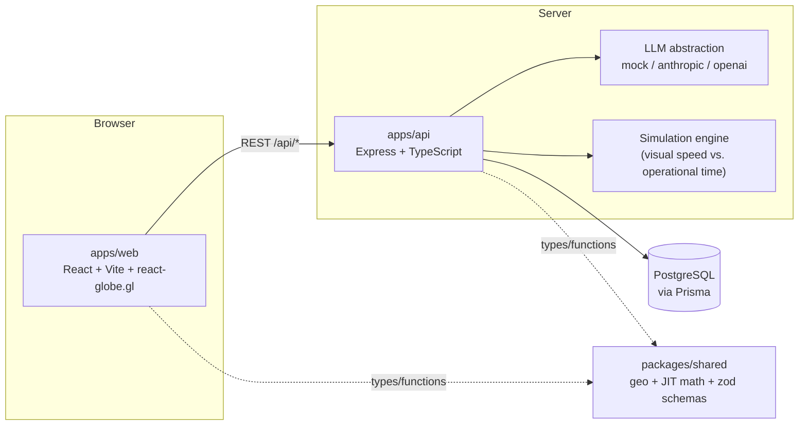
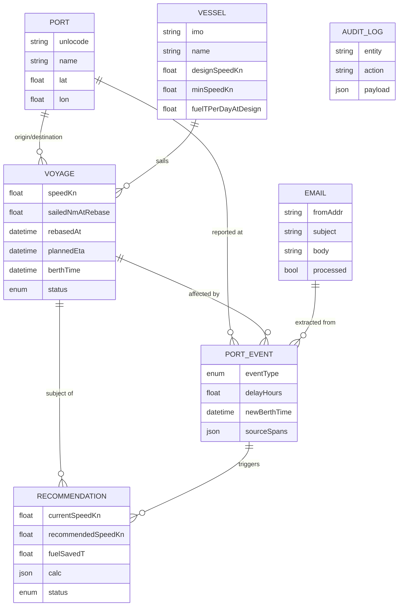

# Tidewise

[](https://github.com/netcompany-hack-2026-overflow/maritime-assistant-v2/actions/workflows/ci.yml)

> **The app's interface is in Greek.** This English README calls pages and buttons by their
> English meaning. Pages: Fleet = Στόλος, Voyages = Ταξίδια, Inbox = Εισερχόμενα, Actions = Ενέργειες,
> Bunkering = Ανεφοδιασμός, Ask = Ερωτήσεις, Value = Αξία, Settings = Ρυθμίσεις. Common buttons:
> Approve = Έγκριση, Reject = Απόρριψη, Undo approval = Αναίρεση έγκρισης, Send = Αποστολή,
> "Simulate incoming email" = «Προσομοίωση εισερχόμενου email», "Simulate supplier quotes" =
> «Προσομοίωση προσφορών προμηθευτών». Emails to suppliers and charterers stay in English.

> 🇬🇷 Ελληνική έκδοση: [README.md](README.md)

**Tidewise: Smart Maritime Operations Assistant.** Built for Netcompany Hackathon
Athens 2026, Challenge #2. *Arrive on time, not early.*

A fleet operator gets a one-line email from a port agent: *"berth delayed 24 hours."*
Today someone has to read that, remember which ship it affects, do mental arithmetic
about fuel, and decide whether to slow the ship down. This tool does the reading, the
matching, and the arithmetic — and then stops and asks a human to approve or reject
the recommendation. **Nothing is executed automatically.**

## The idea in one scenario

MV Aegean Star is sailing Piraeus → Rotterdam at 14.0 kn. A port-agent email arrives:
Rotterdam's berth is delayed by 24 hours. Instead of steaming at full speed and
anchoring outside port for a day, the ship can slow down just enough to arrive exactly
when the new berth is ready — burning less fuel for the same outcome. This is called
**just-in-time (JIT) arrival**, and the saving comes from a cube-law relationship
between speed and fuel burn: `fuel(v) = fuel_design * (v / v_design)³`. A small drop in
speed buys a disproportionately large drop in fuel burn.

Worked example (the reference case checked by
[packages/shared/src/__tests__/jit.test.ts](packages/shared/src/__tests__/jit.test.ts)):

| | Plan A — rush & wait at anchor | Plan B — slow-steam (JIT) |
|---|---|---|
| Speed | 14.0 kn | 10.9 kn |
| Distance remaining | 1200 nm | 1200 nm |
| Time at sea | 85.7 h | 109.7 h |
| Time waiting at anchor | 24.0 h | 0 h |
| Fuel burned | ~145.9 t | ~87.2 t |

**Saved: ~58.7 t of fuel, ~€35,200 (at €600/t), ~182.7 t of CO₂.** The app shows every
one of these numbers — not just the total — under "Show the math" on the Actions page,
so a human reviewer can check the reasoning before approving.

### Second scenario: is a bunker offer worth the detour?

Fuel suppliers email offers like *"VLSFO at Algeciras, USD 540/mt, 800–1,200 mt, valid
until 23 Nov"*. Cheaper fuel only pays if the detour doesn't eat the saving. Tidewise
reads the offer, finds the ship whose remaining route passes nearest the port, and
compares two plans that both end at the berth time:

- **Stay on route**, slowing down to arrive exactly at the berth time: the best the ship
  can do without bunkering, so slow-steaming savings aren't credited to the offer.
- **Bunker**: sail out to the port and back, spend as long alongside as the stem needs
  (8 h for 800 t, ±1 h per 250 t) plus any wait for the barge, and sail at the speed
  that arrives exactly at the berth time (cube-law fuel again).

```
net € = qty × (our price − offer price × USD→EUR) − extra fuel × our price − port costs
```

It's only **worth it** if the net is positive, the ship still makes its berth at or
below design speed, and the offer is still valid when the ship gets there. With the
seeded demo, Algeciras (≈10 nm off the route) comes out **worth it, net ≈ +€54k** for
800 t once the berth delay has given the ship slack. Genoa (≈580 nm off the route)
**stops at the time check**: it needs ≈90 h and the ship has 24 h to spare, so it isn't
analysed any further (see below). Every offer waits on Actions for a person to decide; not-worth-it
ones are marked in red with the reason, and you can ask *"why didn't we take the Genoa
offer?"*. The
calculation is a pure, unit-tested function
([packages/shared/src/bunker.ts](packages/shared/src/bunker.ts)) and every step is
stored with the recommendation (its `calc` field) for the UI to show.

### Third scenario: comparing offers and drafting the replies (Bunkering)

When a fuel offer arrives, the agent:

1. **Reads the terms**, trader shorthand included: grade (several per email, e.g.
   VLSFO + LSMGO), price, quantity, IMO, barging (included / lump sum / per tonne),
   other fees (overtime, agency), payment terms, delivery window (`b/d ETA+12 hrs`,
   `prompt`) and how long the price is firm (`firm 10 mins`, with a live countdown).
2. **Finds the ship** (IMO, name, or the one passing closest), its position, where it
   would leave its route, the distance to the bunker port, likely delays (the supplier's
   window; congestion or closure reported for that port in the last 7 days) and the
   berth time it must still make.
3. **Checks time before anything else.** If *time alongside + barge wait + detour*
   exceeds the ship's slack before its berth (at design speed) by more than **30 min**
   (`bunkerSlackToleranceMin` in Settings), it stops there: no options, **no model call**,
   just a polite decline. Same if the ship can't reach the port before the offer expires.
4. For offers that pass, **at most two options**, each with the reshaped route (ship →
   turn-off → port → back on route → destination, with times), a **proposed speed** and
   the net saving: *ECO* (slow down, arrive exactly at the berth) and *KEEP_SPEED*
   (current speed, arrive early with time in hand), the latter only if it really differs.
5. **Compares all the ship's offers side by side** on total cost, not price per tonne:
   ```
   total = fuel + barging + other fees + port call
         + extra fuel for detour & speed
         + delay risk (hours × charter rate × urgency 25/50/100%)
         + cost of credit (8%/yr vs 30 days) + supplier risk (0.3% per point below 10/10)
         + EU ETS on the extra CO₂ (same model as the scenarios: Settings EUA price ×
           the year's phase-in × EU/non-EU voyage scope; can be switched off in the UI)
   ```
   The sliders (charter rate, stem, urgency, ETS) re-run the same pure calculation in the
   browser instantly, no tokens. The plain-English recommendation is built from the
   numbers; "Ask the AI" makes **one** model call, only when asked.
6. **Drafts the replies** (an acceptance per option, a counter-offer when the price doesn't
   work, a decline) from templates, so figures are exact and cost no tokens. You read,
   edit and send **one**: acceptance approves the offer with that option, decline rejects
   it, counter leaves it pending. The others close. Nothing is sent without pressing Send.

**One decision per ship.** All of a ship's open recommendations (a speed change, each fuel
offer) are alternatives. Approving one, on Actions or by sending an acceptance email, closes
the others with the reason "Not taken: …". Their acceptances and counter-offers can no longer
be sent, though a polite decline still can. "Undo approval" reopens them, except any that
have had a reply since. A recommendation that arrives *after* the approval is a new decision
([alternatives.ts](apps/api/src/services/alternatives.ts)).

**Emails only for ships at sea.** A ship counts as on its voyage when the voyage is underway **and** it still has
distance to go (live AIS when available); the stored status alone stays "underway" after arrival. For a ship that has
arrived or whose voyage was cancelled, emails are not matched to it, no replies are drafted, nothing can be approved and
nothing is sent, not even a decline or a notice. The Bunkering page lists only ships at sea
([atSea.ts](apps/api/src/services/atSea.ts)).

Code: [bunkerPlan.ts](packages/shared/src/bunkerPlan.ts) (time check, options, route),
[bunkerTco.ts](packages/shared/src/bunkerTco.ts) (comparison, explanation),
[bunkerEmails.ts](packages/shared/src/bunkerEmails.ts) (replies), all pure and unit-tested.
The four demo emails are in [apps/api/prisma/mock_demo_data.json](apps/api/prisma/mock_demo_data.json).

## The 90-second demo path

0. **Landing** (`/`): what Tidewise does in one screen; "Open the console" goes to the app.
1. **Fleet** — a live 3D globe shows 8 fictional vessels in motion (simulated at
   `SIM_SPEED`× real time). MV Aegean Star is underway, Piraeus → Rotterdam, at 14.0 kn.
2. **Inbox** — click "Simulate incoming email" to release the queued Rotterdam
   berth-delay notice. It gets extracted into a structured port event (highlighted
   directly in the email body) and matched to MV Aegean Star's voyage.
3. **Actions** — a recommendation is waiting with **three scenarios side by side**: A (same
   speed, wait at anchor), B (slow down for a just-in-time arrival), C (weather re-route).
   Each shows ETA, fuel, CO₂, fuel + EU ETS cost, laytime/demurrage from the charter party,
   JIT-clause coverage and the CII rating (A–E). Weather is a real forecast (Open-Meteo waves
   and ocean currents). Pick a scenario and **Approve**.
4. **Notice** — approval drafts the email to the charterers (To) and agent (Cc): new ETA,
   the reason and the charter-party terms. Review it, then "Send" it through the email
   provider in `.env` (the same one as the supplier replies), or send it from your own mail
   client ("Open in mail app") and "Mark as sent".
5. **Fleet** — MV Aegean Star is now visibly slower (or on the new route if C was approved),
   and its ETA matches the new berth time exactly.
6. **Bunker offers** — back in Inbox, simulate and process the next two emails. On
   Actions, both wait for a decision: Algeciras is marked worth it (net ≈ +€54k),
   Genoa is marked in red as not worth it, with the reason. Reject Genoa. "Compare
   offers, route options and replies →" opens the Bunkering page.
6b. **Bunkering** — "Simulate supplier quotes" brings in four quotes for MV Aegean Star
   and compares them on total cost (see the pitch below).
7. **Voyages → Charter party** — upload `apps/web/public/samples/cycladic-wind-charter-party.pdf`
   to MV Cycladic Wind's voyage, then process the Singapore congestion email: that CP has
   **no** JIT clause, so scenario B is flagged "Not covered" (utmost despatch applies).
8. **Value** — the business-value section: the customer, a per-ship and per-fleet savings
   calculator (fuel, ETS, demurrage, CII) and "why now", with sources.
9. **Ask** — ask "Why didn't we take the Genoa offer?" or "How much fuel have we saved
   from approved recommendations?" and get an answer with a citation back to the
   recommendation record.
10. **Documents** (optional) — in Inbox, "Upload PDF" with the sample
   `apps/web/public/samples/algeciras-berth-notice.pdf`. The PDF's text runs through the
   same pipeline and produces a recommendation for MV Ionian Trader.

## What sets it apart: scenarios with contractual consequences

A plain JIT calculator says "slow down, save fuel". Tidewise also answers chartering's questions:

1. **Charter-party reading** (Voyages → Charter party, PDF or pasted text). The LLM (or the
   offline extractor) reads laytime and basis (SHINC/SHEX), NOR turn time, whether waiting
   for a berth counts as laytime (WIBON), demurrage/despatch, charterer/agent emails and the
   Just-In-Time Arrival clause, each with its exact source words. Every scenario then shows
   laytime used, demurrage (and how much is avoided vs A), and whether the JIT clause covers
   the speed reduction. [packages/shared/src/laytime.ts](packages/shared/src/laytime.ts)
2. **Scenarios A/B/C on real weather.** Twelve points along the remaining route are read from
   the [Open-Meteo Marine API](https://open-meteo.com/en/docs/marine-weather-api) at the hour
   the ship passes them: wave height → fuel factor (1 + 0.012·Hs²), current → component
   against the heading. C tries detour waypoints 60/120 nm either side of the worst point and
   keeps the cheapest. If Open-Meteo is down a deterministic mock is used and the UI says so.
   [packages/shared/src/scenarios.ts](packages/shared/src/scenarios.ts),
   [apps/api/src/services/weatherRoute.ts](apps/api/src/services/weatherRoute.ts)
3. **EU ETS in € and CII.** ETS cost = t CO₂ × the year's phase-in (2024: 40%, 2025: 70%,
   2026 on: 100%) × voyage scope (100% intra-EU/EEA, 50% to/from the EU, 0% outside) × EUA
   price (Settings). CII per IMO G1–G4 with Z = 11% (2026), 13.625% (2027) … 21.5% (2030),
   rated A–E for the leg and as a year-to-date projection.
   [packages/shared/src/ets.ts](packages/shared/src/ets.ts), [packages/shared/src/cii.ts](packages/shared/src/cii.ts)
4. **Automatic email after approval** (step 4 of the plan), as a DRAFT the operator sends;
   undoing the approval withdraws it. [apps/api/src/services/notices.ts](apps/api/src/services/notices.ts)
5. **Live AIS** from [aisstream.io](https://aisstream.io): link a vessel's MMSI in its Fleet
   panel. Position updates on every report; at most every `AIS_RECOMPUTE_MINUTES` the ETA
   (sea-route distance from the AIS position / SOG) and pending scenarios are recomputed. The
   key lives **only** in `.env` as `AISSTREAM_API_KEY` (git-ignored) and never reaches the
   browser. [apps/api/src/services/ais.ts](apps/api/src/services/ais.ts)

## Business value

**Customer.** Dry bulk and tanker owner-operators (10–60 ships) on voyage charters, starting
with Greek fleets; used by operations, chartering and technical/ESG.

**Savings** (calculator on the **Value** page, same engine). Supramax 58,000 dwt, 13.5 kn,
29 t/day, 24 h berth delay notified 1,200 nm out: ~43 t fuel and ~135 t CO₂ less, ~€26k fuel
+ ~€7k EU ETS (60% average ETS scope, EUA €90) ≈ **€33k per notice**; at 10 notices a year
**~€330k per ship**, ~€6.7M for a 20-ship fleet, ~6% lower attained CII per ship. Demurrage
avoided is shown separately (it moves between charterer and owner).

**Why now.** EU ETS covers 40% / 70% / 100% of shipping emissions for 2024 / 2025 / 2026 with
EUAs around €90/t in November 2026
([European Commission](https://climate.ec.europa.eu/eu-action/transport/reducing-emissions-shipping-sector_en),
[2 Nov 2026 auction at €89.43/t](https://www.tradingview.com/news/reuters.com,2026-11-02:newsml_APNB56IHF:0-european-union-auctions-2-792-mln-spot-carbon-permits-at-89-43-eur-t/));
CII tightens to 13.625% in 2027 and 21.5% in 2030
([DNV on MEPC 83](https://www.dnv.com/news/imo-mepc-83-ghg-requirements-approved-taking-effect-from-2028/));
Rotterdam VLSFO is ~$734/t (17 Nov 2026, [Ship & Bunker](https://shipandbunker.com/prices));
and IMO's Low Carbon GIA found ships spend 4.6% of their time at anchor from early arrival,
with JIT cutting fuel/CO₂ by up to 14% per voyage
([IMO](https://www.imo.org/en/MediaCentre/Pages/WhatsNew-1326.aspx)).

## 60-second pitch: Bunkering co-pilot

**Once, before the pitch:**

```bash
docker compose up --build            # or see "Local dev without Docker"
# To send email: fill in SMTP_* and MAIL_FROM in .env, and for the demo
# MAIL_REDIRECT_TO=<your address> (the demo suppliers use fake *.example addresses).
docker compose up -d --build api     # after changing .env
```

Open http://localhost:8080 → **Inbox** → "Simulate incoming email" → **Process** (the 24 h
Rotterdam delay gives the ship time to bunker; without it every offer, correctly, stops at
the time check).

| Time | Show | Say |
|---|---|---|
| 0–10 s | **Bunkering** → "Simulate supplier quotes" | "Four suppliers, four emails in trader shorthand, like every day." |
| 10–20 s | The table: Rock Marine at **$526/t** is cheapest… and ranks **#4** | "Cheapest per tonne is dearest overall: $4,500 barging on top, barge 12 hours after arrival, reliability 5/10." |
| 20–30 s | The recommendation: "Strait Bunkering is $5.00/t dearer on paper… but ≈$33k cheaper overall" | "Making up 12 hours means sailing faster: ≈$27k of extra fuel no quote shows." |
| 30–40 s | Ceuta's countdown (**firm 10 mins**, amber) · sliders: charter $40k, urgency High, ETS on/off | "The ranking re-computes instantly, no model call." |
| 40–50 s | Click the Strait Bunkering column → route sketch, ECO 12.5 kn vs 14 kn, times per waypoint | "It also planned the new route and the speed that arrives exactly at the berth." |
| 50–60 s | "Accept · eco speed" → tweak the text → **Send** | "A person decides and sends. The model only reads; nobody makes the numbers up, and offers that don't fit the schedule are cut before we spend a token." |

## Pages

- **Landing** (`/`) — hero page explaining the product, with a live "fuel saved so far"
  figure and a link into the console. The console pages live under `/fleet`, `/voyages`,
  `/inbox`, `/actions`, `/ask`, `/value`, `/settings`.
- **Fleet** — 3D globe (dotted-land style) with every vessel's live position, heading,
  and remaining sea route, plus labelled ports; a side list of ships; click a ship for a detail drawer. Ships with a
  pending recommendation are highlighted. A "Saved to date" tile totals fuel, € and
  CO₂ saved by every approved recommendation.
- **Voyages** — a table of every voyage with a "New voyage" form: pick a vessel and two
  ports (via dropdowns or by clicking a small rotating globe), see the sea route and a
  live distance/ETA preview, and create or cancel voyages.
- **Inbox** — queued and processed port-agent emails. "Simulate incoming email"
  releases the next queued one; "Paste email" lets you type a custom one; "Upload PDF"
  turns a text-based PDF (berth notice, port circular) into an inbox item. Processing an
  email shows the extracted fields with their exact source text highlighted in the
  original body, which voyage it matched (or why it didn't), and the recommendation it
  produced.
- **Actions** — pending and historical recommendations. Each card shows the KPI
  tiles (fuel/cost/CO₂ saved), a plain-English rationale, a full "Show the math"
  breakdown of every intermediate JIT calculation value, a "Facts used" section that
  expands the underlying email/port-event/voyage records, and Approve/Reject controls
  (reject requires a reason). Approving updates the voyage's speed and ETA atomically
  and logs the decision.
- **Ask** — free-text questions over the fleet data, answered by the LLM provider from
  a fixed set of rows (never free-form knowledge), with citations back to real
  table+id records. Citations the model invents are dropped server-side.
- **Settings** — the fuel price (€/t) used for every saving. Saving re-prices pending
  recommendations only.

## Architecture



The LLM is never called directly from routes: every extraction, rationale, and
Q&A answer goes through `getLlmProvider()`
([apps/api/src/llm/index.ts](apps/api/src/llm/index.ts)), which picks `anthropic` or
`openai` only if that provider is selected **and** its API key is present, and falls
back to a deterministic regex-based `mock` provider otherwise — so the whole app works
with zero API keys configured.

Vessel movement runs on two deliberately decoupled clocks: a **visual** clock
(`SIM_SPEED`-accelerated, used only to animate positions on the globe) and an
**operational** clock (`plannedEta`, `berthTime` — real-world-equivalent time, used for
every JIT calculation). This keeps the business math sound regardless of how fast the
globe is spinning or how long the demo machine has been running.

## Data model



## Monorepo layout

```
apps/
  web/      React + Vite + TypeScript frontend (plain CSS, react-globe.gl)
  api/      Node + Express + TypeScript + Prisma backend
packages/
  shared/   Shared TS types, zod schemas, geo + JIT domain functions
```

## Setup (Docker — recommended)

```bash
git clone <repo-url>
cd maritime-assistant-v2
docker compose up --build
```

No `.env` file is required — every variable has a working default (mock LLM provider,
no API key needed). Then open **http://localhost:8080**.

Only the web container publishes a host port. Postgres and the API stay on the internal
Docker network (nginx proxies `/api` to the API), so a Postgres already running on your
machine can't clash with the stack. If port 8080 is taken, set `WEB_PORT`, e.g.
`WEB_PORT=8090 docker compose up --build`.

To use a real LLM instead of the offline mock, copy `.env.example` to `.env` and set
`LLM_PROVIDER=openai` (or `anthropic`) plus the matching API key before running
`docker compose up --build`. `LLM_MODEL` is optional: when empty it defaults to
`gpt-5-mini` for OpenAI and `claude-sonnet-5-5` for Anthropic. With the hackathon-issued OpenAI key you can
also set `LLM_MODEL=gpt-6-luna` for the larger model. The top bar shows which
provider is actually active. Without a key, the Ask page answers only its example
questions and says so on screen.

Real-LLM calls are bounded: each request times out after `LLM_TIMEOUT_MS` (default
30 s) and is retried at most once by the SDK, the JSON-repair loop makes at most two
attempts, and OpenAI output is capped (4,000 tokens for JSON, 2,000 for rationales,
leaving room for GPT-5 reasoning tokens). The model is only called on user actions
(processing an email, generating a rationale, asking a question), never from the
pages' polling. A timeout shows "The language model took too long to answer".

## Design, devices & accessibility

- Responsive down to phone width: the nav moves to its own scrollable row, the Fleet
  globe stacks above the ship list, the vessel drawer becomes a bottom sheet, Inbox
  stacks list over detail, the voyages table scrolls sideways, recommendation KPIs stack.
- Accessibility: skip-to-content link, a page `<h1>` on every route, visible keyboard
  focus, ARIA tabs on Actions, `aria-expanded` on every disclosure, a labelled dialog
  for "Reject", `role="alert"`/`role="status"` on errors and loading, labels on all form
  fields, 44 px touch targets, AA-contrast warning colour, `prefers-reduced-motion`.
- Type: Inter for UI, Instrument Serif italic for accents (both self-hosted via
  `@fontsource`, no external font requests). Hero photo by Austin Neill on Unsplash.

### Sending email (optional)

Supplier replies go out over SMTP, so any provider works (Gmail, Microsoft 365,
SendGrid, Mailgun, Brevo, Amazon SES). Set at least `SMTP_HOST` and `MAIL_FROM` in `.env`
(plus `SMTP_USER`/`SMTP_PASS` if the server needs a login); `.env.example` lists the
settings per provider. `MAIL_REDIRECT_TO` sends everything to your own address for
testing. Without it configured the replies are still written and can be copied; only
Send is disabled.

## Local dev without Docker

Requires Node 20+ and a local PostgreSQL instance.

```bash
npm install
cp .env.example .env            # set DATABASE_URL to your local Postgres, e.g.
                                # postgresql://<you>@localhost:5432/maritime
                                # (the example uses host "db", which only exists inside Docker)
createdb maritime
npm run build --workspace packages/shared
npm run prisma:migrate --workspace apps/api
npm run prisma:seed --workspace apps/api
npm run dev                     # runs the api and web dev servers together
```

## Testing & accuracy evidence

GitHub Actions ([.github/workflows/ci.yml](.github/workflows/ci.yml)) runs on every push:
typecheck, unit tests, the extraction eval (fails below 18/18), and a full
`docker compose up --build` with smoke tests of the Fleet API, PDF upload and Ask.

```bash
npm run test     # packages/shared (geo + JIT + bunker) and apps/api (LLM mock, extraction, settings, land, sim, weather, PDF, ask, env)
npm run eval      # runs apps/api/eval/emails/*.json through the mock extractor

# same 18 emails through a real LLM (writes apps/api/eval/results-openai.md)
LLM_PROVIDER=openai OPENAI_API_KEY=sk-... npm run eval
```

The eval set is 18 synthetic emails. Twelve are port-agent notices covering plain English, Greek-only,
mixed Greek/English wording, multi-port disambiguation (resolved by UN/LOCODE), a
missing-vessel-name case, an alternate date separator, two pure no-event emails, one
email that mentions a real port/vessel but describes no event, and an explicit check
that the earliest-mentioned event type wins when an email touches on more than one.
Six are bunker offers: a clear offer whose text also names the ship's destination, an
off-route offer, an expired offer, one with no quantity, one in Greek, and a weekly
price newsletter that must not count as an offer. Offer fields (grade, price, quantity
range, validity) are scored too.
Full per-field, per-email results are written to
[apps/api/eval/results.md](apps/api/eval/results.md) on every run. Latest run:

| Field | Accuracy |
|---|---|
| Exact-match emails | 18 / 18 (100%) |
| eventType, portName, portUnlocode, vesselNameMentioned | 100% |
| delayHours, newBerthTime | 100% |
| fuelGrade, priceUsdPerT, qtyMinT, qtyMaxT, validUntil | 100% |

## REST API

| Method | Path | Purpose |
|---|---|---|
| GET | `/api/health` | liveness check |
| GET | `/api/meta` | active LLM provider (after key fallback), sim speed, and economics assumptions |
| GET | `/api/ports` | all seeded ports |
| GET | `/api/ports/route?from=&to=` | sea route + distance between two ports (UN/LOCODEs) |
| GET | `/api/vessels` | all vessels with their current voyage status |
| GET | `/api/vessels/positions` | live simulated positions for the globe |
| GET | `/api/voyages` | all voyages |
| POST | `/api/voyages` | create a voyage (vesselId, originPortId, destPortId, optional speedKn) |
| PATCH | `/api/voyages/:id/cancel` | cancel an underway/planned voyage |
| GET | `/api/emails` | all emails (queued + processed) |
| POST | `/api/emails` | add a custom email |
| POST | `/api/emails/simulate` | release the next queued demo email |
| POST | `/api/emails/document?filename=` | upload a PDF (raw body, `Content-Type: application/pdf`, max 5 MB) as an inbox item |
| POST | `/api/emails/:id/process` | extract + match + (maybe) generate a recommendation |
| GET | `/api/port-events` | all extracted port events |
| GET | `/api/recommendations` | recommendations, optional `?status=` filter |
| GET | `/api/recommendations/:id` | one recommendation |
| POST | `/api/recommendations/:id/approve` | approve a scenario (`{"scenarioId":"B"\|"C"}`): speed/ETA/route, audit log, notice draft |
| POST | `/api/recommendations/:id/refresh` | recompute scenarios (position, weather, prices, charter party) |
| POST | `/api/recommendations/:id/undo` | undo an approval (restores speed/route, withdraws the draft) |
| GET/POST/PATCH/DELETE | `/api/voyages/:id/charter-party` | voyage charter party (POST `{text}`; PATCH term fixes/`expectedOpsHours`) |
| POST | `/api/voyages/:id/charter-party/document?filename=` | upload a charter party PDF |
| GET | `/api/outbound-emails` | notices to charterers/agents |
| PATCH | `/api/outbound-emails/:id` | edit a draft |
| POST | `/api/outbound-emails/:id/sent` | mark as sent |
| PUT | `/api/vessels/:id/ais` | link/unlink an MMSI for live AIS |
| GET | `/api/ais/status` | aisstream.io connection status (never the key) |
| POST | `/api/recommendations/:id/reject` | reject (requires a reason) |
| GET | `/api/records/:table/:id` | generic record lookup, used by "Facts used" and Ask citations |
| POST | `/api/ask` | natural-language Q&A with validated citations |
| GET | `/api/settings` | fuel price, EUA price, CO₂ factor, USD→EUR rate and bunker assumptions |
| PUT | `/api/settings` | set `fuelPriceEurPerT` (0–5000), `usdEurRate` (0.5–2) and/or `euaPriceEurPerT` (0–1000); re-prices pending recommendations |
| GET | `/api/bunker-offers` | every fuel offer with terms, supplier, time check, options, route and reply drafts |
| POST | `/api/bunker-offers/simulate` | brings in and processes the four demo quotes (`mock_demo_data.json`) |
| POST | `/api/bunker-offers/explain` | one LLM call: explains a voyage's comparison under the given assumptions |
| PATCH | `/api/email-drafts/:id` | save edits to a draft (`toAddr`, `subject`, `body`) |
| POST | `/api/email-drafts/:id/send` | send over SMTP; records the decision on the offer |

## Assumptions

- All data (ports, vessels, voyages, emails) is synthetic; vessel IMOs are fictional.
- Ships follow real sea lanes (via Gibraltar, Suez, Malacca, Panama…) computed with
  [searoute-js](https://github.com/johnx25bd/searoute) on the Eurostat maritime
  network ([apps/api/src/services/seaRoute.ts](apps/api/src/services/seaRoute.ts)).
  Each voyage stores its route and length, which drive the ship's position and ETA
  (e.g. Piraeus–Rotterdam ~2,890 nm, Hamburg–Singapore ~8,650 nm). The network is
  coarse near some coasts, so short coastal hops can come out a little long.
- Fuel price (default €600/t, from `FUEL_PRICE_EUR_PER_T`) is editable on the
  **Settings** page. Saving a new price re-prices pending recommendations; approved
  and rejected ones keep the price they were decided at. The CO₂ factor (3.114 t
  CO₂/t fuel, the standard VLSFO factor) comes from `CO2_FACTOR`. Neither is live
  market data, and both are shown next to every figure that depends on them.
- Weather comes from the Open-Meteo Marine API (wave height, currents; no key). Waves become
  a fuel factor `1 + 0.012·Hs²` (capped at 1.35): a simple documented proxy, not a
  vessel-specific seakeeping model; wind is not modelled separately. With
  `WEATHER_PROVIDER=mock`, or when the API does not answer, a deterministic mock per 2°×2°
  cell and day is used; the UI always shows the source.
- Laytime starts at the earlier of (arrival + NOR turn time) and berthing when waiting counts
  (WIBON), otherwise at berthing; used = counted waiting + cargo-operations hours (operator
  estimate, default 80% of laytime). Exceptions, holidays, laycan and shifting are not modelled.
- The annual CII projection uses seeded year-to-date data per vessel (`ytdCo2T`, `ytdDistanceNm`).
- The demo charter parties are fictional, GENCON-style; the JIT clause wording was written for
  this prototype (it is not BIMCO's text).
- Bunker offers: prices are in USD/t and converted with a USD→EUR rate (default 0.92,
  set with `PUT /api/settings`; changing it re-prices pending offers). A bunker call is
  assumed to take 8 h alongside for 800 t (±1 h per 250 t, pump rate
  `bunkerPumpRateTPerH`) and cost €5,000 in port and agency fees. The quantity is the
  ship's stem (800 t), clamped to the supplier's range. A supplier's delivery window
  (`ETA+12 hrs`) counts at its worst case; with congestion as well, the larger of the
  two counts, not the sum.
- Offer comparison (TCO): a charter rate per vessel (e.g. $18,000/day for MV Aegean
  Star), cost of money 8%/yr against 30 days' credit, supplier risk 0.3% of the bill per
  reliability point below 10 (history in the `Supplier` table; unknown = 6/10), EUA
  €75/t. Barging not stated is treated as included and flagged. The first grade in each
  email (e.g. VLSFO) is compared; other grades are shown separately. The detour is measured as a straight line out to
  the port and back from the closest point on the ship's remaining route whose line to
  the port doesn't cross land (Natural Earth 110m coastlines). The sea-route network is
  too coarse for this at short range. The bunker calculation uses calm water.
- When a notice gives only "delayed by N hours" without a new berth time, the new berth
  time is the voyage's current planned arrival plus N hours.
- A recommended speed never exceeds the vessel's current speed (the app only slows
  ships down) and never drops below its `minSpeedKn`; if the available time is too
  short even at minimum speed, the plan still clamps and reports a residual wait.

## Known limitations

- The mock LLM provider is a deterministic regex extractor, not a real language model.
  It handles the patterns in the eval set well (100% on every field as of the last
  run) but is not robust to arbitrary free-form phrasing the way a real LLM call
  (`LLM_PROVIDER=anthropic`/`openai`) would be.
- Event-type disambiguation uses an "earliest keyword in the email wins" heuristic.
  This matches the common case (the subject line usually states the real event) but
  can misclassify an email that leads with a secondary detail before announcing the
  primary event.
- Voyage creation does not check for a duplicate route/vessel combination beyond
  "vessel already has an active voyage" — nothing stops two voyages on the same route
  for different vessels.
- Approving a bunker offer (or sending its acceptance) records the decision and the
  option; it does not yet re-route the ship through the bunker port on the globe or
  change its speed.
- One decision per ship: approving closes the ship's other open options. A recommendation
  that arrives later for the same voyage is worked out from the ship's current state, not on
  top of an already approved bunker plan.
- Offers come in through the Inbox (simulate, paste, PDF). A real mailbox (IMAP) isn't
  read yet; `.env` only configures sending.
- The time check and options are worked out when the offer is processed; if the ship
  has moved on a lot, process the offer again. Bunker calculations assume calm water.
- There is no authentication; this is a single-tenant demo app.
- PDF upload reads the text layer only; scanned (image-only) PDFs are rejected with a
  clear message rather than OCR'd.

## Hard rules followed throughout

Synthetic data only. No secrets committed (`.env` is gitignored; `.env.example` ships
with empty API key placeholders). No hardcoded API keys. Every phase of the build
ended with a working `docker compose up --build` from a clean state before moving on.
