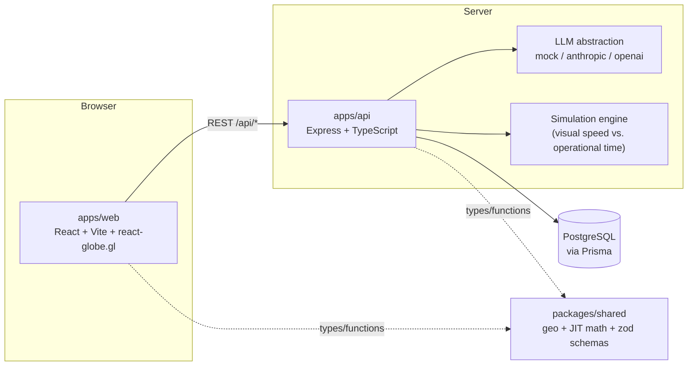
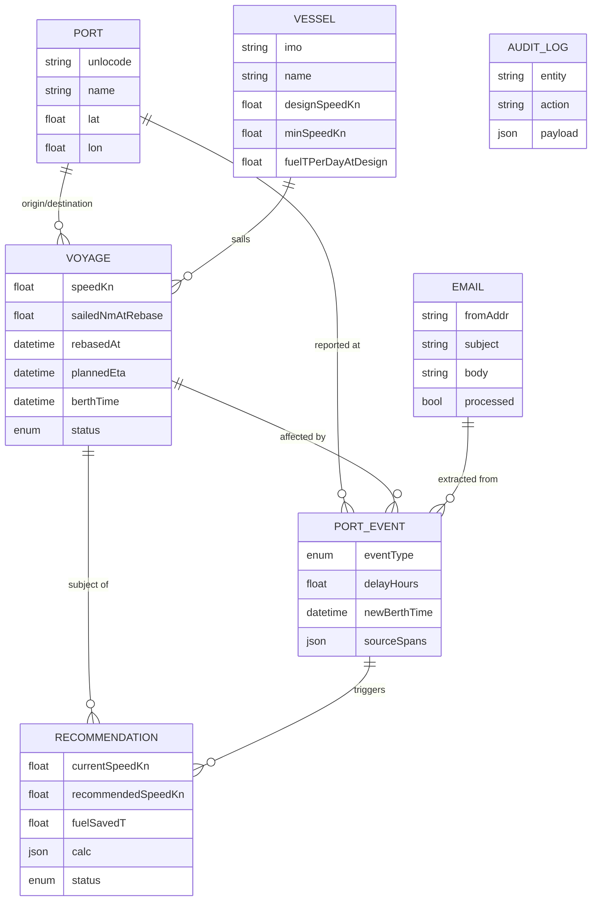

# Tidewise

[](https://github.com/netcompany-hack-2026-overflow/maritime-assistant-v2/actions/workflows/ci.yml)

> 🇬🇷 Ελληνική έκδοση: [README.md](README.md)

**Tidewise: Smart Maritime Operations Assistant.** Built for Netcompany Hackathon
Athens 2026, Challenge #2. *Arrive on time, not early.*

A fleet operator gets a one-line email from a port agent: *"berth delayed 24 hours."*
Today someone has to read that, remember which ship it affects, do mental arithmetic
about fuel, and decide whether to slow the ship down. This tool does the reading, the
matching, and the arithmetic — and then stops and asks a human to approve or reject
the recommendation. **Nothing is executed automatically.**

## The idea in one scenario

MV Aegean Star is sailing Piraeus → Rotterdam at 14.0 kn. A port-agent email arrives:
Rotterdam's berth is delayed by 24 hours. Instead of steaming at full speed and
anchoring outside port for a day, the ship can slow down just enough to arrive exactly
when the new berth is ready — burning less fuel for the same outcome. This is called
**just-in-time (JIT) arrival**, and the saving comes from a cube-law relationship
between speed and fuel burn: `fuel(v) = fuel_design * (v / v_design)³`. A small drop in
speed buys a disproportionately large drop in fuel burn.

Worked example (the reference case checked by
[packages/shared/src/__tests__/jit.test.ts](packages/shared/src/__tests__/jit.test.ts)):

| | Plan A — rush & wait at anchor | Plan B — slow-steam (JIT) |
|---|---|---|
| Speed | 14.0 kn | 10.9 kn |
| Distance remaining | 1200 nm | 1200 nm |
| Time at sea | 85.7 h | 109.7 h |
| Time waiting at anchor | 24.0 h | 0 h |
| Fuel burned | ~145.9 t | ~87.2 t |

**Saved: ~58.7 t of fuel, ~€35,200 (at €600/t), ~182.7 t of CO₂.** The app shows every
one of these numbers — not just the total — under "Show the math" on the Actions page,
so a human reviewer can check the reasoning before approving.

### Second scenario: is a bunker offer worth the detour?

Fuel suppliers email offers like *"VLSFO at Algeciras, USD 540/mt, 800–1,200 mt, valid
until 23 Nov"*. Cheaper fuel only pays if the detour doesn't eat the saving. Tidewise
reads the offer, finds the ship whose remaining route passes nearest the port, and
compares two plans that both end at the berth time:

- **Stay on route** at the current speed (waiting out any slack at anchor).
- **Bunker**: sail out to the port and back, spend 8 h alongside, and speed up only as
  much as needed to still make the berth (cube-law fuel again).

```
net € = qty × (our price − offer price × USD→EUR) − extra fuel × our price − port costs
```

It's only **worth it** if the net is positive, the ship still makes its berth at or
below design speed, and the offer is still valid when the ship gets there. With the
seeded demo, Algeciras (≈10 nm off the route) comes out **worth it, net ≈ +€110k**
once the berth delay has given the ship slack. Genoa (≈580 nm off the route) is
**not worth it**: the detour burns more than the cheaper fuel saves, and the ship
would miss its berth. Every offer waits on Actions for a person to decide; not-worth-it
ones are marked in red with the reason, and you can ask *"why didn't we take the Genoa
offer?"*. The
calculation is a pure, unit-tested function
([packages/shared/src/bunker.ts](packages/shared/src/bunker.ts)) and every step is
stored with the recommendation (its `calc` field) for the UI to show.

## The 90-second demo path

0. **Landing** (`/`): what Tidewise does in one screen; "Open the console" goes to the app.
1. **Fleet** — a live 3D globe shows 8 fictional vessels in motion (simulated at
   `SIM_SPEED`× real time). MV Aegean Star is underway, Piraeus → Rotterdam, at 14.0 kn.
2. **Inbox** — click "Simulate incoming email" to release the queued Rotterdam
   berth-delay notice. It gets extracted into a structured port event (highlighted
   directly in the email body) and matched to MV Aegean Star's voyage.
3. **Actions** — a recommendation is waiting: slow from 14.0 kn to about 12 kn and save
   about 57 t of fuel (~€34k). The exact figures move a little with that day's mock
   weather. Expand "Show the math" to see every step, then **Approve**.
4. **Fleet** — MV Aegean Star is now visibly slower on the globe, and its ETA has
   moved to match the new berth time exactly.
5. **Bunker offers** — back in Inbox, simulate and process the next two emails. On
   Actions, both wait for a decision: Algeciras is marked worth it (net ≈ +€110k),
   Genoa is marked in red as not worth it, with the reason. Reject Genoa.
6. **Ask** — ask "Why didn't we take the Genoa offer?" or "How much fuel have we saved
   from approved recommendations?" and get an answer with a citation back to the
   recommendation record.
7. **Documents** (optional) — in Inbox, "Upload PDF" with the sample
   `apps/web/public/samples/algeciras-berth-notice.pdf` (also downloadable from the
   Inbox page). The PDF's text runs through the same pipeline and produces a
   recommendation for MV Ionian Trader.

## Pages

- **Landing** (`/`) — hero page explaining the product, with a live "fuel saved so far"
  figure and a link into the console. The console pages live under `/fleet`, `/voyages`,
  `/inbox`, `/actions`, `/ask`, `/settings`.
- **Fleet** — 3D globe (dotted-land style) with every vessel's live position, heading,
  and remaining sea route, plus labelled ports; a side list of ships; click a ship for a detail drawer. Ships with a
  pending recommendation are highlighted. A "Saved to date" tile totals fuel, € and
  CO₂ saved by every approved recommendation.
- **Voyages** — a table of every voyage with a "New voyage" form: pick a vessel and two
  ports (via dropdowns or by clicking a small rotating globe), see the sea route and a
  live distance/ETA preview, and create or cancel voyages.
- **Inbox** — queued and processed port-agent emails. "Simulate incoming email"
  releases the next queued one; "Paste email" lets you type a custom one; "Upload PDF"
  turns a text-based PDF (berth notice, port circular) into an inbox item. Processing an
  email shows the extracted fields with their exact source text highlighted in the
  original body, which voyage it matched (or why it didn't), and the recommendation it
  produced.
- **Actions** — pending and historical recommendations. Each card shows the KPI
  tiles (fuel/cost/CO₂ saved), a plain-English rationale, a full "Show the math"
  breakdown of every intermediate JIT calculation value, a "Facts used" section that
  expands the underlying email/port-event/voyage records, and Approve/Reject controls
  (reject requires a reason). Approving updates the voyage's speed and ETA atomically
  and logs the decision.
- **Ask** — free-text questions over the fleet data, answered by the LLM provider from
  a fixed set of rows (never free-form knowledge), with citations back to real
  table+id records. Citations the model invents are dropped server-side.
- **Settings** — the fuel price (€/t) used for every saving. Saving re-prices pending
  recommendations only.

## Architecture



The LLM is never called directly from routes: every extraction, rationale, and
Q&A answer goes through `getLlmProvider()`
([apps/api/src/llm/index.ts](apps/api/src/llm/index.ts)), which picks `anthropic` or
`openai` only if that provider is selected **and** its API key is present, and falls
back to a deterministic regex-based `mock` provider otherwise — so the whole app works
with zero API keys configured.

Vessel movement runs on two deliberately decoupled clocks: a **visual** clock
(`SIM_SPEED`-accelerated, used only to animate positions on the globe) and an
**operational** clock (`plannedEta`, `berthTime` — real-world-equivalent time, used for
every JIT calculation). This keeps the business math sound regardless of how fast the
globe is spinning or how long the demo machine has been running.

## Data model



## Monorepo layout

```
apps/
  web/      React + Vite + TypeScript frontend (plain CSS, react-globe.gl)
  api/      Node + Express + TypeScript + Prisma backend
packages/
  shared/   Shared TS types, zod schemas, geo + JIT domain functions
```

## Setup (Docker — recommended)

```bash
git clone <repo-url>
cd maritime-assistant-v2
docker compose up --build
```

No `.env` file is required — every variable has a working default (mock LLM provider,
no API key needed). Then open **http://localhost:8080**.

Only the web container publishes a host port. Postgres and the API stay on the internal
Docker network (nginx proxies `/api` to the API), so a Postgres already running on your
machine can't clash with the stack. If port 8080 is taken, set `WEB_PORT`, e.g.
`WEB_PORT=8090 docker compose up --build`.

To use a real LLM instead of the offline mock, copy `.env.example` to `.env` and set
`LLM_PROVIDER=openai` (or `anthropic`) plus the matching API key before running
`docker compose up --build`. `LLM_MODEL` is optional: when empty it defaults to
`gpt-5-mini` for OpenAI and `claude-sonnet-5-5` for Anthropic. With the hackathon-issued OpenAI key you can
also set `LLM_MODEL=gpt-6-luna` for the larger model. The top bar shows which
provider is actually active. Without a key, the Ask page answers only its example
questions and says so on screen.

Real-LLM calls are bounded: each request times out after `LLM_TIMEOUT_MS` (default
30 s) and is retried at most once by the SDK, the JSON-repair loop makes at most two
attempts, and OpenAI output is capped (4,000 tokens for JSON, 2,000 for rationales,
leaving room for GPT-5 reasoning tokens). The model is only called on user actions
(processing an email, generating a rationale, asking a question), never from the
pages' polling. A timeout shows "The language model took too long to answer".

## Design, devices & accessibility

- Responsive down to phone width: the nav moves to its own scrollable row, the Fleet
  globe stacks above the ship list, the vessel drawer becomes a bottom sheet, Inbox
  stacks list over detail, the voyages table scrolls sideways, recommendation KPIs stack.
- Accessibility: skip-to-content link, a page `<h1>` on every route, visible keyboard
  focus, ARIA tabs on Actions, `aria-expanded` on every disclosure, a labelled dialog
  for "Reject", `role="alert"`/`role="status"` on errors and loading, labels on all form
  fields, 44 px touch targets, AA-contrast warning colour, `prefers-reduced-motion`.
- Type: Inter for UI, Instrument Serif italic for accents (both self-hosted via
  `@fontsource`, no external font requests). Hero photo by Austin Neill on Unsplash.

## Local dev without Docker

Requires Node 20+ and a local PostgreSQL instance.

```bash
npm install
cp .env.example .env            # set DATABASE_URL to your local Postgres, e.g.
                                # postgresql://<you>@localhost:5432/maritime
                                # (the example uses host "db", which only exists inside Docker)
createdb maritime
npm run build --workspace packages/shared
npm run prisma:migrate --workspace apps/api
npm run prisma:seed --workspace apps/api
npm run dev                     # runs the api and web dev servers together
```

## Testing & accuracy evidence

GitHub Actions ([.github/workflows/ci.yml](.github/workflows/ci.yml)) runs on every push:
typecheck, unit tests, the extraction eval (fails below 18/18), and a full
`docker compose up --build` with smoke tests of the Fleet API, PDF upload and Ask.

```bash
npm run test     # packages/shared (geo + JIT + bunker) and apps/api (LLM mock, extraction, settings, land, sim, weather, PDF, ask, env)
npm run eval      # runs apps/api/eval/emails/*.json through the mock extractor

# same 18 emails through a real LLM (writes apps/api/eval/results-openai.md)
LLM_PROVIDER=openai OPENAI_API_KEY=sk-... npm run eval
```

The eval set is 18 synthetic emails. Twelve are port-agent notices covering plain English, Greek-only,
mixed Greek/English wording, multi-port disambiguation (resolved by UN/LOCODE), a
missing-vessel-name case, an alternate date separator, two pure no-event emails, one
email that mentions a real port/vessel but describes no event, and an explicit check
that the earliest-mentioned event type wins when an email touches on more than one.
Six are bunker offers: a clear offer whose text also names the ship's destination, an
off-route offer, an expired offer, one with no quantity, one in Greek, and a weekly
price newsletter that must not count as an offer. Offer fields (grade, price, quantity
range, validity) are scored too.
Full per-field, per-email results are written to
[apps/api/eval/results.md](apps/api/eval/results.md) on every run. Latest run:

| Field | Accuracy |
|---|---|
| Exact-match emails | 18 / 18 (100%) |
| eventType, portName, portUnlocode, vesselNameMentioned | 100% |
| delayHours, newBerthTime | 100% |
| fuelGrade, priceUsdPerT, qtyMinT, qtyMaxT, validUntil | 100% |

## REST API

| Method | Path | Purpose |
|---|---|---|
| GET | `/api/health` | liveness check |
| GET | `/api/meta` | active LLM provider (after key fallback), sim speed, and economics assumptions |
| GET | `/api/ports` | all seeded ports |
| GET | `/api/ports/route?from=&to=` | sea route + distance between two ports (UN/LOCODEs) |
| GET | `/api/vessels` | all vessels with their current voyage status |
| GET | `/api/vessels/positions` | live simulated positions for the globe |
| GET | `/api/voyages` | all voyages |
| POST | `/api/voyages` | create a voyage (vesselId, originPortId, destPortId, optional speedKn) |
| PATCH | `/api/voyages/:id/cancel` | cancel an underway/planned voyage |
| GET | `/api/emails` | all emails (queued + processed) |
| POST | `/api/emails` | add a custom email |
| POST | `/api/emails/simulate` | release the next queued demo email |
| POST | `/api/emails/document?filename=` | upload a PDF (raw body, `Content-Type: application/pdf`, max 5 MB) as an inbox item |
| POST | `/api/emails/:id/process` | extract + match + (maybe) generate a recommendation |
| GET | `/api/port-events` | all extracted port events |
| GET | `/api/recommendations` | recommendations, optional `?status=` filter |
| GET | `/api/recommendations/:id` | one recommendation |
| POST | `/api/recommendations/:id/approve` | approve: updates voyage speed/ETA, logs the decision |
| POST | `/api/recommendations/:id/reject` | reject (requires a reason) |
| GET | `/api/records/:table/:id` | generic record lookup, used by "Facts used" and Ask citations |
| POST | `/api/ask` | natural-language Q&A with validated citations |
| GET | `/api/settings` | current fuel price, CO₂ factor, USD→EUR rate and bunker assumptions |
| PUT | `/api/settings` | set `fuelPriceEurPerT` (0–5000) and/or `usdEurRate` (0.5–2); re-prices pending recommendations |

## Assumptions

- All data (ports, vessels, voyages, emails) is synthetic; vessel IMOs are fictional.
- Ships follow real sea lanes (via Gibraltar, Suez, Malacca, Panama…) computed with
  [searoute-js](https://github.com/johnx25bd/searoute) on the Eurostat maritime
  network ([apps/api/src/services/seaRoute.ts](apps/api/src/services/seaRoute.ts)).
  Each voyage stores its route and length, which drive the ship's position and ETA
  (e.g. Piraeus–Rotterdam ~2,890 nm, Hamburg–Singapore ~8,650 nm). The network is
  coarse near some coasts, so short coastal hops can come out a little long.
- Fuel price (default €600/t, from `FUEL_PRICE_EUR_PER_T`) is editable on the
  **Settings** page. Saving a new price re-prices pending recommendations; approved
  and rejected ones keep the price they were decided at. The CO₂ factor (3.114 t
  CO₂/t fuel, the standard VLSFO factor) comes from `CO2_FACTOR`. Neither is live
  market data, and both are shown next to every figure that depends on them.
- Weather is **mocked**: each destination port gets a deterministic head current
  (−0.5 to +1.5 kn) and sea state (fuel factor 1.00–1.10) per day
  ([apps/api/src/sim/weather.ts](apps/api/src/sim/weather.ts)). An adverse current
  raises the speed through the water needed to arrive on time; rougher seas raise fuel
  burn for both plans. Both values appear in "Show the math". A real deployment would
  call a marine-weather API instead.
- Bunker offers: prices are in USD/t and converted with a USD→EUR rate (default 0.92,
  set with `PUT /api/settings`; changing it re-prices pending offers). A bunker call is
  assumed to take 8 h alongside and cost €5,000 in port and agency fees. An offer with
  no quantity is assumed to be 800 t. The detour is measured as a straight line out to
  the port and back from the closest point on the ship's remaining route whose line to
  the port doesn't cross land (Natural Earth 110m coastlines). The sea-route network is
  too coarse for this at short range. The bunker calculation uses calm water.
- When a notice gives only "delayed by N hours" without a new berth time, the new berth
  time is the voyage's current planned arrival plus N hours.
- A recommended speed never exceeds the vessel's current speed (the app only slows
  ships down) and never drops below its `minSpeedKn`; if the available time is too
  short even at minimum speed, the plan still clamps and reports a residual wait.

## Known limitations

- The mock LLM provider is a deterministic regex extractor, not a real language model.
  It handles the patterns in the eval set well (100% on every field as of the last
  run) but is not robust to arbitrary free-form phrasing the way a real LLM call
  (`LLM_PROVIDER=anthropic`/`openai`) would be.
- Event-type disambiguation uses an "earliest keyword in the email wins" heuristic.
  This matches the common case (the subject line usually states the real event) but
  can misclassify an email that leads with a secondary detail before announcing the
  primary event.
- Voyage creation does not check for a duplicate route/vessel combination beyond
  "vessel already has an active voyage" — nothing stops two voyages on the same route
  for different vessels.
- Approving a bunker offer records the decision; it does not yet re-route the ship
  through the bunker port on the globe or change its speed.
- The bunker and slow-steaming recommendations are each priced on their own. Approving
  both on one voyage doesn't re-run the other's numbers against the combined plan.
- There is no authentication; this is a single-tenant demo app.
- PDF upload reads the text layer only; scanned (image-only) PDFs are rejected with a
  clear message rather than OCR'd.

## Hard rules followed throughout

Synthetic data only. No secrets committed (`.env` is gitignored; `.env.example` ships
with empty API key placeholders). No hardcoded API keys. Every phase of the build
ended with a working `docker compose up --build` from a clean state before moving on.
