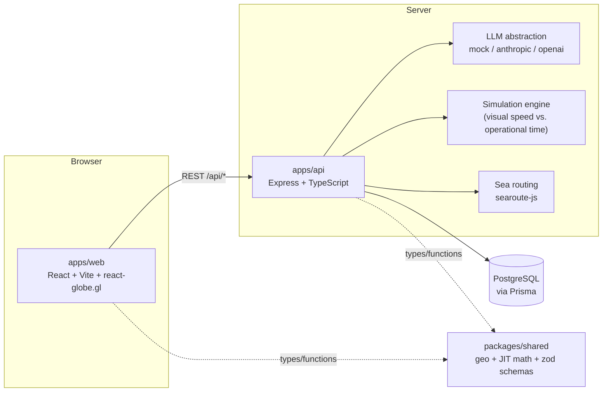
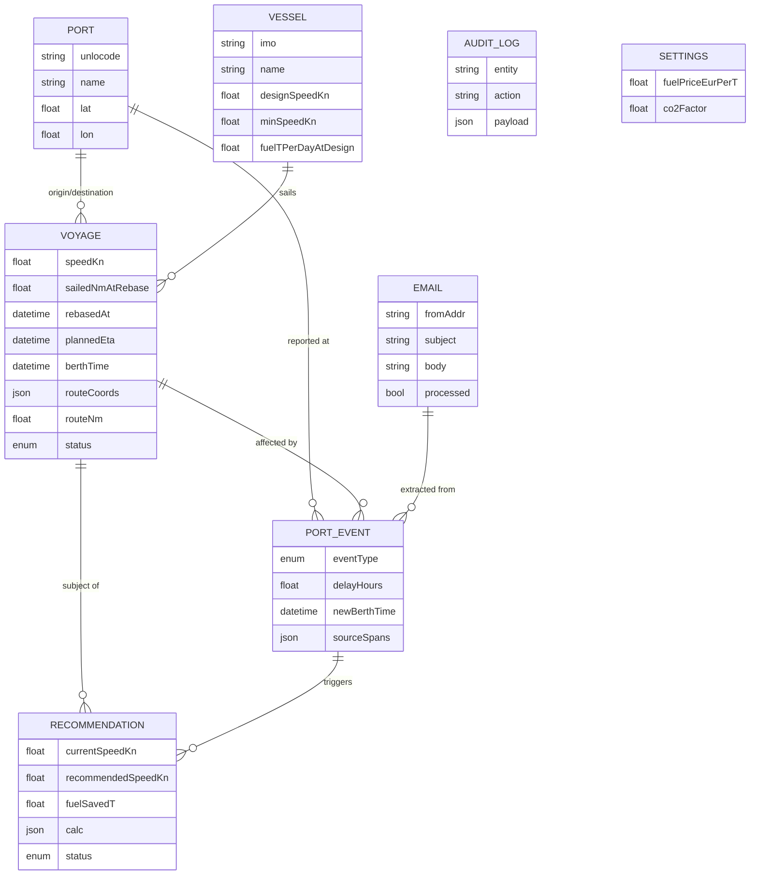

# Tidewise

[](https://github.com/netcompany-hack-2026-overflow/maritime-assistant-v2/actions/workflows/ci.yml)

> 🇬🇧 English version: [README.en.md](README.en.md)

**Tidewise: Έξυπνος Βοηθός Ναυτιλιακών Επιχειρήσεων.** Αναπτύχθηκε για το Netcompany
Hackathon Athens 2026, Challenge #2. *Φτάσε στην ώρα σου, όχι νωρίτερα.*

Ένας διαχειριστής στόλου λαμβάνει ένα email μίας γραμμής από τον πράκτορα του λιμανιού:
*«η θέση πρόσδεσης καθυστερεί 24 ώρες».* Σήμερα κάποιος πρέπει να το διαβάσει, να θυμηθεί
ποιο πλοίο αφορά, να κάνει πρόχειρους υπολογισμούς για το καύσιμο και να αποφασίσει αν θα
μειώσει την ταχύτητα του πλοίου. Το Tidewise κάνει την ανάγνωση, την αντιστοίχιση και τους
υπολογισμούς — και μετά σταματά και ζητά από έναν άνθρωπο να εγκρίνει ή να απορρίψει τη
σύσταση. **Τίποτα δεν εκτελείται αυτόματα.**

## Η ιδέα σε ένα σενάριο

Το MV Aegean Star ταξιδεύει Πειραιάς → Ρότερνταμ με 14,0 κόμβους. Φτάνει email από τον
πράκτορα: η θέση πρόσδεσης στο Ρότερνταμ καθυστερεί 24 ώρες. Αντί να πλέει με πλήρη ταχύτητα
και να περιμένει μια μέρα στην αγκυροβολία, το πλοίο μπορεί να επιβραδύνει όσο ακριβώς
χρειάζεται για να φτάσει τη στιγμή που η νέα θέση είναι έτοιμη — καίγοντας λιγότερο καύσιμο
για το ίδιο αποτέλεσμα. Αυτό λέγεται **άφιξη just-in-time (JIT)**. Η εξοικονόμηση προκύπτει
από τον κυβικό νόμο ταχύτητας–κατανάλωσης: `fuel(v) = fuel_design * (v / v_design)³`.
Μια μικρή μείωση ταχύτητας φέρνει δυσανάλογα μεγάλη μείωση στην κατανάλωση.

Παράδειγμα (η περίπτωση αναφοράς που ελέγχεται στο
[packages/shared/src/\_\_tests\_\_/jit.test.ts](packages/shared/src/__tests__/jit.test.ts)):

| | Σχέδιο A — βιασύνη & αναμονή στην άγκυρα | Σχέδιο B — αργή πλεύση (JIT) |
|---|---|---|
| Ταχύτητα | 14,0 kn | 10,9 kn |
| Απόσταση που απομένει | 1200 nm | 1200 nm |
| Χρόνος στη θάλασσα | 85,7 h | 109,7 h |
| Αναμονή στην άγκυρα | 24,0 h | 0 h |
| Καύσιμο | ~145,9 t | ~87,2 t |

**Εξοικονόμηση: ~58,7 t καυσίμου, ~€35.200 (με €600/t), ~182,7 t CO₂.** Η εφαρμογή δείχνει
κάθε έναν από αυτούς τους αριθμούς — όχι μόνο το σύνολο — στο «Δείτε τους υπολογισμούς» της σελίδας
Actions, ώστε ο άνθρωπος να ελέγξει το σκεπτικό πριν εγκρίνει.

### Δεύτερο σενάριο: αξίζει η παράκαμψη για φθηνότερο καύσιμο;

Οι προμηθευτές στέλνουν προσφορές όπως *«VLSFO στο Algeciras, USD 540/mt, 800–1.200 mt,
ισχύει έως 23/11»*. Το φθηνότερο καύσιμο συμφέρει μόνο αν η παράκαμψη δεν τρώει την
εξοικονόμηση. Το Tidewise διαβάζει την προσφορά, βρίσκει το πλοίο που η υπόλοιπη διαδρομή
του περνά πιο κοντά από το λιμάνι, και συγκρίνει δύο σχέδια που καταλήγουν και τα δύο
στην ώρα πρόσδεσης:

- **Μένει στη διαδρομή** και κόβει ταχύτητα ώστε να φτάσει ακριβώς στην ώρα πρόσδεσης: το
  καλύτερο που μπορεί να κάνει χωρίς ανεφοδιασμό, ώστε η εξοικονόμηση της αργής πλεύσης να
  μην πιστώνεται στην προσφορά.
- **Ανεφοδιασμός**: πάει στο λιμάνι και επιστρέφει, μένει εκεί όσο χρειάζεται η ποσότητα
  (8 h για 800 t, ±1 h ανά 250 t) συν την αναμονή για το barge, και πλέει με την ταχύτητα
  που το φέρνει ακριβώς στην ώρα πρόσδεσης (πάλι με τον κυβικό νόμο).

```
καθαρό € = ποσότητα × (δική μας τιμή − τιμή προσφοράς × USD→EUR) − επιπλέον καύσιμο × δική μας τιμή − λιμενικά έξοδα
```

**Αξίζει** μόνο αν το καθαρό είναι θετικό, το πλοίο προλαβαίνει τη θέση του χωρίς να
ξεπεράσει την ταχύτητα σχεδίασης, και η προσφορά ισχύει ακόμα όταν φτάσει. Στο demo, το
Algeciras (≈10 nm από τη διαδρομή) βγαίνει **αξίζει, καθαρό ≈ +€54 χιλ.** για 800 t, αφού η
καθυστέρηση πρόσδεσης έχει δώσει περιθώριο χρόνου. Η Γένοβα (≈580 nm μακριά) **σταματά
στον έλεγχο χρόνου**: χρειάζεται ≈90 h ενώ το πλοίο έχει 24 h περιθώριο, οπότε δεν
αναλύεται καν παραπέρα (βλ. παρακάτω). Κάθε προσφορά περιμένει στις Ενέργειες να αποφασίσει άνθρωπος· όσες δεν
αξίζουν σημειώνονται με κόκκινο μαζί με τον λόγο, και μπορείτε να ρωτήσετε **«γιατί δεν πήραμε την
προσφορά της Γένοβας;»*. Ο υπολογισμός είναι καθαρή συνάρτηση με unit tests
([packages/shared/src/bunker.ts](packages/shared/src/bunker.ts)) και κάθε βήμα
αποθηκεύεται μαζί με τη σύσταση (πεδίο `calc`) για να το δείξει το UI.

### Τρίτο σενάριο: σύγκριση προσφορών και έτοιμες απαντήσεις (στις Ενέργειες)

Οι προσφορές καυσίμου δεν έχουν δική τους σελίδα. Στις **Ενέργειες** κάθε πλοίο με προσφορές είναι μία ομάδα:
η αλλαγή ταχύτητας (αν υπάρχει) και όλες οι προσφορές μαζί, γιατί η έγκριση μίας κλείνει τις υπόλοιπες
(μία απόφαση ανά πλοίο). Η ομάδα μένει στο «Σε αναμονή» όσο υπάρχει ανοιχτή προσφορά και πηγαίνει στο «Ιστορικό»
όταν αποφασιστούν όλες.

Όταν φτάνει email με προσφορά καυσίμου, ο agent:

1. **Διαβάζει τους όρους**, ακόμα και σε trader slang: τύπος καυσίμου (και πολλά grades στο
   ίδιο email, π.χ. VLSFO + LSMGO), τιμή, ποσότητα, IMO, barging (included / lump sum /
   $ ανά τόνο), λοιπά έξοδα (overtime, agency), όροι πληρωμής, παράθυρο παράδοσης
   (`b/d ETA+12 hrs`, `prompt`) και πόσο ισχύει η τιμή (`firm 10 mins`, με αντίστροφη μέτρηση).
2. **Βρίσκει το πλοίο** (IMO, όνομα ή όποιο περνά πιο κοντά) και τη θέση του, το σημείο που
   φεύγει από τη διαδρομή, την απόσταση ως το λιμάνι ανεφοδιασμού, πιθανές καθυστερήσεις
   (παράθυρο του προμηθευτή, συμφόρηση ή κλείσιμο που αναφέρθηκε για το λιμάνι τις
   τελευταίες 7 μέρες) και την ώρα πρόσδεσης που πρέπει να προλάβει.
3. **Έλεγχος χρόνου πριν από οτιδήποτε άλλο.** Αν *χρόνος ανεφοδιασμού + αναμονή barge +
   παράκαμψη* ξεπερνά το περιθώριο του πλοίου ως την πρόσδεση (υπολογισμένο στην ταχύτητα
   σχεδίασης) πάνω από **30 λεπτά** (`bunkerSlackToleranceMin` στα Settings), η ανάλυση
   σταματά εκεί: καμία επιλογή, **καμία κλήση LLM**, μόνο ευγενική άρνηση. Το ίδιο αν το
   πλοίο δεν προλαβαίνει τη λήξη της προσφοράς ούτε με πλήρη ταχύτητα.
4. Για όσες περάσουν, **το πολύ δύο επιλογές** με νέα διαδρομή (πλοίο → σημείο εκτροπής →
   λιμάνι → πίσω στη διαδρομή → προορισμός, με ώρες), **προτεινόμενη ταχύτητα** και καθαρό
   κέρδος: *ECO* (κόβει ταχύτητα και φτάνει ακριβώς στην πρόσδεση) και *KEEP_SPEED* (ίδια
   ταχύτητα, φτάνει νωρίτερα με περιθώριο για καθυστερήσεις), μόνο αν διαφέρει ουσιαστικά.
5. **Συγκρίνει όλες τις προσφορές του πλοίου δίπλα-δίπλα** στο συνολικό κόστος, όχι στην
   τιμή ανά τόνο:
   ```
   σύνολο = καύσιμο + barging + λοιπά έξοδα + λιμενικά/πράκτορας
          + επιπλέον καύσιμο παράκαμψης & ταχύτητας
          + κίνδυνος καθυστέρησης (ώρες × charter rate × urgency 25/50/100%)
          + κόστος πίστωσης (8%/έτος έναντι 30 ημερών) + κίνδυνος προμηθευτή (0,3% ανά μονάδα κάτω από 10/10)
          + EU ETS στο επιπλέον CO₂ (ίδιο μοντέλο με τα σενάρια: τιμή EUA από τα Settings ×
            ποσοστό του έτους × εμβέλεια ταξιδιού EU/εκτός EU· απενεργοποιείται από το UI)
   ```
   Τα sliders (charter rate, ποσότητα, urgency, ETS) ξανατρέχουν τον ίδιο υπολογισμό στον
   browser αμέσως, χωρίς tokens. Η σύσταση σε απλά αγγλικά γράφεται από τα νούμερα· το
   «Ρωτήστε το AI» κάνει **μία** κλήση στο μοντέλο μόνο αν το ζητήσετε.
6. **Γράφει έτοιμα emails** (αποδοχή ανά επιλογή, αντιπροσφορά όταν η τιμή δεν βγαίνει,
   άρνηση) από templates, ώστε τα νούμερα να είναι πάντα ακριβή και να μην κοστίζουν tokens.
   Τα διαβάζετε, τα διορθώνετε και στέλνετε **ένα**: η αποδοχή εγκρίνει την προσφορά με αυτή
   την επιλογή, η άρνηση την απορρίπτει, η αντιπροσφορά την αφήνει σε αναμονή. Τα υπόλοιπα
   κλείνουν. Τίποτα δεν στέλνεται χωρίς να πατήσετε Send.

**Μία απόφαση ανά πλοίο.** Όλες οι ανοιχτές συστάσεις ενός πλοίου (μείωση ταχύτητας, κάθε
προσφορά καυσίμου) είναι εναλλακτικές. Η έγκριση μίας, από το Actions ή με αποστολή email
αποδοχής, κλείνει αυτόματα τις υπόλοιπες με αιτιολογία «Δεν επιλέχθηκε: …». Οι αποδοχές και οι
αντιπροσφορές τους δεν στέλνονται πια, η ευγενική άρνηση όμως ναι. Το «Αναίρεση έγκρισης» τις
ξανανοίγει, εκτός από όσες έχουν ήδη λάβει απάντηση. Μια σύσταση που φτάνει *μετά* την
έγκριση είναι νέα απόφαση ([alternatives.ts](apps/api/src/services/alternatives.ts)).

**Emails μόνο για πλοία σε ταξίδι.** Πλοίο θεωρείται σε ταξίδι όταν το ταξίδι του είναι σε εξέλιξη **και** του
απομένει απόσταση ως τον προορισμό (με live AIS όταν υπάρχει). Η κατάσταση στη βάση μόνη της δεν αρκεί, γιατί μένει
«σε εξέλιξη» και αφού το πλοίο φτάσει. Για πλοίο που έφτασε ή ακυρώθηκε, ένα email δεν αντιστοιχίζεται σε αυτό, δεν
γράφονται απαντήσεις, δεν γίνεται έγκριση και δεν στέλνεται τίποτα, ούτε άρνηση ούτε ειδοποίηση. Η σύγκριση
προσφορών στις Ενέργειες δείχνει μόνο πλοία σε ταξίδι ([atSea.ts](apps/api/src/services/atSea.ts)).

Ο κώδικας: [bunkerPlan.ts](packages/shared/src/bunkerPlan.ts) (έλεγχος χρόνου, επιλογές,
διαδρομή), [bunkerTco.ts](packages/shared/src/bunkerTco.ts) (σύγκριση, εξήγηση),
[bunkerEmails.ts](packages/shared/src/bunkerEmails.ts) (απαντήσεις), όλα καθαρές
συναρτήσεις με unit tests. Τα 4 demo emails είναι στο
[apps/api/prisma/mock_demo_data.json](apps/api/prisma/mock_demo_data.json).

## Το demo σε 90 δευτερόλεπτα

0. **Αρχική** (`/`): τι κάνει το Tidewise σε μία οθόνη· το «Άνοιγμα κονσόλας» ανοίγει την εφαρμογή.
1. **Στόλος** — μια ζωντανή 3D υδρόγειος δείχνει 8 φανταστικά πλοία σε κίνηση (προσομοίωση
   με ταχύτητα `SIM_SPEED`× του πραγματικού χρόνου). Τα πλοία ακολουθούν πραγματικές
   θαλάσσιες διαδρομές (Γιβραλτάρ, Σουέζ, Μάλακα…). Το MV Aegean Star πλέει Πειραιάς →
   Ρότερνταμ με 14,0 kn.
2. **Εισερχόμενα** — πατήστε «Προσομοίωση εισερχόμενου email» για να έρθει η ειδοποίηση καθυστέρησης
   στο Ρότερνταμ. Εξάγεται σε δομημένο port event (με επισήμανση μέσα στο κείμενο του
   email) και αντιστοιχίζεται στο ταξίδι του MV Aegean Star.
3. **Ενέργειες** — περιμένει μια σύσταση με **τρία σενάρια δίπλα-δίπλα**: A (ίδια ταχύτητα,
   αναμονή στην άγκυρα), B (μείωση ταχύτητας για άφιξη JIT), C (αλλαγή διαδρομής λόγω καιρού).
   Για καθένα: ETA, καύσιμο, CO₂, κόστος καυσίμου + EU ETS, laytime/demurrage από το
   ναυλοσύμφωνο, ρήτρα JIT και βαθμολογία CII (A–E). Ο καιρός είναι πραγματική πρόγνωση
   (Open-Meteo: κύμα και θαλάσσια ρεύματα). Επιλέξτε σενάριο και πατήστε **Έγκριση**.
4. **Ειδοποίηση** — με την έγκριση συντάσσεται αυτόματα email προς τον ναυλωτή (To) και τον
   agent (Cc) με το νέο ETA, τον λόγο και τους όρους του ναυλοσυμφώνου. Το ελέγχετε, το
   στέλνετε με «Αποστολή» μέσω του email provider του `.env` (τον ίδιο με τις απαντήσεις στους
   προμηθευτές), ή από το δικό σας mail («Άνοιγμα στο πρόγραμμα email») και πατάτε «Σήμανση ως απεσταλμένο».
5. **Στόλος** — το MV Aegean Star κινείται πλέον εμφανώς πιο αργά (ή στη νέα διαδρομή, αν
   εγκρίθηκε το C) και η ETA του ταιριάζει ακριβώς με τη νέα ώρα πρόσδεσης.
6. **Προσφορές καυσίμου** — πίσω στα Εισερχόμενα, φέρτε και επεξεργαστείτε τα επόμενα δύο
   emails. Στις Ενέργειες εμφανίζονται στην ομάδα του MV Aegean Star, δίπλα στην αλλαγή ταχύτητας: το Algeciras
   σημειώνεται ότι αξίζει, η Γένοβα ότι δεν αναλύθηκε (δεν χωράει στο περιθώριο), μαζί με τον λόγο.
6β. **Ενέργειες** — «Προσομοίωση προσφορών καυσίμου» φέρνει 4 προσφορές για το MV Aegean Star και τις
   συγκρίνει σε συνολικό κόστος στην ίδια ομάδα (βλ. pitch παρακάτω).
7. **Voyages → Charter party** — ανεβάστε το
   `apps/web/public/samples/cycladic-wind-charter-party.pdf` στο ταξίδι του MV Cycladic Wind
   και μετά επεξεργαστείτε το email συμφόρησης της Σιγκαπούρης: το ναυλοσύμφωνο αυτό **δεν**
   έχει ρήτρα JIT, οπότε το σενάριο B σημειώνεται «Δεν καλύπτεται» (ισχύει το utmost despatch).
   Έχει όμως ρήτρα πολέμου (VOYWAR 2013): στη στήλη «Ασφάλιση» του ίδιου ταξιδιού φαίνεται ότι
   το επασφάλιστρο για Ερυθρά/Άντεν το επιστρέφουν οι ναυλωτές.
7β. **Ταξίδια → Νέο ταξίδι** — π.χ. Piraeus → Jebel Ali: η προεπισκόπηση δείχνει ήδη το
   επασφάλιστρο πολέμου. Με τη δημιουργία ανοίγει το ασφαλιστήριο του ταξιδιού:
   - Ερυθρά → Ορμούζ: 9,6 ημέρες με το λιμάνι, άρα 2 περίοδοι 7 ημερών × 3%
   - το μπόνους IBF του πληρώματος
   - η πρόταση για K&R
   - η ανάλυση του AI
   - η δήλωση προς τους ασφαλιστές, έτοιμη για αποστολή
8. **Αξία** — η ενότητα business value: ποιος είναι ο πελάτης, υπολογιστής εξοικονόμησης
   ανά πλοίο και στόλο (καύσιμο, ETS, demurrage, CII) και «γιατί τώρα» με πηγές.
9. **Ερωτήσεις** — ρωτήστε «Γιατί δεν πήραμε την προσφορά της Γένοβας;» ή «Πόσο καύσιμο έχουμε γλιτώσει
   από τις εγκεκριμένες συστάσεις;» και πάρτε απάντηση με παραπομπή στην εγγραφή της σύστασης.
10. **Ρυθμίσεις** (προαιρετικά) — τιμή καυσίμου (€/t) και τιμή EUA (€/t CO₂). Οι εκκρεμείς
   συστάσεις επανυπολογίζονται αμέσως. Εδώ φαίνεται και η κατάσταση καιρού/AIS.
11. **Έγγραφα** (προαιρετικά) — στα Εισερχόμενα, «Ανέβασμα PDF» με το δείγμα
    `apps/web/public/samples/algeciras-berth-notice.pdf`. Το κείμενο του PDF περνά από την
    ίδια ροή και παράγει σύσταση για το MV Ionian Trader.

## Τι μας ξεχωρίζει: σενάρια με συμβατικές συνέπειες

Ένας απλός υπολογιστής JIT λέει «πήγαινε πιο αργά, γλιτώνεις καύσιμο». Το Tidewise απαντά
και τις ερωτήσεις του chartering:

1. **Ανάγνωση ναυλοσυμφώνου** (Voyages → Charter party, PDF ή επικόλληση κειμένου). Το LLM
   (ή ο offline εξαγωγέας) βγάζει laytime και βάση (SHINC/SHEX), NOR turn time, αν η αναμονή
   για θέση μετράει ως laytime (WIBON), demurrage/despatch, emails ναυλωτή/agent και τη ρήτρα
   Just-In-Time Arrival — κάθε όρος με το ακριβές κείμενο-πηγή επισημασμένο. Για κάθε
   σενάριο υπολογίζεται: laytime που καταναλώνεται, demurrage (και πόσο αποφεύγεται έναντι
   του A), και αν η ρήτρα JIT καλύπτει τη μείωση ταχύτητας (Covered / Covered on
   instruction / Not covered — utmost despatch).
   [packages/shared/src/laytime.ts](packages/shared/src/laytime.ts)
2. **Σενάρια A/B/C** με πραγματικό καιρό. Δείγματα ανά 1/12 της υπόλοιπης διαδρομής
   διαβάζονται από το [Open-Meteo Marine API](https://open-meteo.com/en/docs/marine-weather-api)
   την ώρα που το πλοίο θα περάσει από εκεί: ύψος κύματος → συντελεστής κατανάλωσης
   (1 + 0,012·Hs²), ρεύμα → συνιστώσα κατά της πορείας. Το C δοκιμάζει σημεία παράκαμψης
   60/120 nm δεξιά/αριστερά από το χειρότερο σημείο και κρατά την πιο οικονομική διαδρομή.
   Αν το Open-Meteo δεν απαντά, χρησιμοποιείται ντετερμινιστικός mock και το UI το λέει.
   [packages/shared/src/scenarios.ts](packages/shared/src/scenarios.ts),
   [apps/api/src/services/weather.ts](apps/api/src/services/weather.ts),
   [apps/api/src/services/weatherRoute.ts](apps/api/src/services/weatherRoute.ts)
3. **EU ETS σε € και CII.** Κόστος ETS = t CO₂ × ποσοστό κάλυψης έτους (2024: 40%, 2025: 70%,
   από 2026: 100%) × εύρος ταξιδιού (100% εντός ΕΕ/ΕΟΧ, 50% από/προς ΕΕ, 0% εκτός) × τιμή EUA
   (Settings). CII κατά IMO (G1–G4): attained = CO₂/(DWT × nm), required με Z = 11% (2026),
   13,625% (2027) … 21,5% (2030), βαθμός A–E. Για κάθε σενάριο: βαθμός του σκέλους και
   προβολή του ετήσιου CII (από αρχή έτους + το σκέλος).
   [packages/shared/src/ets.ts](packages/shared/src/ets.ts),
   [packages/shared/src/cii.ts](packages/shared/src/cii.ts)
4. **Αυτόματο email μετά την έγκριση** (βήμα 4 του σχεδίου): νέο ETA, λόγος, σενάριο,
   laytime/demurrage και ρήτρα JIT. Είναι πρόχειρο (DRAFT)· η εφαρμογή δεν στέλνει mail
   μόνη της. Με «Αναίρεση έγκρισης» το πρόχειρο αποσύρεται.
   [apps/api/src/services/notices.ts](apps/api/src/services/notices.ts)
5. **Live AIS** από το [aisstream.io](https://aisstream.io). Στο panel ενός πλοίου (Fleet)
   συνδέετε το MMSI του. Με κάθε PositionReport ενημερώνεται η θέση· το πολύ κάθε
   `AIS_RECOMPUTE_MINUTES` υπολογίζεται εκ νέου το ETA (θαλάσσια απόσταση από τη θέση AIS /
   SOG) και τα εκκρεμή σενάρια. Το key μπαίνει **μόνο** στο `.env` ως `AISSTREAM_API_KEY`
   (το `.env` είναι στο `.gitignore`) και δεν φτάνει ποτέ στον browser.
   [apps/api/src/services/ais.ts](apps/api/src/services/ais.ts)
6. **Ασφάλιση πολέμου σε περιοχές υψηλού κινδύνου.** Μαζί με τη διαδρομή, το ETA και το CII,
   κάθε ταξίδι παίρνει στην αναχώρηση το ασφαλιστήριό του (Ταξίδια → στήλη «Ασφάλιση»).
   Αναλυτικά παρακάτω.

### Ασφάλιση πολέμου: πώς δουλεύει

**Πώς λειτουργεί η αγορά** (έρευνα Νοεμβρίου 2026):

- Η ασφάλιση σκάφους (H&M) και το P&I **δεν** καλύπτουν πόλεμο. Η ξεχωριστή ασφάλιση πολέμου
  καλύπτει όλο τον κόσμο **εκτός** από τις περιοχές της λίστας της Joint War Committee
  ([JWLA-035, 16/9/2026](https://lmalloyds.com/specialist-areas/underwriting/listed-areas/)): νότια
  Ερυθρά κάτω από 25,5°Β, Άντεν, Περσικός, Ομάν και δυτικός Ινδικός, Κόλπος Γουινέας, Μαύρη
  Θάλασσα/Αζοφική, Κάμπο Ντελγκάντο και χώρες όπως Ιράν, Ισραήλ, Ρωσία, ΗΑΕ, Σαουδική Αραβία.
- Πριν μπει το πλοίο σε τέτοια περιοχή, ο πλοιοκτήτης **δηλώνει** το ταξίδι στους ασφαλιστές
  πολέμου και πληρώνει **επασφάλιστρο (AP)**: ποσοστό της αξίας του σκάφους, συνήθως για
  **7 ημέρες**. Αν μείνει περισσότερο (αργή πλεύση, αναμονή για θέση, εργασίες στο λιμάνι),
  χρειάζεται **νέα περίοδος**. Χωρίς δήλωση δεν υπάρχει κάλυψη μέσα στην περιοχή (held covered
  μόνο με άμεση ειδοποίηση και πληρωμή).
- Στις περιοχές πειρατείας (Άντεν, Ινδικός, Γουινέα) προτείνεται και ξεχωριστή **K&R**
  (απαγωγή και λύτρα). Προαιρετικά, απώλεια μισθώματος από πόλεμο.
- **Πλήρωμα** ([λίστα IBF/ITF](https://imec.org.uk/the-international-bargaining-forum-ibf/ibf-risk-areas),
  7/5/2026). Οι ζώνες χωρίζονται σε τρεις κατηγορίες:
  - **Warlike Operations Area** (νότια Ερυθρά/Άντεν, Περσικός/Ορμούζ/Ομάν, βόρεια Μαύρη
    Θάλασσα): μπόνους ίσο με τον βασικό μισθό για τουλάχιστον 5 ημέρες, διπλή αποζημίωση
    θανάτου/αναπηρίας και δικαίωμα άρνησης.
  - **High Risk Area**: μπόνους για τις πραγματικές ημέρες.
  - **Extended Risk Zone**: μπόνους μόνο την ημέρα επίθεσης.
- **Ποιος πληρώνει**: με ρήτρα BIMCO VOYWAR/CONWARTIME στο ναυλοσύμφωνο, οι ναυλωτές
  επιστρέφουν το AP (και συνήθως το μπόνους) όταν στέλνουν το πλοίο στην περιοχή.

**Τι κάνει η εφαρμογή:**

- **Ο κώδικας ελέγχει τη διαδρομή** ([warRisk.ts](packages/shared/src/warRisk.ts)). Δειγματοληπτεί
  τη θαλάσσια διαδρομή ανά 5 nm και τη συγκρίνει με τα όρια της JWLA-035 και της λίστας IBF.
  Βγάζει είσοδο/έξοδο (ώρα και θέση), ημέρες μέσα (πλεύση και λιμάνι προορισμού), περιόδους
  των 7 ημερών και AP = αξία × ποσοστό × περίοδοι. Μία χρέωση ανά διέλευση, με το ποσοστό του
  πιο επικίνδυνου τμήματος. Υπολογίζει επίσης το μπόνους πληρώματος και αν προτείνεται K&R.
- **Το LLM γράφει** ([warRisk.ts](apps/api/src/llm/warRisk.ts)). Διαβάζει αυτά τα νούμερα και
  τη ρήτρα πολέμου του ναυλοσυμφώνου (που επίσης εξάγει το LLM). Γράφει την ανάλυση στα
  ελληνικά και τη δήλωση προς τους ασφαλιστές στα αγγλικά. Δεν αποφασίζει νούμερα. Χωρίς LLM
  γράφει ένα πρότυπο με τα ίδια στοιχεία.
- **Στην αναχώρηση** κρατιέται το ασφαλιστήριο όπως εκδόθηκε
  ([insurance.ts](apps/api/src/services/insurance.ts)). Μετά συγκρίνεται με το τρέχον: αν μια
  αλλαγή ταχύτητας ή μια καθυστέρηση θέσης ανεβάσει τις ημέρες πάνω από τις 7, φαίνεται
  «χρειάζεται επέκταση κατά 7 ημέρες (+$…)». Αν η δήλωση είχε σταλεί, γράφεται νέα.
- **Προσφορά broker**: το ποσοστό ανά τμήμα αλλάζει στο παράθυρο. Το επασφάλιστρο
  ξαναϋπολογίζεται.
- **Ερωτήσεις**: «Ποια πλοία είναι σε περιοχή υψηλού κινδύνου;»

**Υποθέσεις**, που φαίνονται και στο παράθυρο:

- **Ποσοστά αγοράς (ενδεικτικά):**
  - Ορμούζ/Περσικός 3% (αναφέρονται 3–10%, Σεπ.–Οκτ. 2026)
  - νότια Ερυθρά/Άντεν 1% (1–2%, Ιούλ. 2026)
  - Μαύρη Θάλασσα 1%
  - χωρίς πρόσφατη τιμή (σημειώνονται «υπόθεση»): δυτικός Ινδικός 0,05%, Γουινέα 0,1%, χώρες 0,5%
- **Αξία σκάφους** ανά πλοίο στο seed.
- **Λιμάνι προορισμού:** 48 ώρες όταν δεν δίνει το ναυλοσύμφωνο.
- **Πλήρωμα:** 20 άτομα × 45 $/ημέρα μέσος βασικός μισθός.
- **Δεν μοντελοποιούνται:**
  - τα χωρικά ύδατα Αιγύπτου (Ερυθρά) και Τουρκίας, Βουλγαρίας, Ρουμανίας, Γεωργίας (Μαύρη Θάλασσα), που εξαιρούνται από τη λίστα
  - οι χώρες που είναι ολόκληρες στη λίστα ελέγχονται μόνο από το λιμάνι αναχώρησης/προορισμού (12 nm)

## Business value

**Ποιος είναι ο πελάτης.** Εφοπλιστικές εταιρείες με στόλο bulk ή tanker (10–60 πλοία) που
δουλεύουν με voyage charters, ξεκινώντας από τον ελληνικό στόλο. Χρήστες: operations
(παρακολούθηση ταξιδιών, ETA, συνεννόηση με agents), chartering (όροι ναυλοσυμφώνου,
demurrage, επικοινωνία με ναυλωτή) και technical/ESG (CII, ETS).

**Πόσα εξοικονομεί** (υπολογιστής στη σελίδα **Αξία**, με την ίδια μηχανή). Παράδειγμα:
Supramax 58.000 dwt, 13,5 kn, 29 t/ημέρα, καθυστέρηση θέσης 24 h όταν απέχει 1.200 nm:
~43 t καύσιμο και ~135 t CO₂ λιγότερα, ~€26 χιλ. καύσιμο + ~€7 χιλ. EU ETS (60% μέσο εύρος
ETS, EUA €90) ≈ **€33 χιλ. ανά ειδοποίηση**. Με 10 ειδοποιήσεις τον χρόνο: **~€330 χιλ. ανά
πλοίο**, ~€6,7 εκ. για στόλο 20 πλοίων, ~6% χαμηλότερο attained CII ανά πλοίο. Το demurrage
που αποφεύγεται δείχνεται χωριστά (μεταφορά μεταξύ ναυλωτή και πλοιοκτήτη, όχι διπλό όφελος).
Όλες οι παραδοχές αλλάζουν στη σελίδα.

**Γιατί τώρα.**
- Η ναυτιλία μπήκε στο EU ETS το 2024 με 40% κάλυψη, 70% για το 2025 και 100% από το 2026·
  το EUA κινείται γύρω στα €90/t (Νοέμβριος 2026). Πηγές:
  [Ευρωπαϊκή Επιτροπή](https://climate.ec.europa.eu/eu-action/transport/reducing-emissions-shipping-sector_en),
  [δημοπρασία 2/11/2026 στα €89,43/t](https://www.tradingview.com/news/reuters.com,2026-11-02:newsml_APNB56IHF:0-european-union-auctions-2-792-mln-spot-carbon-permits-at-89-43-eur-t/),
  [GMK Center](https://gmk.center/en/news/european-carbon-prices-exceeded-e90-t-in-november/).
- Τα όρια CII σφίγγουν: 11% κάτω από το 2019 το 2026, 13,625% το 2027, 21,5% το 2030
  ([DNV για MEPC 83](https://www.dnv.com/news/imo-mepc-83-ghg-requirements-approved-taking-effect-from-2028/)).
- Το καύσιμο είναι ακριβό: VLSFO Ρότερνταμ ~$734/t στις 17/11/2026
  ([Ship & Bunker](https://shipandbunker.com/prices)).
- Ο IMO προωθεί το JIT arrival: τα πλοία περνούν 4,6% του χρόνου τους στην άγκυρα λόγω
  πρόωρης άφιξης (~15 ημέρες/έτος) και το JIT μειώνει καύσιμο/CO₂ έως 14% ανά ταξίδι
  (μελέτη Low Carbon GIA, [IMO](https://www.imo.org/en/MediaCentre/Pages/WhatsNew-1326.aspx)).

## Pitch 60 δευτερολέπτων: Bunkering co-pilot

**Προετοιμασία (μία φορά):**

```bash
docker compose up --build            # ή: δείτε «Τοπική ανάπτυξη χωρίς Docker»
# Για αποστολή email: συμπληρώστε SMTP_* και MAIL_FROM στο .env, και για το demo
# MAIL_REDIRECT_TO=<το email σας> (οι προμηθευτές του demo έχουν ψεύτικες διευθύνσεις).
docker compose up -d --build api     # μετά από αλλαγή του .env
```

Ανοίξτε το http://localhost:8080 → **Εισερχόμενα** → «Προσομοίωση εισερχόμενου email» → **Επεξεργασία** (η
καθυστέρηση 24 h στο Ρότερνταμ δίνει στο πλοίο χρόνο για ανεφοδιασμό· χωρίς αυτή κάθε
προσφορά σταματά, σωστά, στον έλεγχο χρόνου).

**Το σενάριο:**

| Χρόνος | Τι δείχνετε | Τι λέτε |
|---|---|---|
| 0–10 s | **Ενέργειες** → «Προσομοίωση προσφορών καυσίμου» | «Τέσσερις προμηθευτές, τέσσερα emails σε trader slang, όπως έρχονται κάθε μέρα.» |
| 10–20 s | Ο πίνακας: Rock Marine στα **$526/t** είναι η φθηνότερη… και βγαίνει **#4** | «Η φθηνότερη τιμή ανά τόνο είναι η ακριβότερη συνολικά: $4.500 barging επιπλέον, barge 12 ώρες μετά την άφιξη, αξιοπιστία 5/10.» |
| 20–30 s | Η σύσταση: «Η Strait Bunkering είναι $5.00/t ακριβότερη στο χαρτί… αλλά ≈$33k φθηνότερη συνολικά» | «Το πλοίο θα έπρεπε να καλύψει τις 12 ώρες τρέχοντας: ≈$27k επιπλέον καύσιμο. Αυτό δεν φαίνεται σε κανένα quote.» |
| 30–40 s | Αντίστροφη μέτρηση της Ceuta (**firm 10 mins**, πορτοκαλί) · sliders: charter $40k, urgency High, ETS on/off | «Η κατάταξη ξαναϋπολογίζεται αμέσως, χωρίς κλήση σε μοντέλο.» |
| 40–50 s | Κλικ στη στήλη Strait Bunkering → σκίτσο διαδρομής, ECO 12,5 kn έναντι 14 kn, ώρες ανά σημείο | «Ο agent σχεδίασε και τη νέα διαδρομή και την ταχύτητα που φτάνει ακριβώς στην ώρα πρόσδεσης.» |
| 50–60 s | «Αποδοχή · οικονομική ταχύτητα» → μικρή αλλαγή στο κείμενο → **Αποστολή** | «Ο άνθρωπος αποφασίζει και στέλνει. Το LLM μόνο διαβάζει· τα νούμερα δεν τα "φαντάζεται" κανείς, και όσες προσφορές δεν χωράνε στο πρόγραμμα κόβονται πριν σπαταλήσουμε tokens.» |

## Σελίδες

- **Αρχική** (`/`) — αρχική σελίδα που εξηγεί το προϊόν (ροή 5 βημάτων και ενότητα business
  value), με ζωντανό σύνολο «fuel saved so far» και σύνδεσμο προς την κονσόλα. Οι σελίδες
  της κονσόλας είναι οι `/fleet`, `/voyages`, `/inbox`, `/actions`, `/ask`, `/value`, `/settings`.
- **Στόλος** — 3D υδρόγειος με τη ζωντανή θέση, την πορεία και την υπόλοιπη θαλάσσια
  διαδρομή κάθε πλοίου, καθώς και τα λιμάνια (πράσινα, με ονόματα) στην πραγματική τους
  θέση. Πλαϊνή λίστα πλοίων· κλικ σε πλοίο ανοίγει τις λεπτομέρειές του. Τα πλοία με
  εκκρεμή σύσταση επισημαίνονται. Το πλακίδιο «Εξοικονόμηση ως τώρα» αθροίζει καύσιμο, € και CO₂
  από όλες τις εγκεκριμένες συστάσεις.
- **Ταξίδια** — πίνακας όλων των ταξιδιών με φόρμα «Νέο ταξίδι»: επιλέξτε πλοίο και δύο
  λιμάνια (από λίστα ή με κλικ σε μια μικρή υδρόγειο), δείτε τη θαλάσσια διαδρομή και
  ζωντανή εκτίμηση απόστασης/ETA, και δημιουργήστε ή ακυρώστε ταξίδια.
- **Εισερχόμενα** — emails πρακτόρων σε αναμονή και επεξεργασμένα. Το «Προσομοίωση εισερχόμενου email»
  φέρνει το επόμενο· το «Επικόλληση email» δέχεται δικό σας κείμενο· το «Ανέβασμα PDF» μετατρέπει
  ένα PDF με κείμενο (ειδοποίηση πρόσδεσης, εγκύκλιο λιμανιού) σε email. Η επεξεργασία
  δείχνει τα πεδία που εξήχθησαν με το ακριβές κείμενο-πηγή επισημασμένο, με ποιο ταξίδι
  ταίριαξε (ή γιατί δεν ταίριαξε) και τη σύσταση που προέκυψε.
- **Ενέργειες** — εκκρεμείς και παλαιότερες συστάσεις. Κάθε κάρτα έχει KPIs
  (καύσιμο/κόστος/CO₂), αιτιολόγηση σε απλή γλώσσα, πλήρη ανάλυση «Δείτε τους υπολογισμούς» για κάθε
  ενδιάμεση τιμή του υπολογισμού JIT, ενότητα «Στοιχεία που χρησιμοποιήθηκαν» με τις εγγραφές email/port
  event/ταξιδιού, και κουμπιά Approve/Reject (η απόρριψη απαιτεί αιτιολογία). Ο πίνακας
  σεναρίων A/B/C συγκρίνει ETA, καύσιμο, CO₂, κόστος (καύσιμο + EU ETS), laytime/demurrage,
  ρήτρα JIT και CII· το «Ανανέωση» τα ξαναϋπολογίζει. Η έγκριση ενημερώνει ταχύτητα, ETA (και
  διαδρομή για το C) ατομικά, καταγράφει την απόφαση και συντάσσει την ειδοποίηση προς
  ναυλωτή/agent.
- **Αξία** — business value: πελάτης, υπολογιστής εξοικονόμησης ανά πλοίο/στόλο, «γιατί τώρα» με πηγές.
- **Ερωτήσεις** — ελεύθερες ερωτήσεις για τα δεδομένα του στόλου, που απαντώνται από το LLM
  μόνο με βάση συγκεκριμένες εγγραφές (ποτέ από «γενική γνώση»), με παραπομπές σε
  πραγματικές εγγραφές πίνακας+id. Παραπομπές που επινοεί το μοντέλο απορρίπτονται στον server.
- **Ρυθμίσεις** — η τιμή καυσίμου (€/t, VLSFO) και η τιμή EUA (€/t CO₂) που χρησιμοποιούνται
  σε κάθε υπολογισμό, και η κατάσταση των πηγών (καιρός, AIS). Με την αποθήκευση επανυπολογίζονται μόνο οι εκκρεμείς συστάσεις· οι
  εγκεκριμένες και οι απορριφθείσες κρατούν την τιμή με την οποία αποφασίστηκαν.

## Αρχιτεκτονική



Το LLM δεν καλείται ποτέ απευθείας από τα routes: κάθε εξαγωγή, αιτιολόγηση και απάντηση
περνά από το `getLlmProvider()`
([apps/api/src/llm/index.ts](apps/api/src/llm/index.ts)), που επιλέγει `anthropic` ή
`openai` μόνο αν έχει οριστεί αυτός ο provider **και** υπάρχει το αντίστοιχο API key·
αλλιώς χρησιμοποιεί έναν ντετερμινιστικό `mock` provider βασισμένο σε regex — έτσι όλη η
εφαρμογή δουλεύει χωρίς κανένα API key.

Η κίνηση των πλοίων τρέχει σε δύο σκόπιμα ανεξάρτητα «ρολόγια»: ένα **οπτικό**
(επιταχυμένο κατά `SIM_SPEED`, μόνο για την κίνηση στην υδρόγειο) και ένα **λειτουργικό**
(`plannedEta`, `berthTime` — πραγματικός χρόνος, για κάθε υπολογισμό JIT). Έτσι τα
επιχειρηματικά νούμερα μένουν σωστά ανεξάρτητα από το πόσο γρήγορα γυρίζει η υδρόγειος.

Κάθε ταξίδι αποθηκεύει τη θαλάσσια διαδρομή του (`routeCoords`) και το μήκος της
(`routeNm`). Από αυτά προκύπτουν η θέση, η πορεία και η ETA του πλοίου
([apps/api/src/sim/positions.ts](apps/api/src/sim/positions.ts)).

## Μοντέλο δεδομένων



## Δομή του monorepo

```
apps/
  web/      Frontend σε React + Vite + TypeScript (απλό CSS, react-globe.gl)
  api/      Backend σε Node + Express + TypeScript + Prisma
packages/
  shared/   Κοινοί τύποι TS, zod schemas, συναρτήσεις geo + JIT
```

## Εγκατάσταση (Docker — προτείνεται)

```bash
git clone <repo-url>
cd maritime-assistant-v2
docker compose up --build
```

Δεν χρειάζεται αρχείο `.env` — κάθε μεταβλητή έχει λειτουργική προεπιλογή (mock LLM, χωρίς
API key). Μετά ανοίξτε το **http://localhost:8080**.

Μόνο το web container ανοίγει θύρα στον υπολογιστή σας. Η Postgres και το API μένουν στο
εσωτερικό δίκτυο του Docker (το nginx προωθεί το `/api` στο API), οπότε μια Postgres που
ήδη τρέχει τοπικά δεν συγκρούεται. Αν η θύρα 8080 είναι πιασμένη, ορίστε `WEB_PORT`, π.χ.
`WEB_PORT=8090 docker compose up --build`.

### Αποστολή email (προαιρετικό)

Οι απαντήσεις στους προμηθευτές στέλνονται μέσω SMTP, οπότε δουλεύει με οποιονδήποτε
provider (Gmail, Microsoft 365, SendGrid, Mailgun, Brevo, Amazon SES). Συμπληρώστε στο `.env`
τουλάχιστον `SMTP_HOST` και `MAIL_FROM` (και `SMTP_USER`/`SMTP_PASS` αν χρειάζεται login).
Το `.env.example` έχει έτοιμες τιμές ανά provider. Με `MAIL_REDIRECT_TO` όλα τα emails πάνε
σε δική σας διεύθυνση για δοκιμή. Χωρίς ρύθμιση τα emails γράφονται κανονικά και μπορείτε να
τα αντιγράψετε, απλώς το κουμπί Send είναι ανενεργό.

## Τοπική ανάπτυξη χωρίς Docker

Απαιτεί Node 20+ και τοπική PostgreSQL.

```bash
npm install
cp .env.example .env            # ορίστε DATABASE_URL στη δική σας Postgres, π.χ.
                                # postgresql://<you>@localhost:5432/maritime
                                # (το παράδειγμα έχει host "db", που υπάρχει μόνο μέσα στο Docker)
createdb maritime
npm run build --workspace packages/shared
npm run prisma:migrate --workspace apps/api
npm run prisma:seed --workspace apps/api
npm run dev                     # τρέχει μαζί τους dev servers του api και του web
```

Το `npm run dev` ανοίγει το API στη θύρα 4000 και το web στη 5173. Αν δείτε
`EADDRINUSE :::4000`, τρέχει ήδη ένα παλιότερο `npm run dev` — σταματήστε το (Ctrl+C στο
τερματικό του, ή `lsof -ti tcp:4000 | xargs kill`) και ξανατρέξτε το.

## Δοκιμή με πραγματικό LLM — βήμα προς βήμα

Χωρίς key η εφαρμογή χρησιμοποιεί τον offline mock. Για πραγματικό μοντέλο:

1. **Βάλτε το key στο `.env`** (στη ρίζα του project). Το API το διαβάζει μόνο του κατά
   την εκκίνηση:
   ```
   LLM_PROVIDER=openai
   OPENAI_API_KEY=sk-...
   LLM_MODEL=
   ```
   Με κενό `LLM_MODEL` χρησιμοποιείται το `gpt-5-mini` (OpenAI) ή το `claude-sonnet-5-5`
   (Anthropic). Με το OpenAI key του hackathon μπορείτε να βάλετε `LLM_MODEL=gpt-6-luna`
   για το μεγαλύτερο μοντέλο. Για Anthropic: `LLM_PROVIDER=anthropic` και
   `ANTHROPIC_API_KEY=...`. Με Docker, τρέξτε μετά `docker compose up --build`.
2. **Επανεκκινήστε** το `npm run dev` (Ctrl+C και ξανά), ώστε να φορτωθεί το νέο key.
3. **Ελέγξτε τον provider**: πάνω δεξιά πρέπει να γράφει **LLM: OPENAI** (ή ANTHROPIC)
   αντί για **LLM: MOCK**. Ή από τερματικό: `curl -s localhost:4000/api/meta`.
4. **Εισερχόμενα** — «Προσομοίωση εισερχόμενου email» ή «Επικόλληση email» με δικό σας κείμενο, π.χ.
   *«Rotterdam berth for MV Aegean Star delayed 30 hours due to congestion»* (δουλεύει και
   στα ελληνικά). Πατήστε **Επεξεργασία**: λιμάνι, καθυστέρηση και πλοίο εξάγονται από το LLM
   και επισημαίνονται μέσα στο email.
5. **Ενέργειες** — εμφανίζεται νέα εκκρεμής σύσταση με αιτιολόγηση γραμμένη από το LLM. Η
   απόσταση και η ETA βασίζονται στη θαλάσσια διαδρομή.
6. **Ρυθμίσεις** — αλλάξτε την τιμή π.χ. 600 → 700 και πατήστε **Save**. Θα δείτε «1 pending
   recommendation recalculated» και στις Ενέργειες η εξοικονόμηση σε € θα έχει αυξηθεί ~16,7%.
   Κάντε **Έγκριση** και δείτε το «Εξοικονόμηση ως τώρα» στον Στόλο να ανεβαίνει.
7. **Ερωτήσεις** — ρωτήστε κάτι που ο mock δεν καταλαβαίνει, π.χ. **«Ποια πλοία περνούν από το
   Σουέζ και πότε φτάνουν;»*.
8. **(Προαιρετικά) Αξιολόγηση** — τα 12 δοκιμαστικά emails μέσα από το πραγματικό μοντέλο
   (γράφει το `apps/api/eval/results-openai.md`):
   ```bash
   npm run eval
   ```

Για επιστροφή στον offline mock: `LLM_PROVIDER=mock` και επανεκκίνηση.

Οι κλήσεις στο LLM έχουν όρια: κάθε αίτημα λήγει μετά από `LLM_TIMEOUT_MS` (προεπιλογή
30 s) και επαναλαμβάνεται το πολύ μία φορά, ο βρόχος επιδιόρθωσης JSON κάνει έως δύο
προσπάθειες, και η έξοδος του OpenAI έχει όριο (4.000 tokens για JSON, 2.000 για
αιτιολογήσεις, ώστε να μένει χώρος για τα reasoning tokens του GPT-5). Το μοντέλο καλείται
μόνο από ενέργειες του χρήστη (επεξεργασία email, αιτιολόγηση, ερώτηση), ποτέ από το
polling των σελίδων. Σε timeout εμφανίζεται «Το γλωσσικό μοντέλο άργησε να απαντήσει».
Αν κάτι αποτύχει, δείτε το τερματικό του API — συνήθως φταίει λάθος key ή όνομα μοντέλου.

## Σχεδίαση, συσκευές & προσβασιμότητα

- Responsive μέχρι πλάτος κινητού: το μενού γίνεται δική του γραμμή με κύλιση, η υδρόγειος
  του Fleet μπαίνει πάνω από τη λίστα πλοίων, οι λεπτομέρειες πλοίου γίνονται bottom sheet,
  το Inbox βάζει τη λίστα πάνω από τις λεπτομέρειες, ο πίνακας ταξιδιών κυλά οριζόντια.
- Προσβασιμότητα: σύνδεσμος skip-to-content, `<h1>` σε κάθε σελίδα, ορατό focus
  πληκτρολογίου, ARIA tabs στις Ενέργειες, `aria-expanded` σε κάθε αναδιπλούμενο στοιχείο,
  διάλογος με ετικέτα για το «Απόρριψη», `role="alert"`/`role="status"` σε σφάλματα και
  φόρτωση, ετικέτες σε όλα τα πεδία, στόχοι αφής 44 px, χρώματα με αντίθεση AA,
  `prefers-reduced-motion`.
- Γραμματοσειρές: Inter για το UI, Instrument Serif italic για έμφαση (self-hosted μέσω
  `@fontsource`, χωρίς εξωτερικά αιτήματα). Φωτογραφία hero: Austin Neill, Unsplash.

## Έλεγχοι & ακρίβεια

Το GitHub Actions ([.github/workflows/ci.yml](.github/workflows/ci.yml)) τρέχει σε κάθε
push: έλεγχο τύπων, unit tests, την αξιολόγηση εξαγωγής (αποτυγχάνει κάτω από 18/18) και
πλήρες `docker compose up --build` με smoke tests για Fleet API, ανέβασμα PDF και Ask.

```bash
npm run test     # packages/shared (geo, διαδρομές, JIT, bunker) και apps/api (LLM mock, εξαγωγή, settings, ξηρά, sim, καιρός, PDF, ask, env)
npm run eval     # περνά τα apps/api/eval/emails/*.json από τον mock extractor

# τα ίδια 18 emails μέσα από πραγματικό LLM (γράφει το apps/api/eval/results-openai.md)
LLM_PROVIDER=openai OPENAI_API_KEY=sk-... npm run eval
```

Το σύνολο αξιολόγησης είναι 18 συνθετικά emails. Τα 12 είναι ειδοποιήσεις πρακτόρων: απλά αγγλικά, μόνο ελληνικά,
μικτά ελληνικά/αγγλικά, αποσαφήνιση πολλών λιμανιών (μέσω UN/LOCODE), email χωρίς όνομα
πλοίου, εναλλακτικό διαχωριστικό ημερομηνίας, δύο emails χωρίς συμβάν, ένα που αναφέρει
πραγματικό λιμάνι/πλοίο αλλά κανένα συμβάν, και έλεγχος ότι κερδίζει ο τύπος συμβάντος
που αναφέρεται πρώτος. Τα 6 είναι προσφορές καυσίμου: μια σαφής προσφορά που αναφέρει και
τον προορισμό του πλοίου, μια μακριά από τη διαδρομή, μια ληγμένη, μια χωρίς ποσότητα, μια
στα ελληνικά, και ένα εβδομαδιαίο δελτίο τιμών που δεν πρέπει να μετρήσει ως προσφορά.
Βαθμολογούνται και τα πεδία της προσφοράς (τύπος καυσίμου, τιμή, εύρος ποσότητας, λήξη).
Τα πλήρη αποτελέσματα ανά πεδίο και email γράφονται στο
[apps/api/eval/results.md](apps/api/eval/results.md) σε κάθε εκτέλεση. Τελευταία εκτέλεση:

| Πεδίο | Ακρίβεια |
|---|---|
| Emails με πλήρη ταύτιση | 18 / 18 (100%) |
| eventType, portName, portUnlocode, vesselNameMentioned | 100% |
| delayHours, newBerthTime | 100% |
| fuelGrade, priceUsdPerT, qtyMinT, qtyMaxT, validUntil | 100% |

## REST API

| Μέθοδος | Path | Σκοπός |
|---|---|---|
| GET | `/api/health` | έλεγχος λειτουργίας |
| GET | `/api/meta` | ενεργός LLM provider (μετά τον έλεγχο key), ταχύτητα προσομοίωσης, τιμή καυσίμου και συντελεστής CO₂ |
| GET | `/api/ports` | όλα τα λιμάνια |
| GET | `/api/ports/route?from=&to=` | θαλάσσια διαδρομή και απόσταση μεταξύ δύο λιμανιών (UN/LOCODE) |
| GET | `/api/vessels` | όλα τα πλοία με την κατάσταση του τρέχοντος ταξιδιού |
| GET | `/api/vessels/positions` | ζωντανές θέσεις και υπόλοιπη διαδρομή για την υδρόγειο |
| GET | `/api/voyages` | όλα τα ταξίδια |
| POST | `/api/voyages` | δημιουργία ταξιδιού (vesselId, originPortId, destPortId, προαιρετικά speedKn) |
| PATCH | `/api/voyages/:id/cancel` | ακύρωση ταξιδιού σε εξέλιξη/προγραμματισμένου |
| GET | `/api/emails` | όλα τα emails (σε αναμονή + επεξεργασμένα) |
| POST | `/api/emails` | προσθήκη δικού σας email |
| POST | `/api/emails/simulate` | φέρνει το επόμενο email του demo |
| POST | `/api/emails/document?filename=` | ανέβασμα PDF (raw body, `Content-Type: application/pdf`, έως 5 MB) ως email |
| POST | `/api/emails/:id/process` | εξαγωγή + αντιστοίχιση + (ενδεχομένως) σύσταση |
| GET | `/api/port-events` | όλα τα port events |
| GET | `/api/recommendations` | συστάσεις, προαιρετικό φίλτρο `?status=` |
| GET | `/api/recommendations/:id` | μία σύσταση |
| POST | `/api/recommendations/:id/approve` | έγκριση σεναρίου (`{"scenarioId":"B"\|"C"}`): ταχύτητα/ETA/διαδρομή, καταγραφή, πρόχειρο email |
| POST | `/api/recommendations/:id/refresh` | επανυπολογισμός σεναρίων (θέση, καιρός, τιμές, ναυλοσύμφωνο) |
| POST | `/api/recommendations/:id/undo` | αναίρεση έγκρισης (επαναφέρει ταχύτητα/διαδρομή, αποσύρει το πρόχειρο) |
| GET/POST/PATCH/DELETE | `/api/voyages/:id/charter-party` | ναυλοσύμφωνο ταξιδιού (POST: `{text}`· PATCH: διορθώσεις όρων/`expectedOpsHours`) |
| POST | `/api/voyages/:id/charter-party/document?filename=` | ανέβασμα ναυλοσυμφώνου σε PDF |
| GET | `/api/outbound-emails` | ειδοποιήσεις προς ναυλωτή/agent |
| PATCH | `/api/outbound-emails/:id` | επεξεργασία προχείρου |
| POST | `/api/outbound-emails/:id/sent` | σήμανση ως απεσταλμένο |
| PUT | `/api/vessels/:id/ais` | σύνδεση/αποσύνδεση MMSI για live AIS |
| GET | `/api/ais/status` | κατάσταση σύνδεσης aisstream.io (χωρίς το key) |
| POST | `/api/recommendations/:id/reject` | απόρριψη (απαιτεί αιτιολογία) |
| GET | `/api/records/:table/:id` | γενική ανάκτηση εγγραφής, για «Στοιχεία που χρησιμοποιήθηκαν» και παραπομπές του Ask |
| POST | `/api/ask` | ερωτήσεις σε φυσική γλώσσα με ελεγμένες παραπομπές |
| GET | `/api/settings` | τιμή καυσίμου, τιμή EUA, συντελεστής CO₂, ισοτιμία USD→EUR και παραδοχές ανεφοδιασμού |
| PUT | `/api/settings` | ορισμός `fuelPriceEurPerT` (0–5000), `usdEurRate` (0,5–2) ή/και `euaPriceEurPerT` (0–1000)· επανυπολογίζει τις εκκρεμείς συστάσεις |
| GET | `/api/bunker-offers` | όλες οι προσφορές καυσίμου με όρους, προμηθευτή, έλεγχο χρόνου, επιλογές, διαδρομή και drafts |
| POST | `/api/bunker-offers/simulate` | φέρνει και επεξεργάζεται τα 4 demo quotes (`mock_demo_data.json`) |
| POST | `/api/bunker-offers/explain` | μία κλήση LLM: εξήγηση της σύγκρισης για ένα ταξίδι με τις δοσμένες παραδοχές |
| PATCH | `/api/email-drafts/:id` | αποθήκευση αλλαγών σε draft (`toAddr`, `subject`, `body`) |
| POST | `/api/email-drafts/:id/send` | αποστολή μέσω SMTP· καταγράφει την απόφαση για την προσφορά |

## Παραδοχές

- Όλα τα δεδομένα (λιμάνια, πλοία, ταξίδια, emails) είναι συνθετικά· τα IMO είναι φανταστικά.
- Τα πλοία ακολουθούν πραγματικές θαλάσσιες οδούς (Γιβραλτάρ, Σουέζ, Μάλακα, Παναμάς…),
  που υπολογίζονται με το [searoute-js](https://github.com/johnx25bd/searoute) πάνω στο
  ναυτιλιακό δίκτυο της Eurostat
  ([apps/api/src/services/seaRoute.ts](apps/api/src/services/seaRoute.ts)). Κάθε ταξίδι
  αποθηκεύει τη διαδρομή και το μήκος της, από τα οποία προκύπτουν θέση και ETA (π.χ.
  Πειραιάς–Ρότερνταμ ~2.890 nm, Αμβούργο–Σιγκαπούρη ~8.650 nm). Το δίκτυο είναι αραιό σε
  κάποιες ακτές, οπότε σύντομα παράκτια ταξίδια μπορεί να βγαίνουν λίγο μεγαλύτερα.
- Οι συντεταγμένες των λιμανιών αντιστοιχούν στους λιμενικούς σταθμούς (π.χ. Σαγκάη =
  λιμάνι Yangshan, όχι το κέντρο της πόλης).
- Η τιμή καυσίμου (προεπιλογή €600/t από το `FUEL_PRICE_EUR_PER_T`) αλλάζει από τη σελίδα
  **Ρυθμίσεις**. Η νέα τιμή επανυπολογίζει τις εκκρεμείς συστάσεις· οι εγκεκριμένες και οι
  απορριφθείσες κρατούν την τιμή με την οποία αποφασίστηκαν. Ο συντελεστής CO₂ (3,114 t
  CO₂/t καυσίμου, ο τυπικός για VLSFO) έρχεται από το `CO2_FACTOR`. Κανένα από τα δύο δεν
  είναι ζωντανή τιμή αγοράς, και εμφανίζονται δίπλα σε κάθε νούμερο που εξαρτάται από αυτά.
- Ο καιρός έρχεται από το Open-Meteo Marine API (ύψος κύματος, ρεύματα· χωρίς key). Το κύμα
  μετατρέπεται σε συντελεστή κατανάλωσης `1 + 0,012·Hs²` (έως 1,35): απλοποιημένο, τεκμηριωμένο
  μοντέλο, όχι μοντέλο seakeeping του συγκεκριμένου πλοίου. Ο άνεμος δεν λαμβάνεται χωριστά.
  Με `WEATHER_PROVIDER=mock` ή όταν το API δεν απαντά, χρησιμοποιείται ντετερμινιστικός mock
  ανά κελί 2°×2° και ημέρα· το UI δείχνει πάντα την πηγή.
- Laytime: αρχίζει στο νωρίτερο από (άφιξη + NOR turn time) και πρόσδεση όταν μετράει η
  αναμονή (WIBON), αλλιώς στην πρόσδεση· χρησιμοποιημένο = αναμονή που μετράει + ώρες
  φορτοεκφόρτωσης (εκτίμηση του operator, προεπιλογή 80% του laytime). Δεν μοντελοποιούνται
  εξαιρέσεις, αργίες, laycan και shifting.
- Το εύρος EU ETS αφορά όλες τις εκπομπές του σεναρίου με το ποσοστό του ταξιδιού· οι
  εκπομπές στην αγκυροβολία δεν διαχωρίζονται από τις «at berth».
- Το ετήσιο CII χρησιμοποιεί seeded στοιχεία αρχής έτους ανά πλοίο (`ytdCo2T`, `ytdDistanceNm`).
- Το demo ναυλοσύμφωνο είναι φανταστικό, σε ύφος GENCON, και η ρήτρα JIT έχει γραφτεί για το
  prototype (δεν είναι το κείμενο της BIMCO).
- Προσφορές καυσίμου: οι τιμές είναι σε USD/t και μετατρέπονται με ισοτιμία USD→EUR
  (προεπιλογή 0,92, ορίζεται με `PUT /api/settings`· η αλλαγή της επανυπολογίζει τις
  εκκρεμείς προσφορές).
  Ο ανεφοδιασμός θεωρείται ότι διαρκεί 8 h για 800 t (±1 h ανά 250 t, ρυθμός άντλησης
  `bunkerPumpRateTPerH`) και κοστίζει €5.000 σε λιμενικά και έξοδα πράκτορα. Η ποσότητα
  είναι το stem που χρειάζεται το πλοίο (800 t), προσαρμοσμένο στο εύρος του προμηθευτή.
  Όταν ο προμηθευτής δίνει παράθυρο παράδοσης (`ETA+12 hrs`), λογαριάζεται η χειρότερη
  περίπτωση· όταν υπάρχουν και συμφόρηση και παράθυρο, μετράει το μεγαλύτερο, όχι το άθροισμα.
- Σύγκριση προσφορών (TCO): charter rate ανά πλοίο (π.χ. $18.000/ημέρα για το MV Aegean
  Star), κόστος χρήματος 8%/έτος έναντι 30 ημερών πίστωσης, κίνδυνος προμηθευτή 0,3% του
  λογαριασμού ανά μονάδα αξιοπιστίας κάτω από 10 (ιστορικό στον πίνακα `Supplier`· άγνωστος
  = 6/10), EUA €75/t. Barging που δεν αναφέρεται θεωρείται included και σημειώνεται.
  Συγκρίνεται το πρώτο grade κάθε email (π.χ. VLSFO)· τα υπόλοιπα εμφανίζονται χωριστά. Η παράκαμψη μετριέται σε
  ευθεία, πήγαινε-έλα, από το πιο κοντινό σημείο της υπόλοιπης διαδρομής που η ευθεία του
  προς το λιμάνι δεν περνά από ξηρά (ακτογραμμές Natural Earth 110m). Το δίκτυο θαλάσσιων
  διαδρομών είναι πολύ αραιό για τόσο μικρές αποστάσεις. Ο υπολογισμός γίνεται για ήρεμη θάλασσα.
- Όταν μια ειδοποίηση λέει μόνο «καθυστέρηση N ωρών» χωρίς νέα ώρα πρόσδεσης, η νέα ώρα
  είναι η τρέχουσα προγραμματισμένη άφιξη συν N ώρες.
- Η προτεινόμενη ταχύτητα δεν ξεπερνά ποτέ την τρέχουσα (η εφαρμογή μόνο επιβραδύνει) και
  δεν πέφτει κάτω από το `minSpeedKn` του πλοίου· αν ο χρόνος δεν φτάνει ούτε στην ελάχιστη
  ταχύτητα, το σχέδιο περιορίζεται εκεί και δείχνει την εναπομένουσα αναμονή.

## Γνωστοί περιορισμοί

- Ο mock LLM provider είναι ντετερμινιστικός εξαγωγέας με regex, όχι πραγματικό γλωσσικό
  μοντέλο. Καλύπτει καλά τα μοτίβα του συνόλου αξιολόγησης (100% σε όλα τα πεδία) αλλά
  δεν αντέχει ελεύθερη διατύπωση όπως ένα πραγματικό LLM (`LLM_PROVIDER=anthropic`/`openai`).
- Η αποσαφήνιση τύπου συμβάντος ακολουθεί τον κανόνα «κερδίζει η πρώτη λέξη-κλειδί». Αυτό
  ταιριάζει στη συνήθη περίπτωση (το θέμα συνήθως λέει το πραγματικό συμβάν) αλλά μπορεί να
  ταξινομήσει λάθος ένα email που ξεκινά με δευτερεύουσα λεπτομέρεια.
- Η δημιουργία ταξιδιού ελέγχει μόνο ότι «το πλοίο δεν έχει ήδη ενεργό ταξίδι» — τίποτα δεν
  εμποδίζει δύο ταξίδια στην ίδια διαδρομή με διαφορετικά πλοία.
- Η έγκριση μιας προσφοράς καυσίμου (ή η αποστολή της αποδοχής) καταγράφει την απόφαση και
  την επιλογή· δεν αλλάζει ακόμα τη διαδρομή του πλοίου στην υδρόγειο ούτε την ταχύτητά του.
- Μία απόφαση ανά πλοίο: η έγκριση κλείνει τις άλλες ανοιχτές επιλογές του. Μια σύσταση που
  έρχεται αργότερα για το ίδιο ταξίδι υπολογίζεται από την τρέχουσα κατάσταση του πλοίου, όχι
  πάνω στο ήδη εγκεκριμένο σχέδιο ανεφοδιασμού.
- Οι προσφορές μπαίνουν από το Inbox (simulate, paste, PDF). Δεν διαβάζεται ακόμα πραγματικό
  γραμματοκιβώτιο (IMAP)· το `.env` ρυθμίζει μόνο την αποστολή.
- Ο έλεγχος χρόνου και οι επιλογές γίνονται τη στιγμή της επεξεργασίας· αν το πλοίο
  προχωρήσει πολύ, ξαναεπεξεργαστείτε την προσφορά. Ο υπολογισμός ανεφοδιασμού είναι για
  ήρεμη θάλασσα.
- Δεν υπάρχει αυθεντικοποίηση· είναι demo για έναν χρήστη.
- Το ανέβασμα PDF διαβάζει μόνο το επίπεδο κειμένου· σαρωμένα PDF (μόνο εικόνα)
  απορρίπτονται με σαφές μήνυμα αντί για OCR.
- Το σενάριο C είναι ευρετικό (δοκιμάζει 4 σημεία παράκαμψης), όχι βελτιστοποιητής weather
  routing· σε σύντομα σκέλη (<150 nm) δεν προτείνεται εναλλακτική.
- Τα φανταστικά πλοία του demo δεν έχουν πραγματικό MMSI: για live AIS συνδέστε το MMSI ενός
  πραγματικού πλοίου. Η θέση AIS χρησιμοποιείται όσο είναι νεότερη από 2 ώρες.
- Ο offline εξαγωγέας ναυλοσυμφώνου καλύπτει διατυπώσεις τύπου GENCON· για ελεύθερο κείμενο
  χρησιμοποιήστε πραγματικό LLM.

## Κανόνες που τηρήθηκαν σε όλη την ανάπτυξη

Μόνο συνθετικά δεδομένα. Κανένα μυστικό στο repo (το `.env` είναι στο `.gitignore`· το
`.env.example` έχει κενά πεδία για API keys, μαζί με το `AISSTREAM_API_KEY`). Κανένα hardcoded API key. Κάθε φάση της
ανάπτυξης ολοκληρώθηκε με λειτουργικό `docker compose up --build` από καθαρή κατάσταση πριν
προχωρήσουμε.
