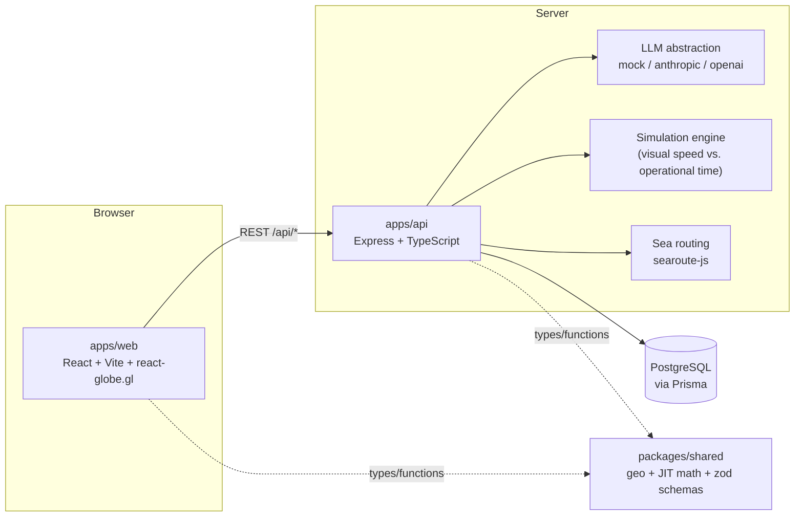
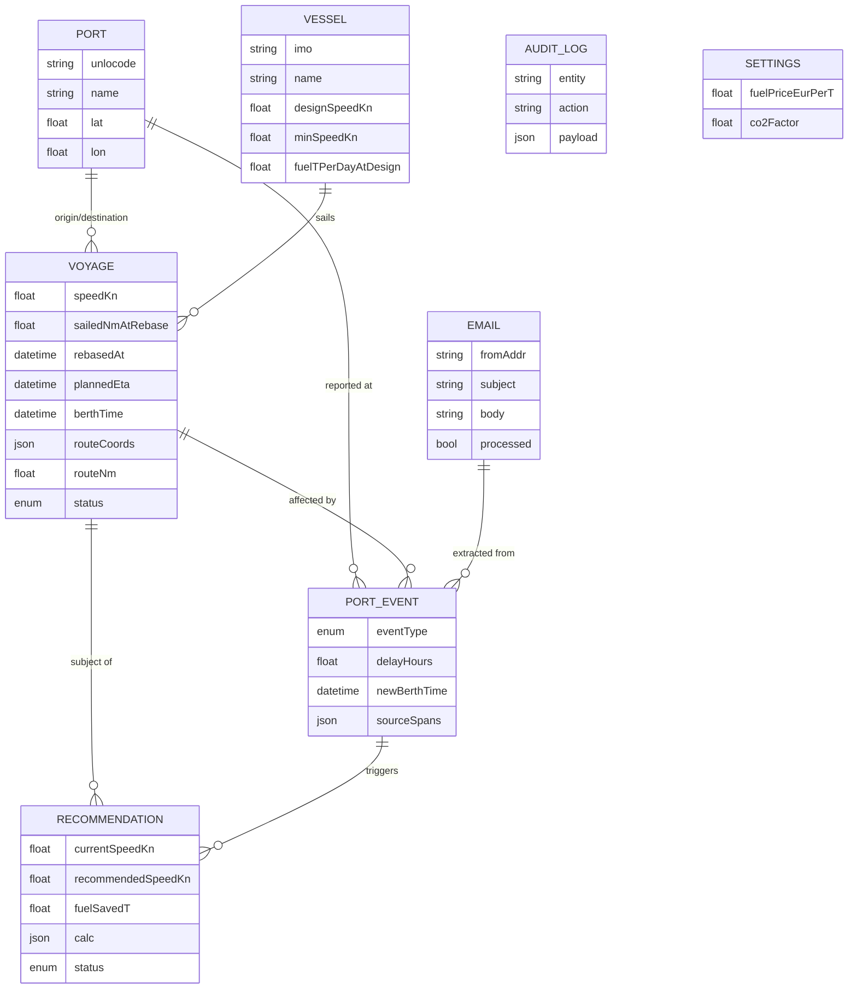

# Tidewise

[](https://github.com/netcompany-hack-2026-overflow/maritime-assistant-v2/actions/workflows/ci.yml)

> 🇬🇧 English version: [README.en.md](README.en.md)

**Tidewise: Έξυπνος Βοηθός Ναυτιλιακών Επιχειρήσεων.** Αναπτύχθηκε για το Netcompany
Hackathon Athens 2026, Challenge #2. *Φτάσε στην ώρα σου, όχι νωρίτερα.*

Ένας διαχειριστής στόλου λαμβάνει ένα email μίας γραμμής από τον πράκτορα του λιμανιού:
*«η θέση πρόσδεσης καθυστερεί 24 ώρες».* Σήμερα κάποιος πρέπει να το διαβάσει, να θυμηθεί
ποιο πλοίο αφορά, να κάνει πρόχειρους υπολογισμούς για το καύσιμο και να αποφασίσει αν θα
μειώσει την ταχύτητα του πλοίου. Το Tidewise κάνει την ανάγνωση, την αντιστοίχιση και τους
υπολογισμούς — και μετά σταματά και ζητά από έναν άνθρωπο να εγκρίνει ή να απορρίψει τη
σύσταση. **Τίποτα δεν εκτελείται αυτόματα.**

## Η ιδέα σε ένα σενάριο

Το MV Aegean Star ταξιδεύει Πειραιάς → Ρότερνταμ με 14,0 κόμβους. Φτάνει email από τον
πράκτορα: η θέση πρόσδεσης στο Ρότερνταμ καθυστερεί 24 ώρες. Αντί να πλέει με πλήρη ταχύτητα
και να περιμένει μια μέρα στην αγκυροβολία, το πλοίο μπορεί να επιβραδύνει όσο ακριβώς
χρειάζεται για να φτάσει τη στιγμή που η νέα θέση είναι έτοιμη — καίγοντας λιγότερο καύσιμο
για το ίδιο αποτέλεσμα. Αυτό λέγεται **άφιξη just-in-time (JIT)**. Η εξοικονόμηση προκύπτει
από τον κυβικό νόμο ταχύτητας–κατανάλωσης: `fuel(v) = fuel_design * (v / v_design)³`.
Μια μικρή μείωση ταχύτητας φέρνει δυσανάλογα μεγάλη μείωση στην κατανάλωση.

Παράδειγμα (η περίπτωση αναφοράς που ελέγχεται στο
[packages/shared/src/\_\_tests\_\_/jit.test.ts](packages/shared/src/__tests__/jit.test.ts)):

| | Σχέδιο A — βιασύνη & αναμονή στην άγκυρα | Σχέδιο B — αργή πλεύση (JIT) |
|---|---|---|
| Ταχύτητα | 14,0 kn | 10,9 kn |
| Απόσταση που απομένει | 1200 nm | 1200 nm |
| Χρόνος στη θάλασσα | 85,7 h | 109,7 h |
| Αναμονή στην άγκυρα | 24,0 h | 0 h |
| Καύσιμο | ~145,9 t | ~87,2 t |

**Εξοικονόμηση: ~58,7 t καυσίμου, ~€35.200 (με €600/t), ~182,7 t CO₂.** Η εφαρμογή δείχνει
κάθε έναν από αυτούς τους αριθμούς — όχι μόνο το σύνολο — στο «Show the math» της σελίδας
Actions, ώστε ο άνθρωπος να ελέγξει το σκεπτικό πριν εγκρίνει.

### Δεύτερο σενάριο: αξίζει η παράκαμψη για φθηνότερο καύσιμο;

Οι προμηθευτές στέλνουν προσφορές όπως *«VLSFO στο Algeciras, USD 540/mt, 800–1.200 mt,
ισχύει έως 23/11»*. Το φθηνότερο καύσιμο συμφέρει μόνο αν η παράκαμψη δεν τρώει την
εξοικονόμηση. Το Tidewise διαβάζει την προσφορά, βρίσκει το πλοίο που η υπόλοιπη διαδρομή
του περνά πιο κοντά από το λιμάνι, και συγκρίνει δύο σχέδια που καταλήγουν και τα δύο
στην ώρα πρόσδεσης:

- **Μένει στη διαδρομή** και κόβει ταχύτητα ώστε να φτάσει ακριβώς στην ώρα πρόσδεσης: το
  καλύτερο που μπορεί να κάνει χωρίς ανεφοδιασμό, ώστε η εξοικονόμηση της αργής πλεύσης να
  μην πιστώνεται στην προσφορά.
- **Ανεφοδιασμός**: πάει στο λιμάνι και επιστρέφει, μένει εκεί όσο χρειάζεται η ποσότητα
  (8 h για 800 t, ±1 h ανά 250 t) συν την αναμονή για το barge, και πλέει με την ταχύτητα
  που το φέρνει ακριβώς στην ώρα πρόσδεσης (πάλι με τον κυβικό νόμο).

```
καθαρό € = ποσότητα × (δική μας τιμή − τιμή προσφοράς × USD→EUR) − επιπλέον καύσιμο × δική μας τιμή − λιμενικά έξοδα
```

**Αξίζει** μόνο αν το καθαρό είναι θετικό, το πλοίο προλαβαίνει τη θέση του χωρίς να
ξεπεράσει την ταχύτητα σχεδίασης, και η προσφορά ισχύει ακόμα όταν φτάσει. Στο demo, το
Algeciras (≈10 nm από τη διαδρομή) βγαίνει **αξίζει, καθαρό ≈ +€54 χιλ.** για 800 t, αφού η
καθυστέρηση πρόσδεσης έχει δώσει περιθώριο χρόνου. Η Γένοβα (≈580 nm μακριά) **σταματά
στον έλεγχο χρόνου**: χρειάζεται ≈90 h ενώ το πλοίο έχει 24 h περιθώριο, οπότε δεν
αναλύεται καν παραπέρα (βλ. παρακάτω). Κάθε προσφορά περιμένει στο Actions να αποφασίσει άνθρωπος· όσες δεν
αξίζουν σημειώνονται με κόκκινο μαζί με τον λόγο, και μπορείτε να ρωτήσετε *«why didn't we
take the Genoa offer?»*. Ο υπολογισμός είναι καθαρή συνάρτηση με unit tests
([packages/shared/src/bunker.ts](packages/shared/src/bunker.ts)) και κάθε βήμα
αποθηκεύεται μαζί με τη σύσταση (πεδίο `calc`) για να το δείξει το UI.

### Τρίτο σενάριο: σύγκριση προσφορών και έτοιμες απαντήσεις (Bunkering)

Όταν φτάνει email με προσφορά καυσίμου, ο agent:

1. **Διαβάζει τους όρους**, ακόμα και σε trader slang: τύπος καυσίμου (και πολλά grades στο
   ίδιο email, π.χ. VLSFO + LSMGO), τιμή, ποσότητα, IMO, barging (included / lump sum /
   $ ανά τόνο), λοιπά έξοδα (overtime, agency), όροι πληρωμής, παράθυρο παράδοσης
   (`b/d ETA+12 hrs`, `prompt`) και πόσο ισχύει η τιμή (`firm 10 mins`, με αντίστροφη μέτρηση).
2. **Βρίσκει το πλοίο** (IMO, όνομα ή όποιο περνά πιο κοντά) και τη θέση του, το σημείο που
   φεύγει από τη διαδρομή, την απόσταση ως το λιμάνι ανεφοδιασμού, πιθανές καθυστερήσεις
   (παράθυρο του προμηθευτή, συμφόρηση ή κλείσιμο που αναφέρθηκε για το λιμάνι τις
   τελευταίες 7 μέρες) και την ώρα πρόσδεσης που πρέπει να προλάβει.
3. **Έλεγχος χρόνου πριν από οτιδήποτε άλλο.** Αν *χρόνος ανεφοδιασμού + αναμονή barge +
   παράκαμψη* ξεπερνά το περιθώριο του πλοίου ως την πρόσδεση (υπολογισμένο στην ταχύτητα
   σχεδίασης) πάνω από **30 λεπτά** (`bunkerSlackToleranceMin` στα Settings), η ανάλυση
   σταματά εκεί: καμία επιλογή, **καμία κλήση LLM**, μόνο ευγενική άρνηση. Το ίδιο αν το
   πλοίο δεν προλαβαίνει τη λήξη της προσφοράς ούτε με πλήρη ταχύτητα.
4. Για όσες περάσουν, **το πολύ δύο επιλογές** με νέα διαδρομή (πλοίο → σημείο εκτροπής →
   λιμάνι → πίσω στη διαδρομή → προορισμός, με ώρες), **προτεινόμενη ταχύτητα** και καθαρό
   κέρδος: *ECO* (κόβει ταχύτητα και φτάνει ακριβώς στην πρόσδεση) και *KEEP_SPEED* (ίδια
   ταχύτητα, φτάνει νωρίτερα με περιθώριο για καθυστερήσεις), μόνο αν διαφέρει ουσιαστικά.
5. **Συγκρίνει όλες τις προσφορές του πλοίου δίπλα-δίπλα** στο συνολικό κόστος, όχι στην
   τιμή ανά τόνο:
   ```
   σύνολο = καύσιμο + barging + λοιπά έξοδα + λιμενικά/πράκτορας
          + επιπλέον καύσιμο παράκαμψης & ταχύτητας
          + κίνδυνος καθυστέρησης (ώρες × charter rate × urgency 25/50/100%)
          + κόστος πίστωσης (8%/έτος έναντι 30 ημερών) + κίνδυνος προμηθευτή (0,3% ανά μονάδα κάτω από 10/10)
          + EU ETS στο επιπλέον CO₂ (προαιρετικό)
   ```
   Τα sliders (charter rate, ποσότητα, urgency, ETS) ξανατρέχουν τον ίδιο υπολογισμό στον
   browser αμέσως, χωρίς tokens. Η σύσταση σε απλά αγγλικά γράφεται από τα νούμερα· το
   «Ask the AI» κάνει **μία** κλήση στο μοντέλο μόνο αν το ζητήσετε.
6. **Γράφει έτοιμα emails** (αποδοχή ανά επιλογή, αντιπροσφορά όταν η τιμή δεν βγαίνει,
   άρνηση) από templates, ώστε τα νούμερα να είναι πάντα ακριβή και να μην κοστίζουν tokens.
   Τα διαβάζετε, τα διορθώνετε και στέλνετε **ένα**: η αποδοχή εγκρίνει την προσφορά με αυτή
   την επιλογή, η άρνηση την απορρίπτει, η αντιπροσφορά την αφήνει σε αναμονή. Τα υπόλοιπα
   κλείνουν. Τίποτα δεν στέλνεται χωρίς να πατήσετε Send.

Ο κώδικας: [bunkerPlan.ts](packages/shared/src/bunkerPlan.ts) (έλεγχος χρόνου, επιλογές,
διαδρομή), [bunkerTco.ts](packages/shared/src/bunkerTco.ts) (σύγκριση, εξήγηση),
[bunkerEmails.ts](packages/shared/src/bunkerEmails.ts) (απαντήσεις), όλα καθαρές
συναρτήσεις με unit tests. Τα 4 demo emails είναι στο
[apps/api/prisma/mock_demo_data.json](apps/api/prisma/mock_demo_data.json).

## Το demo σε 90 δευτερόλεπτα

0. **Landing** (`/`): τι κάνει το Tidewise σε μία οθόνη· το «Open the console» ανοίγει την εφαρμογή.
1. **Fleet** — μια ζωντανή 3D υδρόγειος δείχνει 8 φανταστικά πλοία σε κίνηση (προσομοίωση
   με ταχύτητα `SIM_SPEED`× του πραγματικού χρόνου). Τα πλοία ακολουθούν πραγματικές
   θαλάσσιες διαδρομές (Γιβραλτάρ, Σουέζ, Μάλακα…). Το MV Aegean Star πλέει Πειραιάς →
   Ρότερνταμ με 14,0 kn.
2. **Inbox** — πατήστε «Simulate incoming email» για να έρθει η ειδοποίηση καθυστέρησης
   στο Ρότερνταμ. Εξάγεται σε δομημένο port event (με επισήμανση μέσα στο κείμενο του
   email) και αντιστοιχίζεται στο ταξίδι του MV Aegean Star.
3. **Actions** — περιμένει μια σύσταση: μείωση από 14,0 kn σε περίπου 12 kn και
   εξοικονόμηση περίπου 57 t καυσίμου (~€34 χιλ.). Τα ακριβή νούμερα αλλάζουν λίγο με τον
   (mock) καιρό της ημέρας. Ανοίξτε το «Show the math» για να δείτε κάθε βήμα και πατήστε
   **Approve**.
4. **Fleet** — το MV Aegean Star κινείται πλέον εμφανώς πιο αργά και η ETA του ταιριάζει
   ακριβώς με τη νέα ώρα πρόσδεσης.
5. **Προσφορές καυσίμου** — πίσω στο Inbox, φέρτε και επεξεργαστείτε τα επόμενα δύο
   emails. Στο Actions περιμένουν και οι δύο απόφαση: το Algeciras σημειώνεται ότι αξίζει
   (καθαρό ≈ +€54 χιλ.), η Γένοβα με κόκκινο ότι δεν αξίζει, μαζί με τον λόγο. Απορρίψτε τη Γένοβα.
   Το «Compare offers, route options and replies →» ανοίγει τη σελίδα Bunkering.
5β. **Bunkering**: «Simulate supplier quotes» φέρνει 4 προσφορές για το MV Aegean Star
   και τις συγκρίνει (βλ. pitch παρακάτω).
6. **Ask** — ρωτήστε «Why didn't we take the Genoa offer?» ή «How much fuel have we saved
   from approved recommendations?» και πάρτε απάντηση με παραπομπή στην εγγραφή της σύστασης.
7. **Settings** (προαιρετικά) — αλλάξτε την τιμή καυσίμου (€/t). Οι εκκρεμείς συστάσεις
   επανυπολογίζονται αμέσως.
8. **Έγγραφα** (προαιρετικά) — στο Inbox, «Upload PDF» με το δείγμα
   `apps/web/public/samples/algeciras-berth-notice.pdf` (διαθέσιμο και από τη σελίδα
   Inbox). Το κείμενο του PDF περνά από την ίδια ροή και παράγει σύσταση για το MV Ionian
   Trader.

## Pitch 60 δευτερολέπτων: Bunkering co-pilot

**Προετοιμασία (μία φορά):**

```bash
docker compose up --build            # ή: δείτε «Τοπική ανάπτυξη χωρίς Docker»
# Για αποστολή email: συμπληρώστε SMTP_* και MAIL_FROM στο .env, και για το demo
# MAIL_REDIRECT_TO=<το email σας> (οι προμηθευτές του demo έχουν ψεύτικες διευθύνσεις).
docker compose up -d --build api     # μετά από αλλαγή του .env
```

Ανοίξτε το http://localhost:8080 → **Inbox** → «Simulate incoming email» → **Process** (η
καθυστέρηση 24 h στο Ρότερνταμ δίνει στο πλοίο χρόνο για ανεφοδιασμό· χωρίς αυτή κάθε
προσφορά σταματά, σωστά, στον έλεγχο χρόνου).

**Το σενάριο:**

| Χρόνος | Τι δείχνετε | Τι λέτε |
|---|---|---|
| 0–10 s | **Bunkering** → «Simulate supplier quotes» | «Τέσσερις προμηθευτές, τέσσερα emails σε trader slang, όπως έρχονται κάθε μέρα.» |
| 10–20 s | Ο πίνακας: Rock Marine στα **$526/t** είναι η φθηνότερη… και βγαίνει **#4** | «Η φθηνότερη τιμή ανά τόνο είναι η ακριβότερη συνολικά: $4.500 barging επιπλέον, barge 12 ώρες μετά την άφιξη, αξιοπιστία 5/10.» |
| 20–30 s | Η σύσταση: «Strait Bunkering is $5.00/t dearer on paper… but ≈$33k cheaper overall» | «Το πλοίο θα έπρεπε να καλύψει τις 12 ώρες τρέχοντας: ≈$27k επιπλέον καύσιμο. Αυτό δεν φαίνεται σε κανένα quote.» |
| 30–40 s | Αντίστροφη μέτρηση της Ceuta (**firm 10 mins**, πορτοκαλί) · sliders: charter $40k, urgency High, ETS on | «Η κατάταξη ξαναϋπολογίζεται αμέσως, χωρίς κλήση σε μοντέλο.» |
| 40–50 s | Κλικ στη στήλη Strait Bunkering → σκίτσο διαδρομής, ECO 12,5 kn έναντι 14 kn, ώρες ανά σημείο | «Ο agent σχεδίασε και τη νέα διαδρομή και την ταχύτητα που φτάνει ακριβώς στην ώρα πρόσδεσης.» |
| 50–60 s | «Accept · eco speed» → μικρή αλλαγή στο κείμενο → **Send** | «Ο άνθρωπος αποφασίζει και στέλνει. Το LLM μόνο διαβάζει· τα νούμερα δεν τα "φαντάζεται" κανείς, και όσες προσφορές δεν χωράνε στο πρόγραμμα κόβονται πριν σπαταλήσουμε tokens.» |

## Σελίδες

- **Landing** (`/`) — αρχική σελίδα που εξηγεί το προϊόν, με ζωντανό σύνολο «fuel saved so
  far» και σύνδεσμο προς την κονσόλα. Οι σελίδες της κονσόλας είναι οι `/fleet`,
  `/voyages`, `/inbox`, `/actions`, `/ask`, `/settings`.
- **Fleet** — 3D υδρόγειος με τη ζωντανή θέση, την πορεία και την υπόλοιπη θαλάσσια
  διαδρομή κάθε πλοίου, καθώς και τα λιμάνια (πράσινα, με ονόματα) στην πραγματική τους
  θέση. Πλαϊνή λίστα πλοίων· κλικ σε πλοίο ανοίγει τις λεπτομέρειές του. Τα πλοία με
  εκκρεμή σύσταση επισημαίνονται. Το πλακίδιο «Saved to date» αθροίζει καύσιμο, € και CO₂
  από όλες τις εγκεκριμένες συστάσεις.
- **Voyages** — πίνακας όλων των ταξιδιών με φόρμα «New voyage»: επιλέξτε πλοίο και δύο
  λιμάνια (από λίστα ή με κλικ σε μια μικρή υδρόγειο), δείτε τη θαλάσσια διαδρομή και
  ζωντανή εκτίμηση απόστασης/ETA, και δημιουργήστε ή ακυρώστε ταξίδια.
- **Inbox** — emails πρακτόρων σε αναμονή και επεξεργασμένα. Το «Simulate incoming email»
  φέρνει το επόμενο· το «Paste email» δέχεται δικό σας κείμενο· το «Upload PDF» μετατρέπει
  ένα PDF με κείμενο (ειδοποίηση πρόσδεσης, εγκύκλιο λιμανιού) σε email. Η επεξεργασία
  δείχνει τα πεδία που εξήχθησαν με το ακριβές κείμενο-πηγή επισημασμένο, με ποιο ταξίδι
  ταίριαξε (ή γιατί δεν ταίριαξε) και τη σύσταση που προέκυψε.
- **Actions** — εκκρεμείς και παλαιότερες συστάσεις. Κάθε κάρτα έχει KPIs
  (καύσιμο/κόστος/CO₂), αιτιολόγηση σε απλή γλώσσα, πλήρη ανάλυση «Show the math» για κάθε
  ενδιάμεση τιμή του υπολογισμού JIT, ενότητα «Facts used» με τις εγγραφές email/port
  event/ταξιδιού, και κουμπιά Approve/Reject (η απόρριψη απαιτεί αιτιολογία). Η έγκριση
  ενημερώνει ταχύτητα και ETA του ταξιδιού ατομικά και καταγράφει την απόφαση.
- **Ask** — ελεύθερες ερωτήσεις για τα δεδομένα του στόλου, που απαντώνται από το LLM
  μόνο με βάση συγκεκριμένες εγγραφές (ποτέ από «γενική γνώση»), με παραπομπές σε
  πραγματικές εγγραφές πίνακας+id. Παραπομπές που επινοεί το μοντέλο απορρίπτονται στον server.
- **Settings** — η τιμή καυσίμου (€/t, VLSFO) που χρησιμοποιείται σε κάθε υπολογισμό
  εξοικονόμησης. Με την αποθήκευση επανυπολογίζονται μόνο οι εκκρεμείς συστάσεις· οι
  εγκεκριμένες και οι απορριφθείσες κρατούν την τιμή με την οποία αποφασίστηκαν.

## Αρχιτεκτονική



Το LLM δεν καλείται ποτέ απευθείας από τα routes: κάθε εξαγωγή, αιτιολόγηση και απάντηση
περνά από το `getLlmProvider()`
([apps/api/src/llm/index.ts](apps/api/src/llm/index.ts)), που επιλέγει `anthropic` ή
`openai` μόνο αν έχει οριστεί αυτός ο provider **και** υπάρχει το αντίστοιχο API key·
αλλιώς χρησιμοποιεί έναν ντετερμινιστικό `mock` provider βασισμένο σε regex — έτσι όλη η
εφαρμογή δουλεύει χωρίς κανένα API key.

Η κίνηση των πλοίων τρέχει σε δύο σκόπιμα ανεξάρτητα «ρολόγια»: ένα **οπτικό**
(επιταχυμένο κατά `SIM_SPEED`, μόνο για την κίνηση στην υδρόγειο) και ένα **λειτουργικό**
(`plannedEta`, `berthTime` — πραγματικός χρόνος, για κάθε υπολογισμό JIT). Έτσι τα
επιχειρηματικά νούμερα μένουν σωστά ανεξάρτητα από το πόσο γρήγορα γυρίζει η υδρόγειος.

Κάθε ταξίδι αποθηκεύει τη θαλάσσια διαδρομή του (`routeCoords`) και το μήκος της
(`routeNm`). Από αυτά προκύπτουν η θέση, η πορεία και η ETA του πλοίου
([apps/api/src/sim/positions.ts](apps/api/src/sim/positions.ts)).

## Μοντέλο δεδομένων



## Δομή του monorepo

```
apps/
  web/      Frontend σε React + Vite + TypeScript (απλό CSS, react-globe.gl)
  api/      Backend σε Node + Express + TypeScript + Prisma
packages/
  shared/   Κοινοί τύποι TS, zod schemas, συναρτήσεις geo + JIT
```

## Εγκατάσταση (Docker — προτείνεται)

```bash
git clone <repo-url>
cd maritime-assistant-v2
docker compose up --build
```

Δεν χρειάζεται αρχείο `.env` — κάθε μεταβλητή έχει λειτουργική προεπιλογή (mock LLM, χωρίς
API key). Μετά ανοίξτε το **http://localhost:8080**.

Μόνο το web container ανοίγει θύρα στον υπολογιστή σας. Η Postgres και το API μένουν στο
εσωτερικό δίκτυο του Docker (το nginx προωθεί το `/api` στο API), οπότε μια Postgres που
ήδη τρέχει τοπικά δεν συγκρούεται. Αν η θύρα 8080 είναι πιασμένη, ορίστε `WEB_PORT`, π.χ.
`WEB_PORT=8090 docker compose up --build`.

### Αποστολή email (προαιρετικό)

Οι απαντήσεις στους προμηθευτές στέλνονται μέσω SMTP, οπότε δουλεύει με οποιονδήποτε
provider (Gmail, Microsoft 365, SendGrid, Mailgun, Brevo, Amazon SES). Συμπληρώστε στο `.env`
τουλάχιστον `SMTP_HOST` και `MAIL_FROM` (και `SMTP_USER`/`SMTP_PASS` αν χρειάζεται login).
Το `.env.example` έχει έτοιμες τιμές ανά provider. Με `MAIL_REDIRECT_TO` όλα τα emails πάνε
σε δική σας διεύθυνση για δοκιμή. Χωρίς ρύθμιση τα emails γράφονται κανονικά και μπορείτε να
τα αντιγράψετε, απλώς το κουμπί Send είναι ανενεργό.

## Τοπική ανάπτυξη χωρίς Docker

Απαιτεί Node 20+ και τοπική PostgreSQL.

```bash
npm install
cp .env.example .env            # ορίστε DATABASE_URL στη δική σας Postgres, π.χ.
                                # postgresql://<you>@localhost:5432/maritime
                                # (το παράδειγμα έχει host "db", που υπάρχει μόνο μέσα στο Docker)
createdb maritime
npm run build --workspace packages/shared
npm run prisma:migrate --workspace apps/api
npm run prisma:seed --workspace apps/api
npm run dev                     # τρέχει μαζί τους dev servers του api και του web
```

Το `npm run dev` ανοίγει το API στη θύρα 4000 και το web στη 5173. Αν δείτε
`EADDRINUSE :::4000`, τρέχει ήδη ένα παλιότερο `npm run dev` — σταματήστε το (Ctrl+C στο
τερματικό του, ή `lsof -ti tcp:4000 | xargs kill`) και ξανατρέξτε το.

## Δοκιμή με πραγματικό LLM — βήμα προς βήμα

Χωρίς key η εφαρμογή χρησιμοποιεί τον offline mock. Για πραγματικό μοντέλο:

1. **Βάλτε το key στο `.env`** (στη ρίζα του project). Το API το διαβάζει μόνο του κατά
   την εκκίνηση:
   ```
   LLM_PROVIDER=openai
   OPENAI_API_KEY=sk-...
   LLM_MODEL=
   ```
   Με κενό `LLM_MODEL` χρησιμοποιείται το `gpt-5-mini` (OpenAI) ή το `claude-sonnet-5-5`
   (Anthropic). Με το OpenAI key του hackathon μπορείτε να βάλετε `LLM_MODEL=gpt-6-luna`
   για το μεγαλύτερο μοντέλο. Για Anthropic: `LLM_PROVIDER=anthropic` και
   `ANTHROPIC_API_KEY=...`. Με Docker, τρέξτε μετά `docker compose up --build`.
2. **Επανεκκινήστε** το `npm run dev` (Ctrl+C και ξανά), ώστε να φορτωθεί το νέο key.
3. **Ελέγξτε τον provider**: πάνω δεξιά πρέπει να γράφει **LLM: OPENAI** (ή ANTHROPIC)
   αντί για **LLM: MOCK**. Ή από τερματικό: `curl -s localhost:4000/api/meta`.
4. **Inbox** — «Simulate incoming email» ή «Paste email» με δικό σας κείμενο, π.χ.
   *«Rotterdam berth for MV Aegean Star delayed 30 hours due to congestion»* (δουλεύει και
   στα ελληνικά). Πατήστε **Process**: λιμάνι, καθυστέρηση και πλοίο εξάγονται από το LLM
   και επισημαίνονται μέσα στο email.
5. **Actions** — εμφανίζεται νέα εκκρεμής σύσταση με αιτιολόγηση γραμμένη από το LLM. Η
   απόσταση και η ETA βασίζονται στη θαλάσσια διαδρομή.
6. **Settings** — αλλάξτε την τιμή π.χ. 600 → 700 και πατήστε **Save**. Θα δείτε «1 pending
   recommendation recalculated» και στο Actions η εξοικονόμηση σε € θα έχει αυξηθεί ~16,7%.
   Κάντε **Approve** και δείτε το «Saved to date» στο Fleet να ανεβαίνει.
7. **Ask** — ρωτήστε κάτι που ο mock δεν καταλαβαίνει, π.χ. *«Which ships are going
   through Suez and when do they arrive?»*.
8. **(Προαιρετικά) Αξιολόγηση** — τα 12 δοκιμαστικά emails μέσα από το πραγματικό μοντέλο
   (γράφει το `apps/api/eval/results-openai.md`):
   ```bash
   npm run eval
   ```

Για επιστροφή στον offline mock: `LLM_PROVIDER=mock` και επανεκκίνηση.

Οι κλήσεις στο LLM έχουν όρια: κάθε αίτημα λήγει μετά από `LLM_TIMEOUT_MS` (προεπιλογή
30 s) και επαναλαμβάνεται το πολύ μία φορά, ο βρόχος επιδιόρθωσης JSON κάνει έως δύο
προσπάθειες, και η έξοδος του OpenAI έχει όριο (4.000 tokens για JSON, 2.000 για
αιτιολογήσεις, ώστε να μένει χώρος για τα reasoning tokens του GPT-5). Το μοντέλο καλείται
μόνο από ενέργειες του χρήστη (επεξεργασία email, αιτιολόγηση, ερώτηση), ποτέ από το
polling των σελίδων. Σε timeout εμφανίζεται «The language model took too long to answer».
Αν κάτι αποτύχει, δείτε το τερματικό του API — συνήθως φταίει λάθος key ή όνομα μοντέλου.

## Σχεδίαση, συσκευές & προσβασιμότητα

- Responsive μέχρι πλάτος κινητού: το μενού γίνεται δική του γραμμή με κύλιση, η υδρόγειος
  του Fleet μπαίνει πάνω από τη λίστα πλοίων, οι λεπτομέρειες πλοίου γίνονται bottom sheet,
  το Inbox βάζει τη λίστα πάνω από τις λεπτομέρειες, ο πίνακας ταξιδιών κυλά οριζόντια.
- Προσβασιμότητα: σύνδεσμος skip-to-content, `<h1>` σε κάθε σελίδα, ορατό focus
  πληκτρολογίου, ARIA tabs στο Actions, `aria-expanded` σε κάθε αναδιπλούμενο στοιχείο,
  διάλογος με ετικέτα για το «Reject», `role="alert"`/`role="status"` σε σφάλματα και
  φόρτωση, ετικέτες σε όλα τα πεδία, στόχοι αφής 44 px, χρώματα με αντίθεση AA,
  `prefers-reduced-motion`.
- Γραμματοσειρές: Inter για το UI, Instrument Serif italic για έμφαση (self-hosted μέσω
  `@fontsource`, χωρίς εξωτερικά αιτήματα). Φωτογραφία hero: Austin Neill, Unsplash.

## Έλεγχοι & ακρίβεια

Το GitHub Actions ([.github/workflows/ci.yml](.github/workflows/ci.yml)) τρέχει σε κάθε
push: έλεγχο τύπων, unit tests, την αξιολόγηση εξαγωγής (αποτυγχάνει κάτω από 18/18) και
πλήρες `docker compose up --build` με smoke tests για Fleet API, ανέβασμα PDF και Ask.

```bash
npm run test     # packages/shared (geo, διαδρομές, JIT, bunker) και apps/api (LLM mock, εξαγωγή, settings, ξηρά, sim, καιρός, PDF, ask, env)
npm run eval     # περνά τα apps/api/eval/emails/*.json από τον mock extractor

# τα ίδια 18 emails μέσα από πραγματικό LLM (γράφει το apps/api/eval/results-openai.md)
LLM_PROVIDER=openai OPENAI_API_KEY=sk-... npm run eval
```

Το σύνολο αξιολόγησης είναι 18 συνθετικά emails. Τα 12 είναι ειδοποιήσεις πρακτόρων: απλά αγγλικά, μόνο ελληνικά,
μικτά ελληνικά/αγγλικά, αποσαφήνιση πολλών λιμανιών (μέσω UN/LOCODE), email χωρίς όνομα
πλοίου, εναλλακτικό διαχωριστικό ημερομηνίας, δύο emails χωρίς συμβάν, ένα που αναφέρει
πραγματικό λιμάνι/πλοίο αλλά κανένα συμβάν, και έλεγχος ότι κερδίζει ο τύπος συμβάντος
που αναφέρεται πρώτος. Τα 6 είναι προσφορές καυσίμου: μια σαφής προσφορά που αναφέρει και
τον προορισμό του πλοίου, μια μακριά από τη διαδρομή, μια ληγμένη, μια χωρίς ποσότητα, μια
στα ελληνικά, και ένα εβδομαδιαίο δελτίο τιμών που δεν πρέπει να μετρήσει ως προσφορά.
Βαθμολογούνται και τα πεδία της προσφοράς (τύπος καυσίμου, τιμή, εύρος ποσότητας, λήξη).
Τα πλήρη αποτελέσματα ανά πεδίο και email γράφονται στο
[apps/api/eval/results.md](apps/api/eval/results.md) σε κάθε εκτέλεση. Τελευταία εκτέλεση:

| Πεδίο | Ακρίβεια |
|---|---|
| Emails με πλήρη ταύτιση | 18 / 18 (100%) |
| eventType, portName, portUnlocode, vesselNameMentioned | 100% |
| delayHours, newBerthTime | 100% |
| fuelGrade, priceUsdPerT, qtyMinT, qtyMaxT, validUntil | 100% |

## REST API

| Μέθοδος | Path | Σκοπός |
|---|---|---|
| GET | `/api/health` | έλεγχος λειτουργίας |
| GET | `/api/meta` | ενεργός LLM provider (μετά τον έλεγχο key), ταχύτητα προσομοίωσης, τιμή καυσίμου και συντελεστής CO₂ |
| GET | `/api/ports` | όλα τα λιμάνια |
| GET | `/api/ports/route?from=&to=` | θαλάσσια διαδρομή και απόσταση μεταξύ δύο λιμανιών (UN/LOCODE) |
| GET | `/api/vessels` | όλα τα πλοία με την κατάσταση του τρέχοντος ταξιδιού |
| GET | `/api/vessels/positions` | ζωντανές θέσεις και υπόλοιπη διαδρομή για την υδρόγειο |
| GET | `/api/voyages` | όλα τα ταξίδια |
| POST | `/api/voyages` | δημιουργία ταξιδιού (vesselId, originPortId, destPortId, προαιρετικά speedKn) |
| PATCH | `/api/voyages/:id/cancel` | ακύρωση ταξιδιού σε εξέλιξη/προγραμματισμένου |
| GET | `/api/emails` | όλα τα emails (σε αναμονή + επεξεργασμένα) |
| POST | `/api/emails` | προσθήκη δικού σας email |
| POST | `/api/emails/simulate` | φέρνει το επόμενο email του demo |
| POST | `/api/emails/document?filename=` | ανέβασμα PDF (raw body, `Content-Type: application/pdf`, έως 5 MB) ως email |
| POST | `/api/emails/:id/process` | εξαγωγή + αντιστοίχιση + (ενδεχομένως) σύσταση |
| GET | `/api/port-events` | όλα τα port events |
| GET | `/api/recommendations` | συστάσεις, προαιρετικό φίλτρο `?status=` |
| GET | `/api/recommendations/:id` | μία σύσταση |
| POST | `/api/recommendations/:id/approve` | έγκριση: ενημερώνει ταχύτητα/ETA, καταγράφει την απόφαση |
| POST | `/api/recommendations/:id/reject` | απόρριψη (απαιτεί αιτιολογία) |
| GET | `/api/records/:table/:id` | γενική ανάκτηση εγγραφής, για «Facts used» και παραπομπές του Ask |
| POST | `/api/ask` | ερωτήσεις σε φυσική γλώσσα με ελεγμένες παραπομπές |
| GET | `/api/settings` | τρέχουσα τιμή καυσίμου, συντελεστής CO₂, ισοτιμία USD→EUR και παραδοχές ανεφοδιασμού |
| PUT | `/api/settings` | ορισμός `fuelPriceEurPerT` (0–5000) ή/και `usdEurRate` (0,5–2)· επανυπολογίζει τις εκκρεμείς συστάσεις |
| GET | `/api/bunker-offers` | όλες οι προσφορές καυσίμου με όρους, προμηθευτή, έλεγχο χρόνου, επιλογές, διαδρομή και drafts |
| POST | `/api/bunker-offers/simulate` | φέρνει και επεξεργάζεται τα 4 demo quotes (`mock_demo_data.json`) |
| POST | `/api/bunker-offers/explain` | μία κλήση LLM: εξήγηση της σύγκρισης για ένα ταξίδι με τις δοσμένες παραδοχές |
| PATCH | `/api/email-drafts/:id` | αποθήκευση αλλαγών σε draft (`toAddr`, `subject`, `body`) |
| POST | `/api/email-drafts/:id/send` | αποστολή μέσω SMTP· καταγράφει την απόφαση για την προσφορά |

## Παραδοχές

- Όλα τα δεδομένα (λιμάνια, πλοία, ταξίδια, emails) είναι συνθετικά· τα IMO είναι φανταστικά.
- Τα πλοία ακολουθούν πραγματικές θαλάσσιες οδούς (Γιβραλτάρ, Σουέζ, Μάλακα, Παναμάς…),
  που υπολογίζονται με το [searoute-js](https://github.com/johnx25bd/searoute) πάνω στο
  ναυτιλιακό δίκτυο της Eurostat
  ([apps/api/src/services/seaRoute.ts](apps/api/src/services/seaRoute.ts)). Κάθε ταξίδι
  αποθηκεύει τη διαδρομή και το μήκος της, από τα οποία προκύπτουν θέση και ETA (π.χ.
  Πειραιάς–Ρότερνταμ ~2.890 nm, Αμβούργο–Σιγκαπούρη ~8.650 nm). Το δίκτυο είναι αραιό σε
  κάποιες ακτές, οπότε σύντομα παράκτια ταξίδια μπορεί να βγαίνουν λίγο μεγαλύτερα.
- Οι συντεταγμένες των λιμανιών αντιστοιχούν στους λιμενικούς σταθμούς (π.χ. Σαγκάη =
  λιμάνι Yangshan, όχι το κέντρο της πόλης).
- Η τιμή καυσίμου (προεπιλογή €600/t από το `FUEL_PRICE_EUR_PER_T`) αλλάζει από τη σελίδα
  **Settings**. Η νέα τιμή επανυπολογίζει τις εκκρεμείς συστάσεις· οι εγκεκριμένες και οι
  απορριφθείσες κρατούν την τιμή με την οποία αποφασίστηκαν. Ο συντελεστής CO₂ (3,114 t
  CO₂/t καυσίμου, ο τυπικός για VLSFO) έρχεται από το `CO2_FACTOR`. Κανένα από τα δύο δεν
  είναι ζωντανή τιμή αγοράς, και εμφανίζονται δίπλα σε κάθε νούμερο που εξαρτάται από αυτά.
- Ο καιρός είναι **mock**: κάθε λιμάνι προορισμού παίρνει ντετερμινιστικό αντίθετο ρεύμα
  (−0,5 έως +1,5 kn) και κατάσταση θάλασσας (συντελεστής καυσίμου 1,00–1,10) ανά ημέρα
  ([apps/api/src/sim/weather.ts](apps/api/src/sim/weather.ts)). Το αντίθετο ρεύμα αυξάνει
  την ταχύτητα που χρειάζεται για έγκαιρη άφιξη· η τρικυμία αυξάνει την κατανάλωση και στα
  δύο σχέδια. Και οι δύο τιμές φαίνονται στο «Show the math». Μια πραγματική εγκατάσταση
  θα χρησιμοποιούσε API θαλάσσιου καιρού.
- Προσφορές καυσίμου: οι τιμές είναι σε USD/t και μετατρέπονται με ισοτιμία USD→EUR
  (προεπιλογή 0,92, ορίζεται με `PUT /api/settings`· η αλλαγή της επανυπολογίζει τις
  εκκρεμείς προσφορές).
  Ο ανεφοδιασμός θεωρείται ότι διαρκεί 8 h για 800 t (±1 h ανά 250 t, ρυθμός άντλησης
  `bunkerPumpRateTPerH`) και κοστίζει €5.000 σε λιμενικά και έξοδα πράκτορα. Η ποσότητα
  είναι το stem που χρειάζεται το πλοίο (800 t), προσαρμοσμένο στο εύρος του προμηθευτή.
  Όταν ο προμηθευτής δίνει παράθυρο παράδοσης (`ETA+12 hrs`), λογαριάζεται η χειρότερη
  περίπτωση· όταν υπάρχουν και συμφόρηση και παράθυρο, μετράει το μεγαλύτερο, όχι το άθροισμα.
- Σύγκριση προσφορών (TCO): charter rate ανά πλοίο (π.χ. $18.000/ημέρα για το MV Aegean
  Star), κόστος χρήματος 8%/έτος έναντι 30 ημερών πίστωσης, κίνδυνος προμηθευτή 0,3% του
  λογαριασμού ανά μονάδα αξιοπιστίας κάτω από 10 (ιστορικό στον πίνακα `Supplier`· άγνωστος
  = 6/10), EUA €75/t. Barging που δεν αναφέρεται θεωρείται included και σημειώνεται.
  Συγκρίνεται το πρώτο grade κάθε email (π.χ. VLSFO)· τα υπόλοιπα εμφανίζονται χωριστά. Η παράκαμψη μετριέται σε
  ευθεία, πήγαινε-έλα, από το πιο κοντινό σημείο της υπόλοιπης διαδρομής που η ευθεία του
  προς το λιμάνι δεν περνά από ξηρά (ακτογραμμές Natural Earth 110m). Το δίκτυο θαλάσσιων
  διαδρομών είναι πολύ αραιό για τόσο μικρές αποστάσεις. Ο υπολογισμός γίνεται για ήρεμη θάλασσα.
- Όταν μια ειδοποίηση λέει μόνο «καθυστέρηση N ωρών» χωρίς νέα ώρα πρόσδεσης, η νέα ώρα
  είναι η τρέχουσα προγραμματισμένη άφιξη συν N ώρες.
- Η προτεινόμενη ταχύτητα δεν ξεπερνά ποτέ την τρέχουσα (η εφαρμογή μόνο επιβραδύνει) και
  δεν πέφτει κάτω από το `minSpeedKn` του πλοίου· αν ο χρόνος δεν φτάνει ούτε στην ελάχιστη
  ταχύτητα, το σχέδιο περιορίζεται εκεί και δείχνει την εναπομένουσα αναμονή.

## Γνωστοί περιορισμοί

- Ο mock LLM provider είναι ντετερμινιστικός εξαγωγέας με regex, όχι πραγματικό γλωσσικό
  μοντέλο. Καλύπτει καλά τα μοτίβα του συνόλου αξιολόγησης (100% σε όλα τα πεδία) αλλά
  δεν αντέχει ελεύθερη διατύπωση όπως ένα πραγματικό LLM (`LLM_PROVIDER=anthropic`/`openai`).
- Η αποσαφήνιση τύπου συμβάντος ακολουθεί τον κανόνα «κερδίζει η πρώτη λέξη-κλειδί». Αυτό
  ταιριάζει στη συνήθη περίπτωση (το θέμα συνήθως λέει το πραγματικό συμβάν) αλλά μπορεί να
  ταξινομήσει λάθος ένα email που ξεκινά με δευτερεύουσα λεπτομέρεια.
- Η δημιουργία ταξιδιού ελέγχει μόνο ότι «το πλοίο δεν έχει ήδη ενεργό ταξίδι» — τίποτα δεν
  εμποδίζει δύο ταξίδια στην ίδια διαδρομή με διαφορετικά πλοία.
- Η έγκριση μιας προσφοράς καυσίμου (ή η αποστολή της αποδοχής) καταγράφει την απόφαση και
  την επιλογή· δεν αλλάζει ακόμα τη διαδρομή του πλοίου στην υδρόγειο ούτε την ταχύτητά του.
- Οι επιλογές ανεφοδιασμού συγκρίνονται με την αργή πλεύση χωρίς ανεφοδιασμό, αλλά αν
  εγκριθούν και οι δύο συστάσεις για το ίδιο ταξίδι δεν ξαναϋπολογίζονται μαζί.
- Οι προσφορές μπαίνουν από το Inbox (simulate, paste, PDF). Δεν διαβάζεται ακόμα πραγματικό
  γραμματοκιβώτιο (IMAP)· το `.env` ρυθμίζει μόνο την αποστολή.
- Ο έλεγχος χρόνου και οι επιλογές γίνονται τη στιγμή της επεξεργασίας· αν το πλοίο
  προχωρήσει πολύ, ξαναεπεξεργαστείτε την προσφορά. Ο υπολογισμός ανεφοδιασμού είναι για
  ήρεμη θάλασσα.
- Δεν υπάρχει αυθεντικοποίηση· είναι demo για έναν χρήστη.
- Το ανέβασμα PDF διαβάζει μόνο το επίπεδο κειμένου· σαρωμένα PDF (μόνο εικόνα)
  απορρίπτονται με σαφές μήνυμα αντί για OCR.

## Κανόνες που τηρήθηκαν σε όλη την ανάπτυξη

Μόνο συνθετικά δεδομένα. Κανένα μυστικό στο repo (το `.env` είναι στο `.gitignore`· το
`.env.example` έχει κενά πεδία για API keys). Κανένα hardcoded API key. Κάθε φάση της
ανάπτυξης ολοκληρώθηκε με λειτουργικό `docker compose up --build` από καθαρή κατάσταση πριν
προχωρήσουμε.
