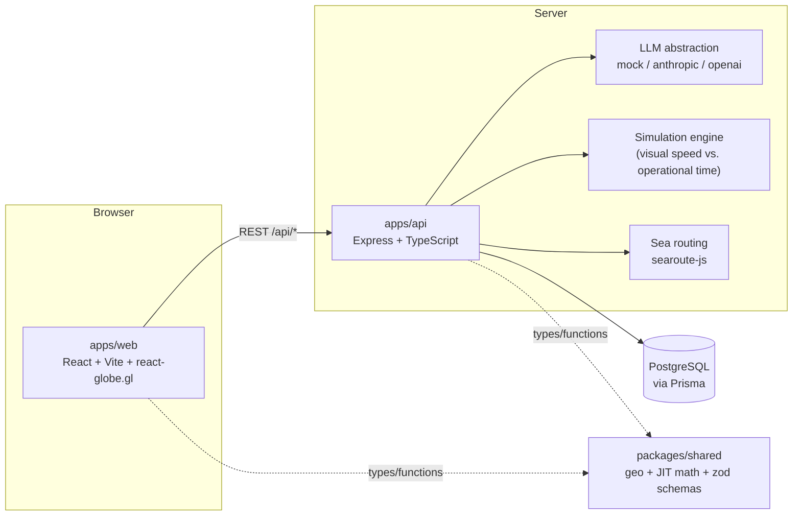
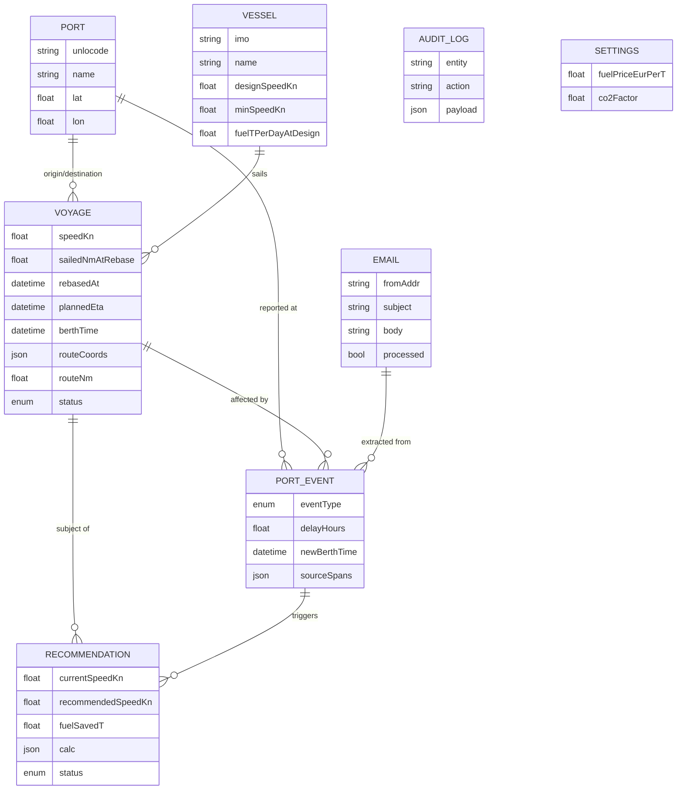

# Tidewise

[](https://github.com/netcompany-hack-2026-overflow/maritime-assistant-v2/actions/workflows/ci.yml)

> 🇬🇧 English version: [README.en.md](README.en.md)

**Tidewise: Έξυπνος Βοηθός Ναυτιλιακών Επιχειρήσεων.** Αναπτύχθηκε για το Netcompany
Hackathon Athens 2026, Challenge #2. *Φτάσε στην ώρα σου, όχι νωρίτερα.*

Ένας διαχειριστής στόλου λαμβάνει ένα email μίας γραμμής από τον πράκτορα του λιμανιού:
*«η θέση πρόσδεσης καθυστερεί 24 ώρες».* Σήμερα κάποιος πρέπει να το διαβάσει, να θυμηθεί
ποιο πλοίο αφορά, να κάνει πρόχειρους υπολογισμούς για το καύσιμο και να αποφασίσει αν θα
μειώσει την ταχύτητα του πλοίου. Το Tidewise κάνει την ανάγνωση, την αντιστοίχιση και τους
υπολογισμούς — και μετά σταματά και ζητά από έναν άνθρωπο να εγκρίνει ή να απορρίψει τη
σύσταση. **Τίποτα δεν εκτελείται αυτόματα.**

## Η ιδέα σε ένα σενάριο

Το MV Aegean Star ταξιδεύει Πειραιάς → Ρότερνταμ με 14,0 κόμβους. Φτάνει email από τον
πράκτορα: η θέση πρόσδεσης στο Ρότερνταμ καθυστερεί 24 ώρες. Αντί να πλέει με πλήρη ταχύτητα
και να περιμένει μια μέρα στην αγκυροβολία, το πλοίο μπορεί να επιβραδύνει όσο ακριβώς
χρειάζεται για να φτάσει τη στιγμή που η νέα θέση είναι έτοιμη — καίγοντας λιγότερο καύσιμο
για το ίδιο αποτέλεσμα. Αυτό λέγεται **άφιξη just-in-time (JIT)**. Η εξοικονόμηση προκύπτει
από τον κυβικό νόμο ταχύτητας–κατανάλωσης: `fuel(v) = fuel_design * (v / v_design)³`.
Μια μικρή μείωση ταχύτητας φέρνει δυσανάλογα μεγάλη μείωση στην κατανάλωση.

Παράδειγμα (η περίπτωση αναφοράς που ελέγχεται στο
[packages/shared/src/\_\_tests\_\_/jit.test.ts](packages/shared/src/__tests__/jit.test.ts)):

| | Σχέδιο A — βιασύνη & αναμονή στην άγκυρα | Σχέδιο B — αργή πλεύση (JIT) |
|---|---|---|
| Ταχύτητα | 14,0 kn | 10,9 kn |
| Απόσταση που απομένει | 1200 nm | 1200 nm |
| Χρόνος στη θάλασσα | 85,7 h | 109,7 h |
| Αναμονή στην άγκυρα | 24,0 h | 0 h |
| Καύσιμο | ~145,9 t | ~87,2 t |

**Εξοικονόμηση: ~58,7 t καυσίμου, ~€35.200 (με €600/t), ~182,7 t CO₂.** Η εφαρμογή δείχνει
κάθε έναν από αυτούς τους αριθμούς — όχι μόνο το σύνολο — στο «Show the math» της σελίδας
Actions, ώστε ο άνθρωπος να ελέγξει το σκεπτικό πριν εγκρίνει.

### Δεύτερο σενάριο: αξίζει η παράκαμψη για φθηνότερο καύσιμο;

Οι προμηθευτές στέλνουν προσφορές όπως *«VLSFO στο Algeciras, USD 540/mt, 800–1.200 mt,
ισχύει έως 23/11»*. Το φθηνότερο καύσιμο συμφέρει μόνο αν η παράκαμψη δεν τρώει την
εξοικονόμηση. Το Tidewise διαβάζει την προσφορά, βρίσκει το πλοίο που η υπόλοιπη διαδρομή
του περνά πιο κοντά από το λιμάνι, και συγκρίνει δύο σχέδια που καταλήγουν και τα δύο
στην ώρα πρόσδεσης:

- **Μένει στη διαδρομή** με την τρέχουσα ταχύτητα (και περιμένει στην άγκυρα αν περισσεύει χρόνος).
- **Ανεφοδιασμός**: πάει στο λιμάνι και επιστρέφει, μένει 8 h εκεί, και επιταχύνει μόνο
  όσο χρειάζεται για να προλάβει τη θέση (πάλι με τον κυβικό νόμο).

```
καθαρό € = ποσότητα × (δική μας τιμή − τιμή προσφοράς × USD→EUR) − επιπλέον καύσιμο × δική μας τιμή − λιμενικά έξοδα
```

**Αξίζει** μόνο αν το καθαρό είναι θετικό, το πλοίο προλαβαίνει τη θέση του χωρίς να
ξεπεράσει την ταχύτητα σχεδίασης, και η προσφορά ισχύει ακόμα όταν φτάσει. Στο demo, το
Algeciras (≈10 nm από τη διαδρομή) βγαίνει **αξίζει, καθαρό ≈ +€110 χιλ.** αφού η
καθυστέρηση πρόσδεσης έχει δώσει περιθώριο χρόνου. Η Γένοβα (≈580 nm μακριά) βγαίνει **δεν
αξίζει**: η παράκαμψη καίει περισσότερα απ' όσα γλιτώνει η φθηνότερη τιμή και το πλοίο θα
έχανε τη θέση του. Κάθε προσφορά περιμένει στο Actions να αποφασίσει άνθρωπος· όσες δεν
αξίζουν σημειώνονται με κόκκινο μαζί με τον λόγο, και μπορείτε να ρωτήσετε *«why didn't we
take the Genoa offer?»*. Ο υπολογισμός είναι καθαρή συνάρτηση με unit tests
([packages/shared/src/bunker.ts](packages/shared/src/bunker.ts)) και κάθε βήμα
αποθηκεύεται μαζί με τη σύσταση (πεδίο `calc`) για να το δείξει το UI.

## Το demo σε 90 δευτερόλεπτα

0. **Landing** (`/`): τι κάνει το Tidewise σε μία οθόνη· το «Open the console» ανοίγει την εφαρμογή.
1. **Fleet** — μια ζωντανή 3D υδρόγειος δείχνει 8 φανταστικά πλοία σε κίνηση (προσομοίωση
   με ταχύτητα `SIM_SPEED`× του πραγματικού χρόνου). Τα πλοία ακολουθούν πραγματικές
   θαλάσσιες διαδρομές (Γιβραλτάρ, Σουέζ, Μάλακα…). Το MV Aegean Star πλέει Πειραιάς →
   Ρότερνταμ με 14,0 kn.
2. **Inbox** — πατήστε «Simulate incoming email» για να έρθει η ειδοποίηση καθυστέρησης
   στο Ρότερνταμ. Εξάγεται σε δομημένο port event (με επισήμανση μέσα στο κείμενο του
   email) και αντιστοιχίζεται στο ταξίδι του MV Aegean Star.
3. **Actions** — περιμένει μια σύσταση με **τρία σενάρια δίπλα-δίπλα**: A (ίδια ταχύτητα,
   αναμονή στην άγκυρα), B (μείωση ταχύτητας για άφιξη JIT), C (αλλαγή διαδρομής λόγω καιρού).
   Για καθένα: ETA, καύσιμο, CO₂, κόστος καυσίμου + EU ETS, laytime/demurrage από το
   ναυλοσύμφωνο, ρήτρα JIT και βαθμολογία CII (A–E). Ο καιρός είναι πραγματική πρόγνωση
   (Open-Meteo: κύμα και θαλάσσια ρεύματα). Επιλέξτε σενάριο και πατήστε **Approve**.
4. **Ειδοποίηση** — με την έγκριση συντάσσεται αυτόματα email προς τον ναυλωτή (To) και τον
   agent (Cc) με το νέο ETA, τον λόγο και τους όρους του ναυλοσυμφώνου. Το ελέγχετε, το
   στέλνετε από το δικό σας mail («Open in mail app») και πατάτε «Mark as sent».
5. **Fleet** — το MV Aegean Star κινείται πλέον εμφανώς πιο αργά (ή στη νέα διαδρομή, αν
   εγκρίθηκε το C) και η ETA του ταιριάζει ακριβώς με τη νέα ώρα πρόσδεσης.
6. **Προσφορές καυσίμου** — πίσω στο Inbox, φέρτε και επεξεργαστείτε τα επόμενα δύο
   emails. Στο Actions περιμένουν και οι δύο απόφαση: το Algeciras σημειώνεται ότι αξίζει
   (καθαρό ≈ +€110 χιλ.), η Γένοβα με κόκκινο ότι δεν αξίζει, μαζί με τον λόγο. Απορρίψτε τη Γένοβα.
7. **Voyages → Charter party** — ανεβάστε το
   `apps/web/public/samples/cycladic-wind-charter-party.pdf` στο ταξίδι του MV Cycladic Wind
   και μετά επεξεργαστείτε το email συμφόρησης της Σιγκαπούρης: το ναυλοσύμφωνο αυτό **δεν**
   έχει ρήτρα JIT, οπότε το σενάριο B σημειώνεται «Not covered» (ισχύει το utmost despatch).
8. **Value** — η ενότητα business value: ποιος είναι ο πελάτης, υπολογιστής εξοικονόμησης
   ανά πλοίο και στόλο (καύσιμο, ETS, demurrage, CII) και «γιατί τώρα» με πηγές.
9. **Ask** — ρωτήστε «Why didn't we take the Genoa offer?» ή «How much fuel have we saved
   from approved recommendations?» και πάρτε απάντηση με παραπομπή στην εγγραφή της σύστασης.
10. **Settings** (προαιρετικά) — τιμή καυσίμου (€/t) και τιμή EUA (€/t CO₂). Οι εκκρεμείς
   συστάσεις επανυπολογίζονται αμέσως. Εδώ φαίνεται και η κατάσταση καιρού/AIS.
11. **Έγγραφα** (προαιρετικά) — στο Inbox, «Upload PDF» με το δείγμα
    `apps/web/public/samples/algeciras-berth-notice.pdf`. Το κείμενο του PDF περνά από την
    ίδια ροή και παράγει σύσταση για το MV Ionian Trader.

## Τι μας ξεχωρίζει: σενάρια με συμβατικές συνέπειες

Ένας απλός υπολογιστής JIT λέει «πήγαινε πιο αργά, γλιτώνεις καύσιμο». Το Tidewise απαντά
και τις ερωτήσεις του chartering:

1. **Ανάγνωση ναυλοσυμφώνου** (Voyages → Charter party, PDF ή επικόλληση κειμένου). Το LLM
   (ή ο offline εξαγωγέας) βγάζει laytime και βάση (SHINC/SHEX), NOR turn time, αν η αναμονή
   για θέση μετράει ως laytime (WIBON), demurrage/despatch, emails ναυλωτή/agent και τη ρήτρα
   Just-In-Time Arrival — κάθε όρος με το ακριβές κείμενο-πηγή επισημασμένο. Για κάθε
   σενάριο υπολογίζεται: laytime που καταναλώνεται, demurrage (και πόσο αποφεύγεται έναντι
   του A), και αν η ρήτρα JIT καλύπτει τη μείωση ταχύτητας (Covered / Covered on
   instruction / Not covered — utmost despatch).
   [packages/shared/src/laytime.ts](packages/shared/src/laytime.ts)
2. **Σενάρια A/B/C** με πραγματικό καιρό. Δείγματα ανά 1/12 της υπόλοιπης διαδρομής
   διαβάζονται από το [Open-Meteo Marine API](https://open-meteo.com/en/docs/marine-weather-api)
   την ώρα που το πλοίο θα περάσει από εκεί: ύψος κύματος → συντελεστής κατανάλωσης
   (1 + 0,012·Hs²), ρεύμα → συνιστώσα κατά της πορείας. Το C δοκιμάζει σημεία παράκαμψης
   60/120 nm δεξιά/αριστερά από το χειρότερο σημείο και κρατά την πιο οικονομική διαδρομή.
   Αν το Open-Meteo δεν απαντά, χρησιμοποιείται ντετερμινιστικός mock και το UI το λέει.
   [packages/shared/src/scenarios.ts](packages/shared/src/scenarios.ts),
   [apps/api/src/services/weather.ts](apps/api/src/services/weather.ts),
   [apps/api/src/services/weatherRoute.ts](apps/api/src/services/weatherRoute.ts)
3. **EU ETS σε € και CII.** Κόστος ETS = t CO₂ × ποσοστό κάλυψης έτους (2024: 40%, 2025: 70%,
   από 2026: 100%) × εύρος ταξιδιού (100% εντός ΕΕ/ΕΟΧ, 50% από/προς ΕΕ, 0% εκτός) × τιμή EUA
   (Settings). CII κατά IMO (G1–G4): attained = CO₂/(DWT × nm), required με Z = 11% (2026),
   13,625% (2027) … 21,5% (2030), βαθμός A–E. Για κάθε σενάριο: βαθμός του σκέλους και
   προβολή του ετήσιου CII (από αρχή έτους + το σκέλος).
   [packages/shared/src/ets.ts](packages/shared/src/ets.ts),
   [packages/shared/src/cii.ts](packages/shared/src/cii.ts)
4. **Αυτόματο email μετά την έγκριση** (βήμα 4 του σχεδίου): νέο ETA, λόγος, σενάριο,
   laytime/demurrage και ρήτρα JIT. Είναι πρόχειρο (DRAFT)· η εφαρμογή δεν στέλνει mail
   μόνη της. Με «Undo approval» το πρόχειρο αποσύρεται.
   [apps/api/src/services/notices.ts](apps/api/src/services/notices.ts)
5. **Live AIS** από το [aisstream.io](https://aisstream.io). Στο panel ενός πλοίου (Fleet)
   συνδέετε το MMSI του. Με κάθε PositionReport ενημερώνεται η θέση· το πολύ κάθε
   `AIS_RECOMPUTE_MINUTES` υπολογίζεται εκ νέου το ETA (θαλάσσια απόσταση από τη θέση AIS /
   SOG) και τα εκκρεμή σενάρια. Το key μπαίνει **μόνο** στο `.env` ως `AISSTREAM_API_KEY`
   (το `.env` είναι στο `.gitignore`) και δεν φτάνει ποτέ στον browser.
   [apps/api/src/services/ais.ts](apps/api/src/services/ais.ts)

## Business value

**Ποιος είναι ο πελάτης.** Εφοπλιστικές εταιρείες με στόλο bulk ή tanker (10–60 πλοία) που
δουλεύουν με voyage charters, ξεκινώντας από τον ελληνικό στόλο. Χρήστες: operations
(παρακολούθηση ταξιδιών, ETA, συνεννόηση με agents), chartering (όροι ναυλοσυμφώνου,
demurrage, επικοινωνία με ναυλωτή) και technical/ESG (CII, ETS).

**Πόσα εξοικονομεί** (υπολογιστής στη σελίδα **Value**, με την ίδια μηχανή). Παράδειγμα:
Supramax 58.000 dwt, 13,5 kn, 29 t/ημέρα, καθυστέρηση θέσης 24 h όταν απέχει 1.200 nm:
~43 t καύσιμο και ~135 t CO₂ λιγότερα, ~€26 χιλ. καύσιμο + ~€7 χιλ. EU ETS (60% μέσο εύρος
ETS, EUA €90) ≈ **€33 χιλ. ανά ειδοποίηση**. Με 10 ειδοποιήσεις τον χρόνο: **~€330 χιλ. ανά
πλοίο**, ~€6,7 εκ. για στόλο 20 πλοίων, ~6% χαμηλότερο attained CII ανά πλοίο. Το demurrage
που αποφεύγεται δείχνεται χωριστά (μεταφορά μεταξύ ναυλωτή και πλοιοκτήτη, όχι διπλό όφελος).
Όλες οι παραδοχές αλλάζουν στη σελίδα.

**Γιατί τώρα.**
- Η ναυτιλία μπήκε στο EU ETS το 2024 με 40% κάλυψη, 70% για το 2025 και 100% από το 2026·
  το EUA κινείται γύρω στα €90/t (Νοέμβριος 2026). Πηγές:
  [Ευρωπαϊκή Επιτροπή](https://climate.ec.europa.eu/eu-action/transport/reducing-emissions-shipping-sector_en),
  [δημοπρασία 2/11/2026 στα €89,43/t](https://www.tradingview.com/news/reuters.com,2026-11-02:newsml_APNB56IHF:0-european-union-auctions-2-792-mln-spot-carbon-permits-at-89-43-eur-t/),
  [GMK Center](https://gmk.center/en/news/european-carbon-prices-exceeded-e90-t-in-november/).
- Τα όρια CII σφίγγουν: 11% κάτω από το 2019 το 2026, 13,625% το 2027, 21,5% το 2030
  ([DNV για MEPC 83](https://www.dnv.com/news/imo-mepc-83-ghg-requirements-approved-taking-effect-from-2028/)).
- Το καύσιμο είναι ακριβό: VLSFO Ρότερνταμ ~$734/t στις 17/11/2026
  ([Ship & Bunker](https://shipandbunker.com/prices)).
- Ο IMO προωθεί το JIT arrival: τα πλοία περνούν 4,6% του χρόνου τους στην άγκυρα λόγω
  πρόωρης άφιξης (~15 ημέρες/έτος) και το JIT μειώνει καύσιμο/CO₂ έως 14% ανά ταξίδι
  (μελέτη Low Carbon GIA, [IMO](https://www.imo.org/en/MediaCentre/Pages/WhatsNew-1326.aspx)).

## Σελίδες

- **Landing** (`/`) — αρχική σελίδα που εξηγεί το προϊόν (ροή 5 βημάτων και ενότητα business
  value), με ζωντανό σύνολο «fuel saved so far» και σύνδεσμο προς την κονσόλα. Οι σελίδες
  της κονσόλας είναι οι `/fleet`, `/voyages`, `/inbox`, `/actions`, `/ask`, `/value`, `/settings`.
- **Fleet** — 3D υδρόγειος με τη ζωντανή θέση, την πορεία και την υπόλοιπη θαλάσσια
  διαδρομή κάθε πλοίου, καθώς και τα λιμάνια (πράσινα, με ονόματα) στην πραγματική τους
  θέση. Πλαϊνή λίστα πλοίων· κλικ σε πλοίο ανοίγει τις λεπτομέρειές του. Τα πλοία με
  εκκρεμή σύσταση επισημαίνονται. Το πλακίδιο «Saved to date» αθροίζει καύσιμο, € και CO₂
  από όλες τις εγκεκριμένες συστάσεις.
- **Voyages** — πίνακας όλων των ταξιδιών με φόρμα «New voyage»: επιλέξτε πλοίο και δύο
  λιμάνια (από λίστα ή με κλικ σε μια μικρή υδρόγειο), δείτε τη θαλάσσια διαδρομή και
  ζωντανή εκτίμηση απόστασης/ETA, και δημιουργήστε ή ακυρώστε ταξίδια.
- **Inbox** — emails πρακτόρων σε αναμονή και επεξεργασμένα. Το «Simulate incoming email»
  φέρνει το επόμενο· το «Paste email» δέχεται δικό σας κείμενο· το «Upload PDF» μετατρέπει
  ένα PDF με κείμενο (ειδοποίηση πρόσδεσης, εγκύκλιο λιμανιού) σε email. Η επεξεργασία
  δείχνει τα πεδία που εξήχθησαν με το ακριβές κείμενο-πηγή επισημασμένο, με ποιο ταξίδι
  ταίριαξε (ή γιατί δεν ταίριαξε) και τη σύσταση που προέκυψε.
- **Actions** — εκκρεμείς και παλαιότερες συστάσεις. Κάθε κάρτα έχει KPIs
  (καύσιμο/κόστος/CO₂), αιτιολόγηση σε απλή γλώσσα, πλήρη ανάλυση «Show the math» για κάθε
  ενδιάμεση τιμή του υπολογισμού JIT, ενότητα «Facts used» με τις εγγραφές email/port
  event/ταξιδιού, και κουμπιά Approve/Reject (η απόρριψη απαιτεί αιτιολογία). Ο πίνακας
  σεναρίων A/B/C συγκρίνει ETA, καύσιμο, CO₂, κόστος (καύσιμο + EU ETS), laytime/demurrage,
  ρήτρα JIT και CII· το «Refresh» τα ξαναϋπολογίζει. Η έγκριση ενημερώνει ταχύτητα, ETA (και
  διαδρομή για το C) ατομικά, καταγράφει την απόφαση και συντάσσει την ειδοποίηση προς
  ναυλωτή/agent.
- **Value** — business value: πελάτης, υπολογιστής εξοικονόμησης ανά πλοίο/στόλο, «γιατί τώρα» με πηγές.
- **Ask** — ελεύθερες ερωτήσεις για τα δεδομένα του στόλου, που απαντώνται από το LLM
  μόνο με βάση συγκεκριμένες εγγραφές (ποτέ από «γενική γνώση»), με παραπομπές σε
  πραγματικές εγγραφές πίνακας+id. Παραπομπές που επινοεί το μοντέλο απορρίπτονται στον server.
- **Settings** — η τιμή καυσίμου (€/t, VLSFO) και η τιμή EUA (€/t CO₂) που χρησιμοποιούνται
  σε κάθε υπολογισμό, και η κατάσταση των πηγών (καιρός, AIS). Με την αποθήκευση επανυπολογίζονται μόνο οι εκκρεμείς συστάσεις· οι
  εγκεκριμένες και οι απορριφθείσες κρατούν την τιμή με την οποία αποφασίστηκαν.

## Αρχιτεκτονική



Το LLM δεν καλείται ποτέ απευθείας από τα routes: κάθε εξαγωγή, αιτιολόγηση και απάντηση
περνά από το `getLlmProvider()`
([apps/api/src/llm/index.ts](apps/api/src/llm/index.ts)), που επιλέγει `anthropic` ή
`openai` μόνο αν έχει οριστεί αυτός ο provider **και** υπάρχει το αντίστοιχο API key·
αλλιώς χρησιμοποιεί έναν ντετερμινιστικό `mock` provider βασισμένο σε regex — έτσι όλη η
εφαρμογή δουλεύει χωρίς κανένα API key.

Η κίνηση των πλοίων τρέχει σε δύο σκόπιμα ανεξάρτητα «ρολόγια»: ένα **οπτικό**
(επιταχυμένο κατά `SIM_SPEED`, μόνο για την κίνηση στην υδρόγειο) και ένα **λειτουργικό**
(`plannedEta`, `berthTime` — πραγματικός χρόνος, για κάθε υπολογισμό JIT). Έτσι τα
επιχειρηματικά νούμερα μένουν σωστά ανεξάρτητα από το πόσο γρήγορα γυρίζει η υδρόγειος.

Κάθε ταξίδι αποθηκεύει τη θαλάσσια διαδρομή του (`routeCoords`) και το μήκος της
(`routeNm`). Από αυτά προκύπτουν η θέση, η πορεία και η ETA του πλοίου
([apps/api/src/sim/positions.ts](apps/api/src/sim/positions.ts)).

## Μοντέλο δεδομένων



## Δομή του monorepo

```
apps/
  web/      Frontend σε React + Vite + TypeScript (απλό CSS, react-globe.gl)
  api/      Backend σε Node + Express + TypeScript + Prisma
packages/
  shared/   Κοινοί τύποι TS, zod schemas, συναρτήσεις geo + JIT
```

## Εγκατάσταση (Docker — προτείνεται)

```bash
git clone <repo-url>
cd maritime-assistant-v2
docker compose up --build
```

Δεν χρειάζεται αρχείο `.env` — κάθε μεταβλητή έχει λειτουργική προεπιλογή (mock LLM, χωρίς
API key). Μετά ανοίξτε το **http://localhost:8080**.

Μόνο το web container ανοίγει θύρα στον υπολογιστή σας. Η Postgres και το API μένουν στο
εσωτερικό δίκτυο του Docker (το nginx προωθεί το `/api` στο API), οπότε μια Postgres που
ήδη τρέχει τοπικά δεν συγκρούεται. Αν η θύρα 8080 είναι πιασμένη, ορίστε `WEB_PORT`, π.χ.
`WEB_PORT=8090 docker compose up --build`.

## Τοπική ανάπτυξη χωρίς Docker

Απαιτεί Node 20+ και τοπική PostgreSQL.

```bash
npm install
cp .env.example .env            # ορίστε DATABASE_URL στη δική σας Postgres, π.χ.
                                # postgresql://<you>@localhost:5432/maritime
                                # (το παράδειγμα έχει host "db", που υπάρχει μόνο μέσα στο Docker)
createdb maritime
npm run build --workspace packages/shared
npm run prisma:migrate --workspace apps/api
npm run prisma:seed --workspace apps/api
npm run dev                     # τρέχει μαζί τους dev servers του api και του web
```

Το `npm run dev` ανοίγει το API στη θύρα 4000 και το web στη 5173. Αν δείτε
`EADDRINUSE :::4000`, τρέχει ήδη ένα παλιότερο `npm run dev` — σταματήστε το (Ctrl+C στο
τερματικό του, ή `lsof -ti tcp:4000 | xargs kill`) και ξανατρέξτε το.

## Δοκιμή με πραγματικό LLM — βήμα προς βήμα

Χωρίς key η εφαρμογή χρησιμοποιεί τον offline mock. Για πραγματικό μοντέλο:

1. **Βάλτε το key στο `.env`** (στη ρίζα του project). Το API το διαβάζει μόνο του κατά
   την εκκίνηση:
   ```
   LLM_PROVIDER=openai
   OPENAI_API_KEY=sk-...
   LLM_MODEL=
   ```
   Με κενό `LLM_MODEL` χρησιμοποιείται το `gpt-5-mini` (OpenAI) ή το `claude-sonnet-5-5`
   (Anthropic). Με το OpenAI key του hackathon μπορείτε να βάλετε `LLM_MODEL=gpt-6-luna`
   για το μεγαλύτερο μοντέλο. Για Anthropic: `LLM_PROVIDER=anthropic` και
   `ANTHROPIC_API_KEY=...`. Με Docker, τρέξτε μετά `docker compose up --build`.
2. **Επανεκκινήστε** το `npm run dev` (Ctrl+C και ξανά), ώστε να φορτωθεί το νέο key.
3. **Ελέγξτε τον provider**: πάνω δεξιά πρέπει να γράφει **LLM: OPENAI** (ή ANTHROPIC)
   αντί για **LLM: MOCK**. Ή από τερματικό: `curl -s localhost:4000/api/meta`.
4. **Inbox** — «Simulate incoming email» ή «Paste email» με δικό σας κείμενο, π.χ.
   *«Rotterdam berth for MV Aegean Star delayed 30 hours due to congestion»* (δουλεύει και
   στα ελληνικά). Πατήστε **Process**: λιμάνι, καθυστέρηση και πλοίο εξάγονται από το LLM
   και επισημαίνονται μέσα στο email.
5. **Actions** — εμφανίζεται νέα εκκρεμής σύσταση με αιτιολόγηση γραμμένη από το LLM. Η
   απόσταση και η ETA βασίζονται στη θαλάσσια διαδρομή.
6. **Settings** — αλλάξτε την τιμή π.χ. 600 → 700 και πατήστε **Save**. Θα δείτε «1 pending
   recommendation recalculated» και στο Actions η εξοικονόμηση σε € θα έχει αυξηθεί ~16,7%.
   Κάντε **Approve** και δείτε το «Saved to date» στο Fleet να ανεβαίνει.
7. **Ask** — ρωτήστε κάτι που ο mock δεν καταλαβαίνει, π.χ. *«Which ships are going
   through Suez and when do they arrive?»*.
8. **(Προαιρετικά) Αξιολόγηση** — τα 12 δοκιμαστικά emails μέσα από το πραγματικό μοντέλο
   (γράφει το `apps/api/eval/results-openai.md`):
   ```bash
   npm run eval
   ```

Για επιστροφή στον offline mock: `LLM_PROVIDER=mock` και επανεκκίνηση.

Οι κλήσεις στο LLM έχουν όρια: κάθε αίτημα λήγει μετά από `LLM_TIMEOUT_MS` (προεπιλογή
30 s) και επαναλαμβάνεται το πολύ μία φορά, ο βρόχος επιδιόρθωσης JSON κάνει έως δύο
προσπάθειες, και η έξοδος του OpenAI έχει όριο (4.000 tokens για JSON, 2.000 για
αιτιολογήσεις, ώστε να μένει χώρος για τα reasoning tokens του GPT-5). Το μοντέλο καλείται
μόνο από ενέργειες του χρήστη (επεξεργασία email, αιτιολόγηση, ερώτηση), ποτέ από το
polling των σελίδων. Σε timeout εμφανίζεται «The language model took too long to answer».
Αν κάτι αποτύχει, δείτε το τερματικό του API — συνήθως φταίει λάθος key ή όνομα μοντέλου.

## Σχεδίαση, συσκευές & προσβασιμότητα

- Responsive μέχρι πλάτος κινητού: το μενού γίνεται δική του γραμμή με κύλιση, η υδρόγειος
  του Fleet μπαίνει πάνω από τη λίστα πλοίων, οι λεπτομέρειες πλοίου γίνονται bottom sheet,
  το Inbox βάζει τη λίστα πάνω από τις λεπτομέρειες, ο πίνακας ταξιδιών κυλά οριζόντια.
- Προσβασιμότητα: σύνδεσμος skip-to-content, `<h1>` σε κάθε σελίδα, ορατό focus
  πληκτρολογίου, ARIA tabs στο Actions, `aria-expanded` σε κάθε αναδιπλούμενο στοιχείο,
  διάλογος με ετικέτα για το «Reject», `role="alert"`/`role="status"` σε σφάλματα και
  φόρτωση, ετικέτες σε όλα τα πεδία, στόχοι αφής 44 px, χρώματα με αντίθεση AA,
  `prefers-reduced-motion`.
- Γραμματοσειρές: Inter για το UI, Instrument Serif italic για έμφαση (self-hosted μέσω
  `@fontsource`, χωρίς εξωτερικά αιτήματα). Φωτογραφία hero: Austin Neill, Unsplash.

## Έλεγχοι & ακρίβεια

Το GitHub Actions ([.github/workflows/ci.yml](.github/workflows/ci.yml)) τρέχει σε κάθε
push: έλεγχο τύπων, unit tests, την αξιολόγηση εξαγωγής (αποτυγχάνει κάτω από 18/18) και
πλήρες `docker compose up --build` με smoke tests για Fleet API, ανέβασμα PDF και Ask.

```bash
npm run test     # packages/shared (geo, διαδρομές, JIT, bunker) και apps/api (LLM mock, εξαγωγή, settings, ξηρά, sim, καιρός, PDF, ask, env)
npm run eval     # περνά τα apps/api/eval/emails/*.json από τον mock extractor

# τα ίδια 18 emails μέσα από πραγματικό LLM (γράφει το apps/api/eval/results-openai.md)
LLM_PROVIDER=openai OPENAI_API_KEY=sk-... npm run eval
```

Το σύνολο αξιολόγησης είναι 18 συνθετικά emails. Τα 12 είναι ειδοποιήσεις πρακτόρων: απλά αγγλικά, μόνο ελληνικά,
μικτά ελληνικά/αγγλικά, αποσαφήνιση πολλών λιμανιών (μέσω UN/LOCODE), email χωρίς όνομα
πλοίου, εναλλακτικό διαχωριστικό ημερομηνίας, δύο emails χωρίς συμβάν, ένα που αναφέρει
πραγματικό λιμάνι/πλοίο αλλά κανένα συμβάν, και έλεγχος ότι κερδίζει ο τύπος συμβάντος
που αναφέρεται πρώτος. Τα 6 είναι προσφορές καυσίμου: μια σαφής προσφορά που αναφέρει και
τον προορισμό του πλοίου, μια μακριά από τη διαδρομή, μια ληγμένη, μια χωρίς ποσότητα, μια
στα ελληνικά, και ένα εβδομαδιαίο δελτίο τιμών που δεν πρέπει να μετρήσει ως προσφορά.
Βαθμολογούνται και τα πεδία της προσφοράς (τύπος καυσίμου, τιμή, εύρος ποσότητας, λήξη).
Τα πλήρη αποτελέσματα ανά πεδίο και email γράφονται στο
[apps/api/eval/results.md](apps/api/eval/results.md) σε κάθε εκτέλεση. Τελευταία εκτέλεση:

| Πεδίο | Ακρίβεια |
|---|---|
| Emails με πλήρη ταύτιση | 18 / 18 (100%) |
| eventType, portName, portUnlocode, vesselNameMentioned | 100% |
| delayHours, newBerthTime | 100% |
| fuelGrade, priceUsdPerT, qtyMinT, qtyMaxT, validUntil | 100% |

## REST API

| Μέθοδος | Path | Σκοπός |
|---|---|---|
| GET | `/api/health` | έλεγχος λειτουργίας |
| GET | `/api/meta` | ενεργός LLM provider (μετά τον έλεγχο key), ταχύτητα προσομοίωσης, τιμή καυσίμου και συντελεστής CO₂ |
| GET | `/api/ports` | όλα τα λιμάνια |
| GET | `/api/ports/route?from=&to=` | θαλάσσια διαδρομή και απόσταση μεταξύ δύο λιμανιών (UN/LOCODE) |
| GET | `/api/vessels` | όλα τα πλοία με την κατάσταση του τρέχοντος ταξιδιού |
| GET | `/api/vessels/positions` | ζωντανές θέσεις και υπόλοιπη διαδρομή για την υδρόγειο |
| GET | `/api/voyages` | όλα τα ταξίδια |
| POST | `/api/voyages` | δημιουργία ταξιδιού (vesselId, originPortId, destPortId, προαιρετικά speedKn) |
| PATCH | `/api/voyages/:id/cancel` | ακύρωση ταξιδιού σε εξέλιξη/προγραμματισμένου |
| GET | `/api/emails` | όλα τα emails (σε αναμονή + επεξεργασμένα) |
| POST | `/api/emails` | προσθήκη δικού σας email |
| POST | `/api/emails/simulate` | φέρνει το επόμενο email του demo |
| POST | `/api/emails/document?filename=` | ανέβασμα PDF (raw body, `Content-Type: application/pdf`, έως 5 MB) ως email |
| POST | `/api/emails/:id/process` | εξαγωγή + αντιστοίχιση + (ενδεχομένως) σύσταση |
| GET | `/api/port-events` | όλα τα port events |
| GET | `/api/recommendations` | συστάσεις, προαιρετικό φίλτρο `?status=` |
| GET | `/api/recommendations/:id` | μία σύσταση |
| POST | `/api/recommendations/:id/approve` | έγκριση σεναρίου (`{"scenarioId":"B"\|"C"}`): ταχύτητα/ETA/διαδρομή, καταγραφή, πρόχειρο email |
| POST | `/api/recommendations/:id/refresh` | επανυπολογισμός σεναρίων (θέση, καιρός, τιμές, ναυλοσύμφωνο) |
| POST | `/api/recommendations/:id/undo` | αναίρεση έγκρισης (επαναφέρει ταχύτητα/διαδρομή, αποσύρει το πρόχειρο) |
| GET/POST/PATCH/DELETE | `/api/voyages/:id/charter-party` | ναυλοσύμφωνο ταξιδιού (POST: `{text}`· PATCH: διορθώσεις όρων/`expectedOpsHours`) |
| POST | `/api/voyages/:id/charter-party/document?filename=` | ανέβασμα ναυλοσυμφώνου σε PDF |
| GET | `/api/outbound-emails` | ειδοποιήσεις προς ναυλωτή/agent |
| PATCH | `/api/outbound-emails/:id` | επεξεργασία προχείρου |
| POST | `/api/outbound-emails/:id/sent` | σήμανση ως απεσταλμένο |
| PUT | `/api/vessels/:id/ais` | σύνδεση/αποσύνδεση MMSI για live AIS |
| GET | `/api/ais/status` | κατάσταση σύνδεσης aisstream.io (χωρίς το key) |
| POST | `/api/recommendations/:id/reject` | απόρριψη (απαιτεί αιτιολογία) |
| GET | `/api/records/:table/:id` | γενική ανάκτηση εγγραφής, για «Facts used» και παραπομπές του Ask |
| POST | `/api/ask` | ερωτήσεις σε φυσική γλώσσα με ελεγμένες παραπομπές |
| GET | `/api/settings` | τιμή καυσίμου, τιμή EUA, συντελεστής CO₂, ισοτιμία USD→EUR και παραδοχές ανεφοδιασμού |
| PUT | `/api/settings` | ορισμός `fuelPriceEurPerT` (0–5000), `usdEurRate` (0,5–2) ή/και `euaPriceEurPerT` (0–1000)· επανυπολογίζει τις εκκρεμείς συστάσεις |

## Παραδοχές

- Όλα τα δεδομένα (λιμάνια, πλοία, ταξίδια, emails) είναι συνθετικά· τα IMO είναι φανταστικά.
- Τα πλοία ακολουθούν πραγματικές θαλάσσιες οδούς (Γιβραλτάρ, Σουέζ, Μάλακα, Παναμάς…),
  που υπολογίζονται με το [searoute-js](https://github.com/johnx25bd/searoute) πάνω στο
  ναυτιλιακό δίκτυο της Eurostat
  ([apps/api/src/services/seaRoute.ts](apps/api/src/services/seaRoute.ts)). Κάθε ταξίδι
  αποθηκεύει τη διαδρομή και το μήκος της, από τα οποία προκύπτουν θέση και ETA (π.χ.
  Πειραιάς–Ρότερνταμ ~2.890 nm, Αμβούργο–Σιγκαπούρη ~8.650 nm). Το δίκτυο είναι αραιό σε
  κάποιες ακτές, οπότε σύντομα παράκτια ταξίδια μπορεί να βγαίνουν λίγο μεγαλύτερα.
- Οι συντεταγμένες των λιμανιών αντιστοιχούν στους λιμενικούς σταθμούς (π.χ. Σαγκάη =
  λιμάνι Yangshan, όχι το κέντρο της πόλης).
- Η τιμή καυσίμου (προεπιλογή €600/t από το `FUEL_PRICE_EUR_PER_T`) αλλάζει από τη σελίδα
  **Settings**. Η νέα τιμή επανυπολογίζει τις εκκρεμείς συστάσεις· οι εγκεκριμένες και οι
  απορριφθείσες κρατούν την τιμή με την οποία αποφασίστηκαν. Ο συντελεστής CO₂ (3,114 t
  CO₂/t καυσίμου, ο τυπικός για VLSFO) έρχεται από το `CO2_FACTOR`. Κανένα από τα δύο δεν
  είναι ζωντανή τιμή αγοράς, και εμφανίζονται δίπλα σε κάθε νούμερο που εξαρτάται από αυτά.
- Ο καιρός έρχεται από το Open-Meteo Marine API (ύψος κύματος, ρεύματα· χωρίς key). Το κύμα
  μετατρέπεται σε συντελεστή κατανάλωσης `1 + 0,012·Hs²` (έως 1,35): απλοποιημένο, τεκμηριωμένο
  μοντέλο, όχι μοντέλο seakeeping του συγκεκριμένου πλοίου. Ο άνεμος δεν λαμβάνεται χωριστά.
  Με `WEATHER_PROVIDER=mock` ή όταν το API δεν απαντά, χρησιμοποιείται ντετερμινιστικός mock
  ανά κελί 2°×2° και ημέρα· το UI δείχνει πάντα την πηγή.
- Laytime: αρχίζει στο νωρίτερο από (άφιξη + NOR turn time) και πρόσδεση όταν μετράει η
  αναμονή (WIBON), αλλιώς στην πρόσδεση· χρησιμοποιημένο = αναμονή που μετράει + ώρες
  φορτοεκφόρτωσης (εκτίμηση του operator, προεπιλογή 80% του laytime). Δεν μοντελοποιούνται
  εξαιρέσεις, αργίες, laycan και shifting.
- Το εύρος EU ETS αφορά όλες τις εκπομπές του σεναρίου με το ποσοστό του ταξιδιού· οι
  εκπομπές στην αγκυροβολία δεν διαχωρίζονται από τις «at berth».
- Το ετήσιο CII χρησιμοποιεί seeded στοιχεία αρχής έτους ανά πλοίο (`ytdCo2T`, `ytdDistanceNm`).
- Το demo ναυλοσύμφωνο είναι φανταστικό, σε ύφος GENCON, και η ρήτρα JIT έχει γραφτεί για το
  prototype (δεν είναι το κείμενο της BIMCO).
- Προσφορές καυσίμου: οι τιμές είναι σε USD/t και μετατρέπονται με ισοτιμία USD→EUR
  (προεπιλογή 0,92, ορίζεται με `PUT /api/settings`· η αλλαγή της επανυπολογίζει τις
  εκκρεμείς προσφορές).
  Ο ανεφοδιασμός θεωρείται ότι διαρκεί 8 h και κοστίζει €5.000 σε λιμενικά και έξοδα
  πράκτορα. Αν η προσφορά δεν δίνει ποσότητα, θεωρούνται 800 t. Η παράκαμψη μετριέται σε
  ευθεία, πήγαινε-έλα, από το πιο κοντινό σημείο της υπόλοιπης διαδρομής που η ευθεία του
  προς το λιμάνι δεν περνά από ξηρά (ακτογραμμές Natural Earth 110m). Το δίκτυο θαλάσσιων
  διαδρομών είναι πολύ αραιό για τόσο μικρές αποστάσεις. Ο υπολογισμός γίνεται για ήρεμη θάλασσα.
- Όταν μια ειδοποίηση λέει μόνο «καθυστέρηση N ωρών» χωρίς νέα ώρα πρόσδεσης, η νέα ώρα
  είναι η τρέχουσα προγραμματισμένη άφιξη συν N ώρες.
- Η προτεινόμενη ταχύτητα δεν ξεπερνά ποτέ την τρέχουσα (η εφαρμογή μόνο επιβραδύνει) και
  δεν πέφτει κάτω από το `minSpeedKn` του πλοίου· αν ο χρόνος δεν φτάνει ούτε στην ελάχιστη
  ταχύτητα, το σχέδιο περιορίζεται εκεί και δείχνει την εναπομένουσα αναμονή.

## Γνωστοί περιορισμοί

- Ο mock LLM provider είναι ντετερμινιστικός εξαγωγέας με regex, όχι πραγματικό γλωσσικό
  μοντέλο. Καλύπτει καλά τα μοτίβα του συνόλου αξιολόγησης (100% σε όλα τα πεδία) αλλά
  δεν αντέχει ελεύθερη διατύπωση όπως ένα πραγματικό LLM (`LLM_PROVIDER=anthropic`/`openai`).
- Η αποσαφήνιση τύπου συμβάντος ακολουθεί τον κανόνα «κερδίζει η πρώτη λέξη-κλειδί». Αυτό
  ταιριάζει στη συνήθη περίπτωση (το θέμα συνήθως λέει το πραγματικό συμβάν) αλλά μπορεί να
  ταξινομήσει λάθος ένα email που ξεκινά με δευτερεύουσα λεπτομέρεια.
- Η δημιουργία ταξιδιού ελέγχει μόνο ότι «το πλοίο δεν έχει ήδη ενεργό ταξίδι» — τίποτα δεν
  εμποδίζει δύο ταξίδια στην ίδια διαδρομή με διαφορετικά πλοία.
- Η έγκριση μιας προσφοράς καυσίμου καταγράφει την απόφαση· δεν αλλάζει ακόμα τη διαδρομή
  του πλοίου στην υδρόγειο ούτε την ταχύτητά του.
- Η σύσταση ανεφοδιασμού και η σύσταση αργής πλεύσης κοστολογούνται χωριστά· αν
  εγκριθούν και οι δύο για το ίδιο ταξίδι, δεν ξαναϋπολογίζονται πάνω στο συνδυασμένο σχέδιο.
- Δεν υπάρχει αυθεντικοποίηση· είναι demo για έναν χρήστη.
- Το ανέβασμα PDF διαβάζει μόνο το επίπεδο κειμένου· σαρωμένα PDF (μόνο εικόνα)
  απορρίπτονται με σαφές μήνυμα αντί για OCR.
- Το σενάριο C είναι ευρετικό (δοκιμάζει 4 σημεία παράκαμψης), όχι βελτιστοποιητής weather
  routing· σε σύντομα σκέλη (<150 nm) δεν προτείνεται εναλλακτική.
- Τα φανταστικά πλοία του demo δεν έχουν πραγματικό MMSI: για live AIS συνδέστε το MMSI ενός
  πραγματικού πλοίου. Η θέση AIS χρησιμοποιείται όσο είναι νεότερη από 2 ώρες.
- Ο offline εξαγωγέας ναυλοσυμφώνου καλύπτει διατυπώσεις τύπου GENCON· για ελεύθερο κείμενο
  χρησιμοποιήστε πραγματικό LLM.

## Κανόνες που τηρήθηκαν σε όλη την ανάπτυξη

Μόνο συνθετικά δεδομένα. Κανένα μυστικό στο repo (το `.env` είναι στο `.gitignore`· το
`.env.example` έχει κενά πεδία για API keys, μαζί με το `AISSTREAM_API_KEY`). Κανένα hardcoded API key. Κάθε φάση της
ανάπτυξης ολοκληρώθηκε με λειτουργικό `docker compose up --build` από καθαρή κατάσταση πριν
προχωρήσουμε.
